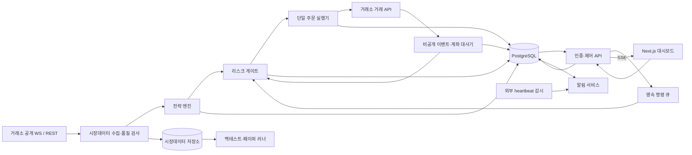

# 코인 무기한 선물 퀀트 자동매매 시스템 PRD v0.1

- 문서 상태: 사용자 검토용 초안
- 작성일: 2026-10-11
- 제품 형태: 개인 운영용 자동매매 시스템 및 웹 대시보드
- 확정 조건: 코인 선물 자동매매, 웹 기반 운영·모니터링, **Next.js 프론트엔드**
- 문서의 나머지 설계·수치·일정은 모두 아래 **가정(A-xx)** 에 따른 제안이다. 가정을 변경하면 연결된 요구사항과 수용 기준도 함께 변경한다.

---

## 1. 개요 / 목표 / 비목표

### 1.1 개요

시장데이터 수집부터 전략 검증, 페이퍼 트레이딩, 실거래 주문 실행, 리스크 통제, 운영 모니터링까지 연결하는 코인 무기한 선물 자동매매 시스템이다.

운영자는 웹 대시보드에서 전략과 계좌 상태를 확인하고, 거래 시작·중지·긴급 청산을 제어한다. 브라우저가 닫혀 있어도 거래 엔진은 독립적으로 실행된다.

초기 제품은 **수익률 극대화보다 주문 정합성과 손실 통제의 검증**을 우선한다. 수익성은 별도의 전략 평가 결과로 판단하며, 시스템 완성 자체가 수익을 보장하지 않는다.

### 1.2 목표

1. 동일한 전략 코드와 설정으로 백테스트·페이퍼·실거래를 실행한다.
2. 모든 신규 주문에 계좌 단위 리스크 검사를 적용한다.
3. 주문 응답 유실·부분 체결·재시작에도 실제 거래소 상태를 복원한다.
4. 손실 한도 초과 시 자동으로 거래를 차단하고 위험 축소를 시도한다.
5. 운영자가 포지션, 손익, 데이터 신선도, 장애 상태를 한 화면에서 판단한다.
6. 주문과 운영 명령의 원인·승인·실행 결과를 추적할 수 있도록 기록한다.

### 1.3 비목표

초기 범위에서 제외한다(A-03).

- 고객 자금 수탁, 다중 사용자 SaaS, 카피 트레이딩
- 초고빈도 매매 및 거래소 간 차익거래
- 옵션·인버스 선물·현물 자동매매
- AI가 실시간으로 전략을 생성하거나 자동 배포하는 기능
- 자동 입출금 및 거래소 간 자금 이동
- 모바일 네이티브 앱
- 세무 신고 자동화 및 법률 자문

---

## 2. 사용자 및 사용 시나리오

### 2.1 사용자

**개인 1인 트레이더가 본인 자금으로 운영한다(A-01).**

한 명이 전략 연구자·운영자·관리자 역할을 겸한다. 다만 시스템 내부에서는 연구 프로세스, 웹 서버, 주문 실행 프로세스의 권한을 분리한다(A-15).

### 2.2 주요 시나리오

| 시나리오 | 흐름 | 완료 조건 |
|---|---|---|
| 전략 검증 | 데이터 선택 → 백테스트 → 비용·손실 분석 → 버전 저장 | 결과를 동일 입력으로 재현 가능 |
| 페이퍼 운영 | 검증된 버전 선택 → 가상 계좌 실행 → 체결·리스크 검증 | 실거래 없이 전체 실행 흐름 검증 |
| 실거래 시작 | 계좌 대사 → 리스크 설정 검토 → 재인증 → LIVE 활성화 | 모든 사전 점검 통과 후 주문 허용 |
| 일상 모니터링 | 대시보드에서 포지션·손익·엔진 상태 확인 | 오래된 데이터와 정상 데이터를 구분 |
| 손실 한도 도달 | 자동 차단 → 신규 주문 취소 → 위험 축소 → 알림 | 차단 유지 및 실제 잔여 포지션 확인 |
| 장애 복구 | 엔진 재시작 → 거래소 조회 → 미확정 주문 해소 → 수동 재개 | 상태 불일치가 없는 경우에만 재개 |

---

## 3. 핵심 가정 목록

아래 목록은 이 문서에서 선택한 기본값의 원장이다.

| ID | 가정 및 기본값 |
|---|---|
| A-01 | 개인 1인 트레이더가 본인 자금만 운영한다. 거주지·이용 자격은 미확정이며 실거래 전에 확인한다. |
| A-02 | 초기 거래소 후보는 **Bybit V5**, 상품은 USDT 결제 무기한 선물, 종목은 BTCUSDT·ETHUSDT다. 이용 자격과 계정별 기능 검증을 통과해야 확정한다. |
| A-03 | 단일 거래소·단일 전용 계좌·단일 활성 전략으로 시작한다. 계좌 내 수동 매매와 다른 봇은 금지한다. |
| A-04 | 초기 전략은 1시간봉 EMA 추세 전략이다. EMA 20/60 교차로 진입하고 반대 교차 또는 보호 손절로 청산한다. |
| A-05 | 완성된 봉만 사용하고 신호 발생 이후 주문한다. 롱·숏 모두 허용하되 종목별 동시 양방향 포지션은 사용하지 않는다. |
| A-06 | 격리마진·단방향 포지션 모드를 사용한다. 거래소 설정 레버리지 상한과 계좌 총 명목 익스포저 상한은 각각 2배다. |
| A-07 | 주문별 계획 손실은 계좌 평가자산의 최대 0.25%, 전체 미청산 포지션의 계획 손실 합은 최대 0.5%다. 최초 손절 거리는 ATR(14)의 2배이며 진입 후 넓히지 않는다. |
| A-08 | 일일 손실 한도 2%, 누적 고점 대비 최대 낙폭 5%, 가용 증거금/평가자산 최소 50%를 적용한다. 손실 한도 도달 시 자동 청산 절차와 거래 잠금을 실행한다. |
| A-09 | 일반 진입은 가격 한도를 둔 IOC 지정가를 사용한다. 긴급 청산은 reduce-only 시장가를 사용하며 체결·가격을 보장하지 않는다. |
| A-10 | 모든 포지션에 거래소 측 보호 손절을 설정하고 확인한다. 기본 트리거는 Mark Price다. 지원 여부와 실제 동작은 계정별 검증한다. |
| A-11 | 공개·비공개 WebSocket을 우선 사용하고 REST로 초기화·대사·누락 복구한다. Mark Price·호가가 5초 이상 오래되면 신규 진입을 차단한다. |
| A-12 | 손익 기준 통화는 USDT, 저장 시각은 UTC다. 일일 리스크 기준은 UTC 00:00, UI 기본 표시는 Asia/Seoul이다. |
| A-13 | 백테스트는 최소 24개월 데이터와 시간순 학습·검증·최종 평가 구간을 사용한다. 수수료·펀딩·슬리피지를 반영한다. |
| A-14 | 페이퍼는 실시간 시장데이터와 가상 체결 모델을 사용한다. 거래소 테스트 환경은 API 검증에 별도로 사용한다. |
| A-15 | 백엔드는 Python·FastAPI, 거래 엔진은 웹 API와 분리된 프로세스다. 거래소 전용 어댑터를 사용한다. |
| A-16 | PostgreSQL을 주문·상태·감사의 기준 저장소로 사용한다. 과거 시장데이터는 Parquet와 S3 호환 객체 저장소에 보관한다. |
| A-17 | 초기 배포는 Linux VM 1대, Docker Compose, 고정 송신 IP다. 데이터베이스 백업과 외부 상태 감시는 별도 장애 영역에 둔다. |
| A-18 | 대시보드는 개인 VPN 뒤에 배치한다. 인증은 OIDC와 MFA, 중요 명령은 최근 5분 이내 재인증을 요구한다. |
| A-19 | 거래 키는 출금 권한 없이 필요한 조회·거래 권한만 부여하고 IP를 제한한다. 비밀관리 서비스로 저장하며 브라우저·로그·DB 평문에 노출하지 않는다. |
| A-20 | 위험 알림은 Telegram, 보조 채널은 이메일이다. 알림 채널에서 거래 명령은 받지 않는다. |
| A-21 | 대시보드 갱신은 SSE와 5초 REST 폴백을 사용한다. 백엔드가 인증 후 상태를 전달한다. |
| A-22 | 신규 진입 차단은 조건 감지 후 1초 이내, 내부 신호→주문 전송 p95는 500ms 이내를 목표로 한다. 외부 거래소 처리 시간은 별도 측정한다. |
| A-23 | 내부 서비스 월 가용성 목표는 99.5%, 장애 후 조회·대사 완료 목표는 15분이다. 신규 진입은 자동 재개하지 않는다. |
| A-24 | 주문·체결·감사 기록은 2년, 운영 로그는 90일 보관한다. 일일 암호화 백업과 월 1회 복구 검증을 수행한다. |
| A-25 | 서버 또는 거래소 통신 장애 시 신규 진입을 멈추고 기존 거래소 보호 주문을 유지한다. 통신 불능 중 청산은 보장할 수 없다. |
| A-26 | 페이퍼 승격 기준은 30일 이상·가상 체결 50건 이상이다. 최초 실거래 입금 상한은 500 USDT, 최소 14일간 관찰한다. |
| A-27 | 개발 일정은 숙련 개발자 1명 기준 10~14주다. 단계별 안전 검증 통과를 일정 준수보다 우선한다. |
| A-28 | 거래 관련 변경은 버전으로 보관한다. 포지션 보유 중 한도 상향·전략 변경은 금지하며 위험 축소 변경만 허용한다. |
| A-29 | 주문 상태는 이벤트와 거래소 대사로 관리한다. 외부 API의 정확히 한 번 실행을 가정하지 않고, 단일 실행자와 주문 식별자로 중복을 방지한다. |
| A-30 | 성능 검증 기준은 2종목·단일 전략·초당 시장 이벤트 100건이며 과부하 시 신규 진입을 차단한다. |

**전략 가정은 연구 시작점이며 수익성이 검증된 전략이라는 의미가 아니다.**

---

## 4. 시스템 아키텍처 개요

### 4.1 컴포넌트

| 컴포넌트 | 책임 |
|---|---|
| Next.js 대시보드 | 조회, 설정 검토, 운영 명령, 장애 상태 표시 |
| FastAPI 제어 API | 인증, 입력 검증, 명령 기록, 조회 API, SSE |
| 시장데이터 수집기 | 호가·Mark Price·봉·펀딩 수집 및 품질 검사 |
| 전략 엔진 | 완성 봉으로 신호와 목표 포지션 생성 |
| 리스크 게이트 | 계좌 단위 주문 승인·거부·잠금 |
| 주문 실행기 | 거래소 요청, 부분 체결, 미확정 주문, 보호 주문 관리 |
| 계좌 대사기 | 주문·체결·포지션·잔고의 실제 상태 확인 |
| 백테스트·페이퍼 러너 | 공통 전략 코드와 환경별 체결 모델 실행 |
| PostgreSQL | 실행 상태, 주문 의도, 감사 기록의 영속화 |
| 객체 저장소 | 시장데이터, 백테스트 입력·결과 보관 |
| 알림·외부 감시 | 장애·손실 알림, 서버 외부에서 heartbeat 감시 |

### 4.2 데이터 흐름

### 4.3 실행 원칙

- Next.js는 거래소 키를 보유하지 않으며 주문을 직접 전송하지 않는다.
- 주문 의도를 DB에 먼저 저장한 후 거래소에 전송한다.
- 전략 신호와 웹 명령 모두 동일한 리스크 게이트를 통과한다.
- 자동 손실 통제는 브라우저·웹 API·알림 서비스와 독립적으로 작동한다.
- 부팅 시 계좌 대사를 완료하기 전까지 신규 진입을 금지한다.
- DB 장애 또는 단일 실행자 소유권 상실 시 새로운 주문 의도를 실행하지 않는다. 기존 보호 주문을 유지하고 외부 감시로 장애를 알린다.

---

## 5. 기능 요구사항

### FR-01. 시장데이터 수집 및 품질 관리

**요구사항:** 호가, Mark Price, 1시간봉, 펀딩 이력·예정 정보를 수집하고 거래소 시각과 수신 시각을 구분한다(A-02, A-11~13).

**수용 기준**

- 미완성 봉은 전략 계산에 사용하지 않는다.
- 중복 이벤트를 재수신해도 봉·체결 기록이 중복 생성되지 않는다.
- 봉 누락을 감지하면 REST로 복구하며, 복구 전 해당 종목의 신규 진입을 차단한다.
- Mark Price·호가가 5초 이상 오래되면 차단 상태와 마지막 정상 시각을 표시한다.
- 종목의 최소 수량·수량 단위·가격 단위·최소 주문금액을 조회하고 주문 검증에 적용한다.
- 재연결 이후 누락 여부와 구독 상태를 확인한 뒤 데이터를 정상으로 표시한다.

### FR-02. 전략 엔진

**요구사항:** EMA 20/60 전략을 버전별로 실행한다(A-04, A-05, A-07, A-28).

**수용 기준**

- EMA·ATR 초기화에 필요한 봉이 없으면 신호를 생성하지 않는다.
- 완성 봉의 교차에 따라 롱·숏 목표 포지션을 생성한다.
- 반대 포지션으로 전환할 때 기존 포지션이 0임을 확인한 후 진입한다.
- 동일 봉·전략 버전·종목의 신호를 다시 처리해도 추가 주문 의도가 생기지 않는다.
- 같은 데이터·버전·설정은 같은 신호를 생성한다.
- 활성 전략 변경은 포지션과 미체결 진입 주문이 없는 경우에만 적용한다.

### FR-03. 백테스트

**요구사항:** 체결 비용과 파생상품 특성을 반영한 재현 가능한 검증을 제공한다(A-13, A-16).

**수용 기준**

- 신호를 계산한 봉의 종가에 즉시 체결했다고 가정하지 않는다.
- 수수료, 실제 펀딩 시각·방향, 슬리피지, 수량 반올림을 반영한다.
- 동일 봉에서 손절과 다른 청산 조건이 함께 발생하면 보수적 순서를 적용하고 결과에 표시한다.
- 거래소 유지증거금 규칙을 반영한 청산 위험 검사를 포함한다. 정확한 모델이 없으면 실거래 승격에 사용할 수 없는 결과로 표시한다.
- 시간순 구간을 나누고 최종 평가 구간은 파라미터 선택에 사용하지 않는다.
- 데이터 해시, 코드 버전, 설정, 비용 가정을 저장한다.
- 순손익·최대 낙폭·거래 수·익스포저·비용별 손익을 출력한다.

### FR-04. 페이퍼 트레이딩

**요구사항:** 실시간 데이터로 전략·리스크·주문 상태 흐름을 검증한다(A-14).

**수용 기준**

- 실거래와 동일한 전략·리스크 코드를 사용한다.
- 호가, 가상 지연, 부분 체결, 수수료와 펀딩을 반영한다.
- 가격이 닿았다는 이유만으로 지정가 전량 체결을 가정하지 않는다.
- 페이퍼 계좌·주문·손익은 실거래와 분리한다.
- 페이퍼 프로세스에는 운영 거래 키를 주입하지 않는다.
- 페이퍼의 체결 모델과 거래소 테스트 환경의 차이를 결과에 명시한다.

### FR-05. 실거래 활성화 및 운영 제어

**요구사항:** 명시적 실거래 활성화와 상태 전이를 제공한다(A-18, A-28).

**수용 기준**

- 기본 실행 모드는 PAPER이며 재시작 후 LIVE가 자동 활성화되지 않는다.
- LIVE 시작 전 계좌 대사, 보호 주문 지원, 키 권한, 데이터 신선도, 잔고, 리스크 설정을 검사한다.
- 화면에 거래소·계좌·종목·자본·손실 한도를 표시하고 재인증 후 활성화한다.
- 중복 클릭·요청 재전송에도 운영 명령은 한 번만 등록된다.
- 명령 접수와 실제 완료를 구분해 표시한다.
- `PAUSED`에서는 신규 진입을 금지하되 보호 주문과 위험 축소 동작은 유지한다.

### FR-06. 주문 실행 및 중복 방지

**요구사항:** 부분 체결과 응답 유실을 포함한 주문 생명주기를 관리한다(A-09, A-29).

**수용 기준**

- 전략 신호마다 내부 주문 의도 ID와 거래소 주문 식별자를 생성한다.
- 응답이 유실되면 `UNKNOWN`으로 기록하고 식별자로 조회한다. 해소 전 동일 의도를 새 주문으로 재전송하지 않는다.
- 체결 이벤트는 거래소 체결 ID 기준으로 중복 제거한다.
- IOC 잔량 취소 후 무제한 재주문하지 않는다. 새 판단과 리스크 승인이 있어야 다시 주문한다.
- 부분 체결 수량에 맞춰 보호 주문과 익스포저를 갱신한다.
- 가격·수량 단위 위반, 증거금 부족, API 제한은 사유별로 기록한다.
- 거래소 접수 응답을 체결 완료로 표시하지 않는다.

Bybit 주문 생성은 비동기 접수이며 후속 상태 확인이 필요하다. 취소와 체결이 경합할 때 중복 완료 이벤트도 처리해야 한다. [주문 생성 문서](https://bybit-exchange.github.io/docs/v5/order/create-order), [주문 이벤트 문서](https://bybit-exchange.github.io/docs/v5/event/websocket/private/order)

### FR-07. 포지션·잔고·손익 관리

**요구사항:** 거래소 상태를 기준으로 계좌를 대사한다(A-03, A-12, A-29).

**수용 기준**

- 시작·재연결 시 전체 대사를 수행하고 정상 운영 중에는 30초마다 REST 대사를 수행한다(A-11의 운영 기본값).
- 포지션 수량, 진입가, Mark Price, 미실현 손익, 가용 증거금, 보호 주문을 표시한다.
- 체결 수수료·실현 손익·펀딩을 별도 항목으로 기록한다.
- 내부 상태와 거래소 상태가 다르면 신규 진입을 잠그고 차이를 기록한다.
- 알려지지 않은 수동 주문·입출금·포지션을 발견하면 확인 전 거래를 재개하지 않는다.
- 미확정 주문의 잠재 익스포저도 주문 가능 한도에서 차감한다.

### FR-08. 주문 전 리스크 검사

**요구사항:** 모든 신규·증액 주문을 중앙 리스크 게이트에서 검사한다(A-06~08).

**수용 기준**

- 거래소 설정 레버리지 2배, 총 명목 익스포저/평가자산 2배를 각각 검사한다.
- 기존 포지션·미체결 주문·미확정 주문을 모두 포함한다.
- 손절 거리와 비용 완충분을 반영한 계획 손실이 주문별 0.25%, 합계 0.5%를 넘으면 거부한다.
- 한도 계산 후 수량을 아래로 반올림한다. 최소 주문 크기 때문에 한도를 넘으면 주문하지 않는다.
- 주문 후 예상 가용 증거금 비율이 50% 미만이면 거부한다.
- 손절 가격이 예상 청산 가격보다 안전한 위치인지 검증할 수 없으면 진입을 거부한다.
- 위험 축소 주문은 신규 진입 한도에 막히지 않지만 현재 포지션 이상을 청산하거나 반대 포지션을 생성할 수 없다.

### FR-09. 손실 한도 및 리스크 잠금

**요구사항:** 비용과 미실현 손익을 포함한 계좌 손실을 감시한다(A-08, A-12).

**측정 정의**

- `E(t)`: USDT 계좌 평가자산. 미실현 손익과 이미 반영된 비용을 포함한다.
- 외부 순입금은 손익에서 제외한다. 예상하지 못한 자금 이동 시 기준값 확정 전 거래를 잠근다.
- 일일 손실은 UTC 일 시작 평가자산 대비 자금 흐름을 보정한 평가자산 감소율이다.
- 누적 낙폭은 실거래 시작 이후 자금 흐름을 보정한 평가자산 고점 대비 감소율이다.
- 수수료·펀딩이 잔고에 반영됐다면 다시 차감하지 않는다.

**수용 기준**

- 일일 손실 2% 또는 누적 낙폭 5%에 도달하면 `RISK_LOCKED`로 전환한다.
- 감지 후 1초 이내 신규 진입을 막고 FR-10의 청산 절차를 실행한다.
- 재시작·날짜 변경으로 잠금이 자동 해제되지 않는다.
- 일일 잠금 해제는 다음 UTC 일과 운영자 검토·재인증을 모두 요구한다.
- 누적 고점과 기준값을 임의로 초기화할 수 없다. 변경 시 근거와 새 리스크 버전을 감사 기록에 남긴다.
- 가격 급변·통신 장애로 실제 손실이 설정 한도를 초과할 수 있음을 표시한다.

### FR-10. 킬스위치와 긴급 청산

**요구사항:** 다음 두 명령을 구분한다(A-09, A-25).

- **신규 거래 중지:** 진입 차단, 미체결 진입 주문 취소, 기존 보호 주문 유지
- **긴급 전량 청산:** 진입 차단, 진입 주문 취소 시도, 실제 포지션 조회, reduce-only 청산, 잔여 상태 확인

**수용 기준**

- 서버가 접수한 중지 명령은 1초 이내 신규 진입 게이트에 반영된다.
- 긴급 청산은 취소 응답을 무기한 기다리지 않고 현재 확인 가능한 포지션을 축소한다.
- 취소와 체결 경합으로 추가 포지션이 생기면 재대사 후 잔여 수량을 청산한다.
- 포지션 0과 관련 잔여 주문 상태를 확인하기 전 `청산 완료`를 표시하지 않는다.
- 청산 재시도는 최신 포지션 조회와 API 제한을 준수한다.
- 보호 주문은 잔여 포지션이 있는 동안 유지한다.
- 통신 불능 시 `청산 미확인`과 마지막 확인 포지션을 표시하고 알림을 반복한다.
- 중지 명령은 즉시 실행하며, 청산 명령에는 재인증과 대상 계좌 확인을 요구한다.

### FR-11. 보호 주문 및 장애 대응

**요구사항:** 거래소 측 보호 주문과 복구 절차를 적용한다(A-10, A-25).

**수용 기준**

- 진입 전에 보호 주문 설정 경로를 검증한다.
- 최초 체결 감지 후 3초 이내 보호 주문 활성 상태를 확인하지 못하면 신규 진입을 잠그고 해당 포지션 축소를 시도한다(A-10의 확인 기한).
- 보호 주문 확인은 HTTP 성공뿐 아니라 거래소 조회 결과를 포함한다.
- 비공개 스트림 단절 시 신규 진입을 차단하고 REST로 대사한다.
- 공개 데이터 단절 시 기존 보호 주문을 유지하며 오래된 가격으로 추가 진입하지 않는다.
- 전체 서버 중단 시 외부 감시가 heartbeat 상실을 탐지한다.
- 복구 후 계좌·주문·보호 상태를 대사하고 운영자가 재개한다.
- 거래소의 연결 종료 자동 취소 기능은 계정·상품별 지원을 검증한 경우에만 보조 수단으로 사용한다.

Bybit의 DCP 기능은 별도 API와 적용 조건을 가진다. 이 기능을 포지션 청산 보장으로 취급하지 않는다. [공식 DCP 문서](https://bybit-exchange.github.io/docs/v5/order/dcp)

### FR-12. 알림

**요구사항:** 손실 잠금, 보호 주문 누락, 주문 미확정, 대사 불일치, 서버 중단을 알린다(A-20).

**수용 기준**

- 정상 통신 환경에서 중요 사건 감지 후 10초 이내 첫 발송을 시도한다.
- 발송 실패를 기록하고 이메일 보조 채널을 시도한다.
- 같은 사건은 묶되 심각도 상승과 복구는 별도 알린다.
- 전송 성공·실패·운영자 확인을 구분한다.
- API 키·비밀값·불필요한 계좌 식별자를 포함하지 않는다.

### FR-13. 대시보드 및 보고

**요구사항:** 상태를 명확히 보여주고 운영 명령을 추적한다(A-21).

**수용 기준**

- 모든 화면에 PAPER/LIVE, 계좌, 엔진 상태, 갱신 시각을 표시한다.
- 데이터 연결이 끊기면 5초 이내 오래된 데이터 표시로 전환한다.
- 주문은 접수·부분 체결·완료·취소·미확정 상태를 구분한다.
- 손익 보고서에 수수료·펀딩·입출금 보정을 표시한다.
- 거래·주문·감사 기록을 CSV로 내보낼 수 있다.
- 버튼 상태만으로 실행 성공을 표시하지 않고 서버 명령 결과를 확인한다.

### FR-14. 설정·감사 관리

**요구사항:** 거래와 설정 변경을 재현할 수 있도록 기록한다(A-24, A-28).

**수용 기준**

- 전략·리스크·실행 설정에 버전과 적용 시각을 부여한다.
- 각 주문에 신호, 전략 버전, 리스크 판정, 실행 설정을 연결한다.
- 운영 명령은 수행자·시각·변경 전후 값·결과를 기록한다.
- 애플리케이션 역할은 감사 기록을 수정·삭제할 수 없다.
- 비밀값은 감사 기록의 변경 전후 값에서도 제외한다.

---

## 6. 대시보드 화면 명세

### 6.1 공통 구성

- 상단: 모드, 계좌, 엔진 상태, 데이터 신선도, UTC/KST 시각
- 상시 접근: 신규 거래 중지, 긴급 전량 청산
- 경고 영역: 손실 잠금, 미확정 주문, 보호 누락, 대사 불일치
- 상태 색상과 함께 텍스트를 표시해 색상만으로 판단하지 않도록 한다.

### 6.2 페이지별 구성

| 페이지 | 주요 구성요소 | 주요 동작 |
|---|---|---|
| 운영 개요 | 평가자산, 순손익, 일일 손실, 낙폭, 익스포저, 증거금, 장애 요약 | 거래 시작·중지, 긴급 청산 |
| 포지션·주문 | 포지션별 수량·진입가·Mark Price·손익·손절·주문 상태 | 종목별 위험 축소·청산 |
| 전략 | 버전, 파라미터, 최근 신호, 활성 상태, 변경 이력 | 검증된 버전 선택 |
| 백테스트 | 기간·데이터·비용 설정, 평가자산 곡선, 낙폭, 거래 목록 | 실행·결과 비교·내보내기 |
| 페이퍼 | 가상 자산, 체결 모델, 실시간 신호, 운영 오류 | 시작·중지·승격 검토 |
| 리스크 | 한도, 현재 사용량, 잠금 원인, 보호 상태 | 한도 변경 검토·잠금 해제 |
| 시스템·감사 | heartbeat, WS 연결, 지연, 대사 시각, 운영 명령 | 사건 추적·기록 검색 |
| 설정 | 거래소 연결 상태, 종목, 알림, 표시 시간대 | 연결 검사·설정 버전 등록 |

### 6.3 실시간 갱신

A-21에 따라 SSE 이벤트에 순번과 서버 생성 시각을 포함한다.

- 가격·손익은 최대 초당 1회 묶어서 전송한다.
- 주문·체결·리스크 잠금·운영 명령 결과는 즉시 전송한다.
- 재연결 시 전체 스냅샷을 먼저 조회하고 이벤트 스트림을 다시 연결한다.
- 순번 누락 시 스냅샷으로 상태를 재동기화한다.
- SSE 실패 시 5초 REST 폴백을 사용한다.
- 브라우저 연결 상태는 거래 엔진 실행 상태와 별도로 표시한다.

---

## 7. 비기능 요구사항

| ID | 영역 | 요구사항 및 검증 기준 |
|---|---|---|
| NFR-01 | 성능 | A-30 부하에서 내부 신호→전송 p95 500ms 이하. 거래소 지연은 분리 측정한다. |
| NFR-02 | 위험 반응 | 감지된 차단 조건은 1초 이내 게이트에 적용한다. 데이터 단절 검출에는 A-11의 5초 임계값이 추가된다. |
| NFR-03 | 가용성 | 월 내부 서비스 가용성 99.5% 목표. 거래소 장애와 내부 장애를 별도 집계한다. |
| NFR-04 | 복구 | 정상 거래소 접근이 가능한 조건에서 15분 내 조회·대사 완료. 완료와 거래 재개는 구분한다. |
| NFR-05 | 보안 | TLS, VPN, OIDC/MFA, IP 제한, 최소 키 권한, 비밀관리 서비스 적용. 비밀 노출 검사 결과 0건. |
| NFR-06 | 무결성 | 주문 의도·명령은 실행 전 영속화. 중복·역순 이벤트가 손익이나 포지션을 중복 반영하지 않는다. |
| NFR-07 | 시간·정밀도 | 서버 시각 동기화, 거래소 시간 편차 감시, 금액·수량은 Decimal 사용. 허용 편차는 거래소 요청 유효시간보다 충분히 작게 설정한다. |
| NFR-08 | 로깅·감사 | 구조화 로그에 실행·명령·주문 ID 포함. 비밀값 제거와 A-24 보관 정책 적용. |
| NFR-09 | 관측성 | 데이터 age, WS 단절, 주문 지연, API 오류, 미확정 주문, 대사 차이, 보호 누락, DB 지연을 측정한다. |
| NFR-10 | 배포 | 포지션 보유 중 거래 엔진 배포 금지. 배포 전 신규 진입 중지 및 상태 저장, 배포 후 대사와 수동 재개를 수행한다. |
| NFR-11 | 백업 | 일일 백업 기준 RPO 24시간. 복원 후 거래소로 주문·체결을 재구성하며 확인 불가능한 상태는 잠근다. 시장데이터는 재수집 가능한 범위를 명시한다. |

**핵심 장애 검증:** 응답 유실, 부분 체결, 중복·역순 이벤트, 체결·취소 경합, WS 단절, DB 중단, 프로세스 강제 종료, 보호 주문 거부를 주입해 신규 진입 차단과 대사 결과를 확인한다.

---

## 8. 데이터 모델 초안

A-16에 따른 주요 엔티티다.

| 엔티티/테이블 | 주요 필드 | 제약·용도 |
|---|---|---|
| `exchange_accounts` | 거래소, 환경, 계좌 별칭, 비밀 참조, 연결 상태 | 키 원문 저장 금지 |
| `instruments` | 종목, 가격·수량 단위, 최소 주문금액, 거래 상태, 검증 시각 | 거래소 메타데이터 이력 보관 |
| `market_dataset_versions` | 기간, 종목, 객체 경로, 해시, 품질 결과 | 백테스트 입력 고정 |
| `strategy_versions` | 코드 해시, 파라미터, 생성 시각 | 활성화 후 불변 |
| `risk_policy_versions` | 한도, 적용 시각, 승인 명령 ID | 변경 이력 보관 |
| `runs` | BACKTEST/PAPER/LIVE, 전략·리스크 버전, 상태 | 실행 환경 분리 |
| `signals` | 실행 ID, 종목, 봉 시각, 목표 포지션 | 실행·종목·봉·신호 유형 유일성 |
| `order_intents` | 신호/명령 ID, 수량, 가격 한도, 리스크 결과 | 외부 전송 전 저장 |
| `orders` | 의도 ID, 거래소 ID, 클라이언트 ID, 상태, 누적 체결량 | 의도와 외부 주문은 1:N 허용 |
| `order_events` | 주문 ID, 거래소 시각, 수신 시각, 정규화 상태 | 순서·중복 처리를 위한 이력 |
| `executions` | 체결 ID, 주문 ID, 가격, 수량, 수수료 | 계좌·거래소 체결 ID 유일성 |
| `position_snapshots` | 종목, 수량, 진입가, Mark Price, 손익, 조회 시각 | 조회 출처·신선도 포함 |
| `protective_orders` | 포지션 참조, 트리거, 수량, 거래소 ID, 확인 상태 | 보호 커버리지 추적 |
| `account_snapshots` | 평가자산, 가용 증거금, 실현·미실현 손익 | 리스크 계산 입력 |
| `cashflows` | 입출금, 펀딩, 수수료, 금액, 외부 ID | 손익 보정·중복 차감 방지 |
| `risk_states` | 일 시작 기준, 누적 고점, 잠금 원인, 확인 시각 | 재시작 후 잠금 유지 |
| `control_commands` | 수행자, 명령, 대상, 멱등 키, 실행 상태 | 영속 명령 큐 |
| `audit_events` | 수행자, 동작, 변경 전후 값, 결과 | 애플리케이션 수정·삭제 금지 |
| `incidents` / `notifications` | 심각도, 사건 ID, 전송 결과, 확인 시각 | 장애·알림 연계 |

추가 원칙:

- 상태 계산용 필드와 거래소 원본 응답을 구분한다.
- 금액·수량은 고정 정밀도 숫자, 시각은 UTC를 저장한다.
- 주문 상태의 도착 순서만으로 최종 상태를 덮어쓰지 않는다.
- DB 스키마·전략 코드·데이터 버전을 함께 기록해 결과 재현성을 확보한다.

---

## 9. 기술 스택 제안

| 영역 | 기본값 | 근거 |
|---|---|---|
| 프론트엔드 | **Next.js + TypeScript** | 사용자 확정 조건. 조회·인증·운영 화면을 통합하기 적합 |
| 백엔드 | Python + FastAPI(A-15) | 전략 연구와 실행 코드 공유, 타입 기반 API 정의 |
| 거래 엔진 | 별도 Python 프로세스(A-15) | 웹 요청·화면 장애로부터 거래 루프 분리 |
| 거래소 연결 | V5 전용 어댑터(A-02, A-15) | 주문·보호·포지션 모드의 거래소별 의미를 명시적으로 처리 |
| 운영 데이터 | PostgreSQL(A-16) | 트랜잭션·유일성 제약·감사·명령 영속화 |
| 연구 데이터 | Parquet + 객체 저장소(A-16) | 대량 시계열 분석 및 입력 데이터 버전 보관 |
| 연구·분석 | pandas/NumPy(A-15의 연구 도구 기본값) | 초기 봉 기반 전략과 비용 모델 구현이 단순 |
| 실시간 UI | SSE + REST(A-21) | 서버→브라우저 상태 전달과 재동기화가 단순 |
| 배포 | Linux VM + Docker Compose(A-17) | 1인 운영의 초기 복잡도·비용 제한 |
| 인증·비밀 | OIDC/MFA + 비밀관리 서비스(A-18, A-19) | 거래 키와 사용자 세션의 권한 분리 |
| 관측성 | Prometheus/Grafana·구조화 로그(A-23의 관측 도구 기본값) | 지연·연결·위험 상태의 연속 관측 |
| 검증 | pytest·거래소 응답 시뮬레이터(A-29의 검증 도구 기본값) | 실패·경합 상황을 반복 재현 |

초기에는 Redis·Kafka·Kubernetes를 도입하지 않는다(A-15~17). 이벤트 규모나 실행자 수가 늘어나면 필요성을 재평가한다.

---

## 10. 마일스톤 / 단계별 로드맵

일정은 A-27에 따른 추정이며, 운영 관찰 기간은 개발 일정과 별개다.

| 단계 | 예상 기간 | 산출물 | 통과 기준 |
|---|---|---|---|
| M0. 연결·안전 설계 | 1~2주 | 계정 기능 검증, 주문 상태 모델, 리스크 정책, 보호 주문 실험 | 이용 자격·계정 모드·키 권한·보호 동작 확인 |
| M1. MVP | 3~4주 | 데이터 수집, 전략, 백테스트, 읽기 중심 대시보드 | 데이터 품질·결과 재현·비용 반영 검증 |
| M2. 페이퍼 | 3~4주 개발 + 관찰 | 가상 실행, 리스크 잠금, 킬스위치, 알림, 장애 주입 | 30일·50체결 이상, 중복 주문·미해결 대사 오류 0건 |
| M3. 소액 실거래 | 3~4주 개발 + 14일 이상 관찰 | LIVE 실행, 보호 주문, 운영 절차, 복구 검증 | 입금 500 USDT 이하, 안전 기능 검증, 미해결 중요 장애 0건 |
| M4. 확장 | 별도 산정 | 자본·종목·전략·거래소 확대 | 기존 운영 결과 검토 후 가정과 한도 재승인 |

### 실거래 승격 필수 조건

- 전략 최종 평가 구간의 비용 차감 후 결과와 위험을 운영자가 검토한다.
- 페이퍼 통과만으로 수익성을 인정하지 않는다.
- 테스트 환경에서 보호 주문, 부분 체결, 재연결, 긴급 청산을 확인한다.
- 실제 계좌 최소 주문 크기가 A-07 위험 예산에 맞지 않으면 실거래하지 않는다.
- 서버 접속 없이 거래소 공식 화면에서 수동 청산할 수 있는 절차를 준비한다.
- 자본 증액은 자동화하지 않고 별도 검토한다.

---

## 11. 리스크 및 대응

| 리스크 | 영향 | 대응 |
|---|---|---|
| 미래 데이터 참조·과최적화 | 실제 성과 급락 | 완성 봉, 시간순 분리, 최종 구간 격리, 비용 민감도 분석 |
| 페이퍼 체결 낙관성 | 실거래 성과 오판 | 부분 체결·지연 반영, 실제 체결 대비 모델 보정 |
| 급변·갭·유동성 부족 | 손절 초과 손실 | 낮은 위험 예산, 익스포저 제한, 거래소 보호 주문, 소액 운영 |
| 펀딩·수수료 상승 | 기대수익 소멸 | 비용 분리 보고, 실제 계정 요율 검증, 비용 스트레스 테스트 |
| 거래소 장애·청산 | 포지션 통제 상실 | 격리마진, 낮은 레버리지, 보호 주문, 잔여 위험 표시 |
| 주문 응답 유실·경합 | 중복 주문·반전 포지션 | UNKNOWN 상태, 조회 후 판단, reduce-only, 단일 실행자 |
| 서버·DB 장애 | 거래 중단·상태 유실 | 거래 차단, 거래소 보호 유지, 외부 감시, 백업·대사 |
| API 키 유출 | 무단 거래·손실 | 출금 금지, IP 제한, 비밀관리, 키 폐기·교체 절차 |
| 수동 매매 혼입 | 리스크 계산 오류 | 전용 계좌, 외부 변경 감지 시 잠금 |
| USDT·거래소 신용 위험 | 기준 통화 손실·출금 제한 | 필요 자본만 예치, 별도 자산 위험 검토 |
| 1인 운영 공백 | 장애 대응 지연 | 자동 안전장치, 이중 알림, 공식 앱 수동 대응 절차 |
| 규제·약관 변경 | 서비스 이용 제한 | 거주지·계정 자격·상품 제한 확인 후 실거래, 정기 재검토 |

### 규제·법적 고지

- 거래소 후보 선정은 특정 국가에서의 이용 가능성이나 적법성을 인정한 것이 아니다.
- 거주지, 계정의 계약 법인, 고객 분류, 파생상품 접근 제한, 세무·신고 의무를 실거래 전에 확인한다.
- 지역 제한을 우회하는 접속·계정 운영을 제품 기능에 포함하지 않는다.
- 개인 자금 운영과 제3자 자금 운용은 요구되는 법적 검토 범위가 다르다.
- 국가별 제한의 예로 영국 FCA는 소매 고객 대상 크립토 파생상품 제한을 두고 있다. 이를 다른 국가에 그대로 적용하거나 이용자의 법적 상태로 단정하지 않는다. [FCA 관련 발표](https://www.fca.org.uk/news/press-releases/fca-lift-ban-crypto-exchange-traded-notes)
- 본 문서는 제품 설계 초안이며 투자·법률·세무 자문이 아니다. 레버리지 거래는 자금 손실을 초래할 수 있고 자동매매·손절·킬스위치는 손실 한도 준수를 보장하지 않는다.

---

## 12. 성공 지표(KPI)

수치는 A-22~26 및 단계별 승격 가정에 따른 초기 목표다.

| 구분 | KPI | 목표·판정 |
|---|---|---|
| 안전 | 의도하지 않은 중복 신규 주문 | 장애 주입·페이퍼·소액 실거래에서 0건 |
| 안전 | 청산 명령으로 발생한 반대 포지션 | 0건 |
| 안전 | 보호 미확인 포지션 처리 | 감지된 모든 사건에서 잠금·축소 절차 실행 |
| 안전 | 차단 후 새 진입 승인 | 0건 |
| 정합성 | 미해결 대사 불일치 | 단계 승격 시 0건 |
| 복구 | 재시작·응답 유실 복구 | 필수 장애 시나리오 전부 통과 |
| 성능 | 내부 신호→전송 지연 | 기준 부하에서 p95 ≤ 500ms |
| 운영 | 내부 서비스 가용성 | 월 99.5% 이상 |
| 관측 | 중요 알림 첫 발송 시도 | 정상 통신 환경에서 10초 이내 |
| 재현성 | 동일 입력 백테스트 | 신호·주문·손익 결과 동일 |
| 실증 | 페이퍼 검증량 | 30일 이상·50체결 이상 |
| 전략 | 비용 차감 후 순손익·낙폭 | 최종 평가와 실거래를 별도 보고 |
| 실행 품질 | 예상 대비 실제 슬리피지·비용 | 지속 측정하고 체결 모델 보정 |

**수익률 목표는 v0.1에서 확정하지 않는다.** 데이터와 검증 결과 없이 목표 수익률을 정하는 대신, 안전성과 비용 차감 후 전략 성과를 분리해 평가한다(A-13, A-26).

---

## 13. 사용자 피드백이 필요한 결정사항

아래 순서는 자금 안전성과 구현 범위에 미치는 영향 기준이다. 피드백 전까지 본문의 기본값을 사용한다.

### 1. 이용 자격과 거래소 — A-01, A-02

**질문:** 거주지와 계정 자격을 기준으로 어느 거래소를 사용할 것인가?

| 선택지 | 장단점 |
|---|---|
| Bybit 단일 거래소 | 현재 설계와 일치하지만 이용 자격·계정 기능 확인 필요 |
| 다른 적격 거래소 단일 운영 | 접근 가능한 거래소를 선택할 수 있지만 어댑터 재검증 필요 |
| 실거래 보류, 페이퍼만 운영 | 자금 위험 없이 개발 가능하지만 실제 체결 검증 지연 |

**기본값:** Bybit 후보, 자격 확인 전 실거래 비활성화.  
**추천 이유:** 한 거래소의 주문·보호 동작을 충분히 검증하는 편이 초기 구현과 운영에 적합하다.

### 2. 초기 운영 자본 — A-26

**질문:** 최초 실거래에 얼마를 배정할 것인가?

| 선택지 | 장단점 |
|---|---|
| 500 USDT 이하 | 장애 손실을 제한하지만 최소 주문 크기에 제약 |
| 500~2,000 USDT | 수량 조정이 쉬워지지만 검증 전 손실 규모 증가 |
| 실거래 자본 미배정 | 위험 없이 연구 가능하지만 실증 불가 |

**기본값:** 500 USDT 이하.  
**추천 이유:** 주문 최소 크기와 위험 예산이 양립하는 범위에서 가장 작은 자본으로 시작한다.

### 3. 손실 한도 — A-08

**질문:** 일일 손실과 누적 낙폭 한도를 얼마나 보수적으로 둘 것인가?

| 선택지 | 장단점 |
|---|---|
| 일일 2% / 누적 5% | 초기 손실 통제에 적합하지만 잠금이 잦을 수 있음 |
| 일일 1% / 누적 3% | 손실 허용이 작지만 전략 관찰이 자주 중단될 수 있음 |
| 일일 3% / 누적 10% | 관찰 지속성이 높지만 더 큰 손실 수용 필요 |

**기본값:** 2% / 5%, 도달 시 청산 절차와 잠금.  
**추천 이유:** 전략·실행 검증이 끝나지 않은 단계에서 손실 규모를 제한한다.

### 4. 레버리지와 마진 모드 — A-06

**질문:** 레버리지·익스포저 상한을 어떻게 설정할 것인가?

| 선택지 | 장단점 |
|---|---|
| 격리마진, 설정·총 익스포저 최대 2배 | 위험과 실행 유연성의 초기 절충 |
| 격리마진, 최대 1배 | 노출이 작지만 자본 사용 효율 감소 |
| 교차마진, 최대 2배 | 증거금 공유가 가능하지만 계좌 전체 위험 관리 복잡 |

**기본값:** 격리마진, 두 상한 각각 2배.  
**추천 이유:** 포지션 간 위험 전이를 줄이고 상한을 명확히 검증할 수 있다.

### 5. 장애 시 포지션 처리 — A-10, A-25

**질문:** 데이터·연결 장애 시 기존 포지션을 어떻게 처리할 것인가?

| 선택지 | 장단점 |
|---|---|
| 진입 중지, 보호 주문 유지 | 불필요한 청산을 줄이지만 잔여 시장 위험 존재 |
| 주문 API가 정상일 때 즉시 청산 | 노출 축소가 빠르지만 일시 장애에도 비용 발생 |
| 운영자 판단까지 유지 | 수동 유연성이 크지만 1인 운영 대응 지연 위험 |

**기본값:** 진입 중지·보호 유지. 보호 누락 또는 손실 한도 도달 시 청산 시도.  
**추천 이유:** 통신 상태별로 실행 가능한 조치를 구분하면서 무보호 포지션을 우선 처리한다.

### 6. 초기 전략 — A-04, A-05

**질문:** 어떤 전략을 첫 검증 대상으로 삼을 것인가?

| 선택지 | 장단점 |
|---|---|
| 1시간봉 EMA 추세 | 구현·원인 분석이 쉽지만 횡보장에서 손실 가능 |
| 평균회귀 | 빈번한 기회가 있지만 급격한 추세에 취약 |
| 사용자가 보유한 기존 전략 | 연구를 이어갈 수 있지만 명세·검증 자료 필요 |

**기본값:** EMA 20/60 추세, ATR 보호 손절.  
**추천 이유:** 초기에는 단순한 전략으로 실행·리스크 시스템의 오류를 구분하기 쉽다.

### 7. 종목 범위 — A-02, A-03

**질문:** 초기 거래 종목을 어디까지 허용할 것인가?

| 선택지 | 장단점 |
|---|---|
| BTC·ETH | 제한된 범위에서 두 종목 운영 검증 가능 |
| BTC만 | 검증 범위가 작지만 기회·관찰 데이터 감소 |
| 다수 알트코인 | 기회가 늘지만 유동성·상관관계·운영 복잡도 증가 |

**기본값:** BTCUSDT·ETHUSDT.  
**추천 이유:** 종목 확대 전에 비용과 동시 익스포저 통제를 검증한다.

### 8. 주문 실행 방식 — A-09

**질문:** 일반 진입에서 체결 확실성과 가격 통제 중 무엇을 우선할 것인가?

| 선택지 | 장단점 |
|---|---|
| 가격 한도 IOC 지정가 | 불리한 가격을 제한하지만 미체결·부분 체결 가능 |
| 시장가 | 실행이 단순하지만 슬리피지가 커질 수 있음 |
| Post-only 지정가 | 비용 절감 가능성이 있지만 미체결·기회 손실 증가 |

**기본값:** 일반 진입 IOC, 긴급 청산 reduce-only 시장가.  
**추천 이유:** 진입 가격 한도와 긴급 위험 축소 목적을 각각 반영한다.

### 9. 운영 인프라 — A-17, A-23

**질문:** 초기 인프라 비용과 가용성을 어떻게 균형 잡을 것인가?

| 선택지 | 장단점 |
|---|---|
| 단일 VM + 외부 감시·백업 | 운영이 단순하지만 서버 단일 장애점 존재 |
| VM + 관리형 DB | DB 복구 부담이 줄지만 비용 증가 |
| 다중 노드 대기 구성 | 복구 여지가 커지지만 중복 실행 방지 복잡도 증가 |

**기본값:** 단일 VM, 외부 감시·백업.  
**추천 이유:** 소액 운영에서 구조를 단순하게 검증한 뒤 가용성을 확장한다.

### 10. 접근·알림 방식 — A-18, A-20

**질문:** 대시보드 접근과 긴급 알림에 어떤 환경을 사용할 것인가?

| 선택지 | 장단점 |
|---|---|
| 개인 VPN + MFA, Telegram·이메일 | 노출 범위를 줄이지만 VPN 설정 필요 |
| 공개 HTTPS + MFA, Telegram·이메일 | 접근이 편하지만 외부 공격 표면 증가 |
| 개인 VPN + MFA, 이메일만 | 구성 채널이 적지만 즉시 인지가 늦을 수 있음 |

**기본값:** 개인 VPN + MFA, Telegram 우선·이메일 보조.  
**추천 이유:** 1인 운영에 필요한 접근성과 빠른 장애 인지를 확보한다.

### 11. 실거래 승격 기준 — A-26

**질문:** 페이퍼 운영을 어느 수준까지 검증한 후 실거래로 전환할 것인가?

| 선택지 | 장단점 |
|---|---|
| 30일·50체결 이상 + 장애 검증 | 초기 기준으로 현실적이지만 다양한 시장을 충분히 포함하지 못할 수 있음 |
| 60~90일 + 장애 검증 | 운영 관찰이 늘지만 출시 지연 |
| 기간 없이 소액 즉시 운영 | 실제 체결을 빨리 확인하지만 미검증 결함에 자금 노출 |

**기본값:** 30일·50체결 이상과 필수 장애 검증 통과.  
**추천 이유:** 기간과 사건 수를 함께 확보하고, 안전 검증을 독립적인 승격 조건으로 유지한다.