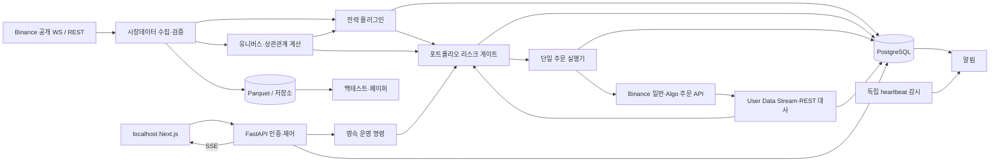

# 코인 무기한 선물 퀀트 자동매매 시스템 PRD v0.2

## 변경 이력 (v0.1 → v0.2)

| 변경 항목 | v0.2 반영 내용 | 변경 이유 |
|---|---|---|
| 거래소 | Binance USDⓈ-M 무기한 선물로 확정. 일반 주문·조건부 주문·User Data Stream·testnet 연동 명세 개정 | 사용자 확정 사항 반영 |
| 초기 전략 | 1시간봉 볼린저 밴드 돌파 + EMA 추세 필터 + 거래량 확인 전략으로 변경 | 사용자 전략 방향을 구현 가능한 규칙으로 구체화 |
| 전략 확장 | 공통 인터페이스를 사용하는 플러그인 구조 추가 | 추후 전략 추가 시 실행·리스크 코드를 재사용 |
| 리스크 설정 | 대시보드 설정값, 보수적 기본값, 시스템 하드 상한을 분리 | 운영 유연성과 실거래 안전성 확보 |
| 거래 종목 | 고정 2종목에서 거래대금 상위 5개 적격 USDT 무기한 종목으로 변경 | 사용자 지정 유니버스 반영 |
| 포트폴리오 통제 | 유니버스 선정·교체, 상관관계, 종목별·그룹별·총 익스포저 제한 추가 | 여러 종목의 동시 손실과 집중 위험 통제 |
| 운영 환경 | 개인 PC·localhost·Docker Compose를 1단계 기본값으로 변경 | 사용자의 초기 운영 환경 반영 |
| 인증·비밀관리 | 로컬 비밀번호·OS 키체인을 우선 적용하고 VPN·OIDC/MFA는 서버 이전 단계로 이동 | 로컬 운영에 맞게 구조 단순화 |
| 실거래·이전 | 로컬 실거래 기본 비활성화, 조건부 허용 절차와 클라우드 이전 절차 추가 | 절전·재부팅·유동 IP·통신 장애 대응 |
| 검증·데이터 | Binance M0 검증 목록, 과거 유니버스 재현, Algo 주문 연결 관계 추가 | 거래소 동작 오해와 백테스트 편향 방지 |

- **문서 상태:** 사용자 검토용 개정 초안
- **작성일:** 2026-10-11
- **범위:** 개인 자금으로 운영하는 코인 무기한 선물 자동매매 및 웹 대시보드
- **표기 원칙:** 사용자 확정 사항과 설계 가정을 구분한다. 직접 선택한 세부 규칙·수치·기술·운영 정책은 **A-xx**에 귀속한다.
- **추적 원칙:** v0.1의 A-01~A-30, FR-01~FR-14 식별자를 유지하고 내용을 개정했다. 추가 사항에는 새 ID를 부여했다.
- **검증 원칙:** 공식 문서의 API 명세와 실제 계정·환경의 동작을 구분한다. 불확실한 동작은 **M0에서 검증**하고 통과 전 관련 실거래 기능을 활성화하지 않는다.

---

## 1. 개요 / 목표 / 비목표

### 1.1 개요

시장데이터 수집, 전략 검증, 페이퍼 트레이딩, 실거래 주문 실행, 리스크 통제, 운영 모니터링을 연결하는 자동매매 시스템이다.

운영자는 **Next.js 웹 대시보드**에서 전략·유니버스·리스크 설정과 계좌 상태를 확인하고 거래 시작·중지·긴급 청산을 제어한다. 거래 엔진은 브라우저와 독립적으로 실행되지만, 로컬 단계에서는 **PC와 거래 엔진이 켜져 있고 네트워크가 연결되어 있어야** 자동매매가 작동한다.

### 1.2 사용자 확정 사항

| 항목 | 확정 내용 |
|---|---|
| 제품 | 코인 무기한 선물 퀀트 자동매매 |
| 운영 UI | 웹 대시보드, Next.js |
| 거래소 | Binance USDⓈ-M 무기한 선물 |
| 초기 전략 | 볼린저 밴드 + EMA + 거래량 조합 |
| 기본 타임프레임 | 1시간봉 |
| 전략 확장 | 공통 인터페이스를 사용하는 플러그인 구조 |
| 리스크 | 대시보드 설정, 보수적 기본값·하드 상한, 보유 중 위험 증가 변경 금지 |
| 종목 | 거래량 기준 상위 5개 USDT 무기한 코인 |
| 백엔드 | Python + FastAPI |
| 초기 운영 | 개인 PC·localhost, 향후 클라우드 이전 가능 |

“거래량 상위”의 구체적 비교 기준은 종목 간 가격 차이를 고려해 **USDT 거래대금**으로 설계한다(A-34).

### 1.3 목표

1. 같은 전략 버전과 설정으로 백테스트·페이퍼·실거래를 실행한다.
2. 모든 신규·증액 주문을 계좌 단위 리스크 검사에 통과시킨다.
3. 응답 유실·부분 체결·재시작에도 실제 거래소 상태를 복원한다.
4. 포지션마다 거래소 측 보호 손절을 확인한다.
5. 손실 한도 도달 시 자동 차단·위험 축소·운영자 통지를 수행한다.
6. 로컬 운영에서 시작해 설정·비밀·데이터를 보존하며 서버로 이전한다.
7. 수익성과 별개로 주문 정합성, 장애 대응, 감사 가능성을 검증한다.

### 1.4 비목표

초기 범위에서 제외한다(A-03).

- 고객 자금 수탁, 다중 사용자 SaaS, 카피 트레이딩
- 초고빈도 매매, 거래소 간 차익거래
- COIN-M·USDC 결제 상품, 옵션, 현물 자동매매
- Hedge Mode, Portfolio Margin, Multi-Assets Mode
- 여러 전략의 동시 자금 배분 및 상충 신호 조정
- AI의 실시간 전략 생성·자동 배포
- 자동 입출금, 모바일 네이티브 앱
- 세무 신고 자동화 및 법률 자문

---

## 2. 사용자 및 사용 시나리오

### 2.1 사용자

**개인 1인 트레이더가 본인 자금만 운영한다(A-01).**

운영자가 연구자·관리자 역할을 겸하되, 시스템은 대시보드·연구 작업·주문 실행기의 권한을 분리한다. 전용 선물 계좌 또는 적격 전용 하위 계좌를 사용하고 다른 봇·수동 매매를 혼용하지 않는다(A-03).

### 2.2 주요 시나리오

| 시나리오 | 흐름 | 완료 조건 |
|---|---|---|
| 로컬 시작 | Compose 실행 → 로그인 → 데이터 연결 → 계좌 대사 | PAPER 또는 거래 중지 상태로 준비 완료 |
| 전략 연구 | 파라미터 설정 → 과거 유니버스 백테스트 → 결과 저장 | 입력과 버전으로 결과 재현 가능 |
| 페이퍼 운영 | 전략 활성화 → 실시간 가상 주문 → 위험·체결 평가 | 실제 주문 없이 전체 흐름 검증 |
| 리스크 변경 | 변경안 입력 → 영향 확인 → 재인증 → 적용 | 하드 상한·변경 조건 충족, 버전·감사 기록 생성 |
| 유니버스 갱신 | 거래대금 집계 → 상위 5개 선정 → 편입·제외 반영 | 제외된 보유 포지션의 보호·청산 관리 지속 |
| 실거래 시작 | 승격·환경 점검 → 계좌·한도 확인 → 재인증 | 사전 조건 통과 후 신규 주문 허용 |
| 장애 복구 | PC/프로세스 재시작 → 일반·Algo 주문 대사 → 상태 복원 | 불일치 해소 후 수동 재개 |
| 서버 이전 | 거래 중지 → 데이터 이전 → 키 교체 → 서버 검증 | 로컬 실행자 비활성화 및 서버 단독 실행 |

---

## 3. 핵심 가정 목록

확정 사항 자체는 가정이 아니다. 아래는 확정 사항을 구현하기 위해 선택한 기본값과 운영 정책이다.

| ID | 가정 및 기본값 |
|---|---|
| A-01 | 개인 1인 운영·본인 자금만 사용한다. 거주지·계정의 서비스 이용 자격은 실거래 전 확인한다. |
| A-02 | Binance 일반 선물 계정의 **USDT 단일 자산 증거금** 구성을 사용한다. 계정별 지원 기능은 M0에서 검증한다. |
| A-03 | 단일 전용 계좌·단일 활성 전략으로 시작한다. 다른 봇·수동 매매·자동 입출금을 혼용하지 않는다. |
| A-04 | 초기 전략은 볼린저 밴드 **돌파형**이다. 구체적 조건과 파라미터는 A-31을 따른다. |
| A-05 | 완성된 1시간봉으로만 신규 신호를 계산한다. 롱·숏을 허용하되 One-way Mode를 사용하고 피라미딩은 하지 않는다. |
| A-06 | 기본 격리마진·레버리지 2배다. 대시보드 설정 범위와 시스템 하드 상한은 A-32를 따른다. |
| A-07 | 주문별 계획 손실 기본 0.25%, 전체 계획 손실 기본 0.5%다. ATR 기반 최초 손절을 설정하고 보유 중 넓히지 않는다. |
| A-08 | 일일 손실 기본 2%, 누적 낙폭 기본 5%, 가용 증거금 비율 기본 최소 50%다. 손실 한도 도달 시 청산 절차와 잠금을 실행한다. |
| A-09 | 신규 진입은 가격 한도를 둔 IOC 지정가, 전략 청산·긴급 청산은 수량을 지정한 reduce-only 시장가를 사용한다. |
| A-10 | 거래소 측 보호 손절은 필수다. 기본은 `STOP_MARKET`, `workingType=MARK_PRICE`, close-all 방식이다. 보호 익절도 거래소 측 조건부 주문으로 설정한다. |
| A-11 | 공개 WebSocket·User Data Stream을 우선 사용한다. REST 전체 대사는 30초마다 수행하며 Mark Price·호가가 5초 이상 오래되면 신규 진입을 차단한다. |
| A-12 | 저장 시각은 UTC, 일일 손실 기준은 UTC 00:00, UI 기본 표시는 Asia/Seoul이다. 손익 기준 통화는 USDT다. |
| A-13 | 백테스트는 최소 24개월, 시간순 60%/20%/20% 연구·검증·최종 평가 구간을 사용한다. 비용·펀딩·과거 유니버스를 반영한다. |
| A-14 | 페이퍼는 운영 시장데이터와 가상 체결 모델을 사용한다. Binance testnet은 API·상태 전이 검증에 별도로 사용한다. |
| A-15 | Python 거래 엔진을 FastAPI·Next.js와 별도 프로세스로 실행한다. Binance 전용 어댑터와 공통 전략 인터페이스를 사용한다. |
| A-16 | PostgreSQL에 운영 상태를 저장하고 Parquet에 연구 데이터를 저장한다. 로컬 파일 저장소와 향후 S3 호환 저장소를 공통 인터페이스로 연결한다. |
| A-17 | 개인 PC에서 Docker Compose로 시작한다. 공개 포트를 localhost로 제한하며 서버 이전 후에도 같은 애플리케이션 구성을 사용한다. |
| A-18 | 로컬 인증은 비밀번호, 비밀 저장은 OS 키체인을 사용한다. 중요 변경은 최근 5분 이내 재인증을 요구한다. 서버 단계에서 VPN·OIDC/MFA·TLS를 적용한다. |
| A-19 | 거래 키는 출금 권한 없이 필요한 조회·선물 거래 권한만 사용한다. 실거래는 검증된 IP 허용 목록을 요구하며 유동 IP 문제를 무제한 IP 허용으로 해결하지 않는다. |
| A-20 | 알림은 Telegram 우선·이메일 보조다. LIVE 운영 시 PC와 독립된 외부 heartbeat 감시를 요구한다. 알림 채널에서 주문 명령은 받지 않는다. |
| A-21 | 대시보드는 SSE를 사용하며 가격·손익은 초당 최대 1회 갱신한다. SSE 실패 시 5초 REST 폴백을 사용한다. |
| A-22 | 내부 신호→전송 p95 500ms, 감지 후 진입 차단 1초, 최초 체결 감지 후 보호 확인 3초, 중요 알림 첫 발송 시도 10초를 목표로 한다. |
| A-23 | 서버 단계 월 가용성 목표는 99.5%다. 로컬은 실제 가동·중단 시간을 보고한다. PC·네트워크 복구 후 조회·대사 완료 목표는 15분이며 거래는 수동 재개한다. |
| A-24 | 주문·체결·감사는 2년, 운영 로그는 90일 보관한다. 일일 암호화 백업·월 1회 복구 검증을 수행한다. |
| A-25 | 장애 시 신규 진입을 중지하고 기존 거래소 보호 주문을 유지한다. countdown cancel-all은 기본 비활성화하며 보호 주문 영향 확인 전 사용하지 않는다. |
| A-26 | 페이퍼는 30일 이상·가상 체결 50건 이상 검증한다. 최초 실거래 입금 상한은 500 USDT, 소액 관찰 기간은 최소 14일이다. |
| A-27 | 숙련 개발자 1명 기준 초기 개발은 10~14주로 추정한다. M0 결과에 따라 재산정하고 안전 검증을 일정보다 우선한다. |
| A-28 | 모든 거래 설정은 버전·재인증·감사 기록을 갖는다. 포지션·미체결·미확정 주문이 있으면 위험 증가 변경을 금지한다. |
| A-29 | 외부 API의 정확히 한 번 실행을 가정하지 않는다. 단일 실행자·영속 주문 의도·식별자·대사로 중복을 방지한다. |
| A-30 | 기준 부하는 활성 5종목과 청산 관리 종목 최대 5개, 수신 이벤트 합계 초당 100건이다. 로컬 기준 환경은 4코어·RAM 8GB 이상이며 M0에서 측정한다. |
| A-31 | 전략 기본값은 BB 20/2.0, EMA 50/200, 거래량 평균 20봉·확인 배수 1.5, ATR 14·손절 2.0ATR·익절 3.0ATR, 최대 보유 48봉·재진입 대기 2봉이다. |
| A-32 | 리스크 설정의 허용 범위·하드 상한·상호 제약은 FR-08 표를 따른다. 하드 정책은 대시보드·일반 환경변수로 완화할 수 없다. |
| A-33 | 진입 허용 슬리피지 10bp, 최대 스프레드 10bp, 신호 유효시간 60초, 신호 종가 대비 최대 이격 0.5ATR를 기본값으로 사용한다. |
| A-34 | 최근 완료된 7일 USDT 거래대금 상위 5개를 매일 UTC 00:05에 선정한다. 상장 90일 미만·스테이블·레버리지 토큰 등을 제외한다. |
| A-35 | 최근 30일 1시간 수익률의 절대 상관계수 0.8 이상을 연결한 그룹으로 집중 위험을 통제한다. 계산 실패 시 관련 종목을 같은 그룹으로 취급한다. |
| A-36 | 로컬 LIVE는 기본 비활성화한다. 서버 이전 후 실거래를 권장하며 로컬 LIVE는 FR-17의 조건을 모두 충족해야 허용한다. |
| A-37 | 클라우드 이전은 포지션·주문이 없는 상태에서 수행한다. 데이터는 이전하고 거래 키는 서버용으로 재발급·교체한다. |
| A-38 | 전략·유니버스·리스크·실행 설정의 세부 기본값과 검증 규칙은 해당 FR에 함께 귀속한다. 명시적 선택이 없는 세부 구현도 코드·설정 버전에 기록한다. |

---

## 4. 시스템 아키텍처 개요

### 4.1 컴포넌트

| 컴포넌트 | 책임 |
|---|---|
| Next.js 대시보드 | 상태 조회, 전략·리스크 설정, 운영 명령 |
| FastAPI 제어 API | 인증, 입력 검증, 명령 영속화, 조회 API·SSE |
| 시장데이터 수집기 | 봉·호가·Mark Price·펀딩 수집, 누락·신선도 검사 |
| 유니버스 관리자 | 후보 분류, 거래대금 순위, 편입·제외 이력 |
| 전략 플러그인 러너 | 완성 봉과 설정으로 신호·청산 의도 생성 |
| 포트폴리오 리스크 게이트 | 손실·상관관계·증거금·포지션·익스포저 통제 |
| 단일 주문 실행기 | 일반·Algo 주문 생성·취소·조회, 미확정 상태 처리 |
| 계좌 대사기 | User Data Stream과 REST로 실제 계좌 상태 확인 |
| 백테스트·페이퍼 러너 | 공통 전략 코드와 환경별 체결 모델 실행 |
| PostgreSQL·데이터 저장소 | 상태·감사·연구 데이터 보관 |
| 알림·외부 감시 | 장애 통지, PC·엔진 heartbeat 감시 |

### 4.2 데이터 흐름



### 4.3 실행·상태 원칙

- 대시보드와 전략 플러그인은 거래 키를 보유하거나 거래소 주문을 직접 전송하지 않는다.
- 주문 의도와 리스크 판정을 저장한 후 외부 요청을 전송한다.
- 운영 명령과 전략 주문은 동일한 계좌 단위 리스크 상태를 공유한다.
- 실행 모드 `PAPER / TESTNET / LIVE`와 운영 상태 `RECONCILING / PAUSED / RUNNING / RISK_LOCKED / EXITING / ERROR`를 분리한다.
- 재시작은 `RECONCILING`에서 시작한다. 대사 완료 후에도 LIVE 신규 진입은 수동 재개한다.
- DB 연결이나 실행자 소유권을 잃으면 신규 주문 전송을 중단한다. 이미 전송한 요청은 미확정 상태로 대사한다.
- 알림·웹 UI가 중단되어도 거래 프로세스가 정상이라면 리스크 감시와 보호 관리가 계속된다.
- **PC 자체가 중단되면 계좌 단위 손실 감시도 중단된다. 거래소 측 개별 보호 주문만 남으며 일일 손실 한도까지 보장하지 않는다.**

### 4.4 Binance 연동 기준

일반 주문은 `newClientOrderId`, 조건부 주문은 `clientAlgoId`로 추적한다. One-way 주문에는 `positionSide=BOTH`를 명시한다. 보호 주문은 Algo API 경로와 `triggerPrice`를 사용한다. `closePosition=true`에는 `quantity`·`reduceOnly`를 함께 보내지 않는다. 수량 지정 즉시 청산은 별도 reduce-only 시장가 경로로 구현한다. [Binance 거래 API](https://developers.binance.com/en/docs/catalog/core-trading-derivatives-trading-usd-s-m-futures/api/rest-api/trade)

User Data Stream은 `listenKey` 생성·갱신·만료·재연결을 관리한다. 문서상 유효시간은 60분이며 시스템 갱신 주기는 **30분**으로 둔다(A-11). 스트림 복구 시 REST 대사를 수행한다. [User Data Stream API](https://developers.binance.com/en/docs/catalog/core-trading-derivatives-trading-usd-s-m-futures/api/rest-api/user-data-streams)

testnet은 운영과 URL·키·DB 실행 구분을 분리한다. 현재 공식 문서의 REST 기준은 `https://demo-fapi.binance.com`, 스트림 기준은 `wss://demo-fstream.binance.com`이며 M0에서 재확인한다. 일부 엔드포인트 차이를 전제로 검증한다. [Binance 일반 정보·testnet](https://developers.binance.com/en/docs/products/derivatives-trading-usds-futures/general-info)

`countdownCancelAll`은 일정 시간 후 해당 종목의 미체결 주문을 취소하는 기능이다. 포지션 청산 수단으로 취급하지 않는다. 보호 Algo 주문 포함 범위가 검증되기 전에는 활성화하지 않는다(A-25). [Binance 자동 주문 취소 API](https://developers.binance.com/en/docs/catalog/core-trading-derivatives-trading-usd-s-m-futures/api/rest-api/trade)

### 4.5 M0에서 검증할 항목

| ID | 검증 항목 | 통과 조건 |
|---|---|---|
| M0-01 | 계정·상품 이용 자격, 전용 계정 구성 | 해당 계정의 USDⓈ-M 이용 및 API 권한 확인 |
| M0-02 | One-way·Single-Asset·격리/교차 모드 | 조회·변경·변경 제한과 계정 전체 영향 확인 |
| M0-03 | 일반·Algo API와 SDK 호환성 | 생성·조회·취소·식별자 매핑을 실증 |
| M0-04 | close-all 손절·익절 | 롱·숏, 부분 체결, 수동 축소, 0포지션에서 동작 확인 |
| M0-05 | 보호 주문 동시 존재·경합 | 손절·익절 중 하나 체결 후 잔여 주문 정리, 반전 방지 확인 |
| M0-06 | 조건부 주문 이벤트 | Algo 상태·실제 주문·체결의 연결, REST 복구 경로 확인 |
| M0-07 | listenKey·WS 수명 | 갱신 실패·만료·연결 교체·누락 대사 검증 |
| M0-08 | countdown cancel-all | 일반·Algo·보호 주문별 취소 범위, 재시작 후 타이머 상태 확인 |
| M0-09 | 주문 제약·청산 위험 | 최소 주문, 수량 단위, 레버리지 구간, 유지증거금 계산 검증 |
| M0-10 | testnet과 운영 차이 | 기능별 지원 차이와 운영 환경의 잔여 검증 항목 기록 |
| M0-11 | 로컬 운영 | OS 키체인·컨테이너 비밀 주입, 절전·복귀, IP 변경, 외부 감시 검증 |

testnet에서 확인할 수 없는 항목은 **미검증 상태로 유지**한다. 해당 항목이 필요한 운영 검증은 소액 실거래 승격 조건을 충족한 뒤 제한된 검증 절차로 수행한다.

---

## 5. 기능 요구사항

### FR-01. 시장데이터 수집·품질 관리

**요구사항:** 전략·유니버스·리스크에 필요한 거래가격 봉, 거래대금, 호가, Mark Price, 펀딩, 종목 메타데이터를 수집한다(A-11~13, A-34).

**수용 기준**

- 거래소 시각·수신 시각·봉 완료 여부를 저장하고 미완성 봉으로 진입 신호를 만들지 않는다.
- 누락·중복·역순 데이터를 감지하며 복구 전 해당 종목의 신규 진입을 차단한다.
- Mark Price 또는 호가가 5초 이상 오래되면 해당 종목을 거래 불가로 표시한다.
- 상위 5개 선정용 후보 전체의 거래대금을 수집하되 실시간 전략 구독과 분리해 API 예산을 관리한다.
- 종목의 주문 필터·거래 상태·상장 정보를 저장하고 주문 전 최신 제약을 적용한다.
- `tickSize`·`stepSize` 등 실제 필터를 사용하며 표시용 소수점 정밀도를 주문 단위로 대체하지 않는다.

종목 상태·상장일·자산 구분과 거래대금 필드는 Binance 시장데이터 API를 기준으로 매핑한다. [Binance 시장데이터 API](https://developers.binance.com/en/docs/catalog/core-trading-derivatives-trading-usd-s-m-futures/api/rest-api/market-data)

### FR-02. 초기 전략: 볼린저 밴드 + EMA + 거래량

**요구사항:** 아래 돌파 전략을 공통 플러그인으로 구현한다(A-04, A-05, A-31).

#### 설정 파라미터

모든 전략 파라미터는 대시보드에서 조회·편집하고 전략 버전에 저장한다. 아래 범위는 초기 입력 검증 범위이며 최적값을 의미하지 않는다.

| 설정값 | 기본값 | 초기 허용 범위·의미 |
|---|---:|---|
| `timeframe` | `1h` | v0.2 지원값은 1h |
| `bb_period` | 20 | 10~100봉 |
| `bb_stddev` | 2.0 | 1.0~4.0 |
| `ema_fast_period` | 50 | 10~200봉 |
| `ema_slow_period` | 200 | 50~500봉, fast보다 커야 함 |
| `volume_period` | 20 | 5~100봉 |
| `volume_multiplier` | 1.5 | 1.0~5.0 |
| `atr_period` | 14 | 5~100봉 |
| `stop_atr_multiple` | 2.0 | 1.0~5.0 |
| `take_profit_atr_multiple` | 3.0 | 1.0~10.0 |
| `exit_on_bb_middle` | true | 밴드 중심선 반대편 종가에서 청산 |
| `exit_on_ema_reversal` | true | EMA 추세 반전 시 청산 |
| `max_holding_bars` | 48 | 1~240봉 |
| `cooldown_bars` | 2 | 청산 후 0~24개 완성 봉 대기 |
| `trade_direction` | both | long / short / both |
| `warmup_multiplier` | 5 | 가장 긴 지표 기간의 3~10배 준비 봉 |

지표 정의는 종가 기준 SMA·모집단 표준편차의 볼린저 밴드, EMA, Wilder 방식 ATR이다. 계산 방식은 플러그인 버전으로 고정해 라이브러리별 차이를 방지한다.

#### 진입 규칙

완성 봉 `t`에서 다음 조건을 모두 만족해야 한다.

**롱**

1. `EMA_fast(t) > EMA_slow(t)`이고 `Close(t) > EMA_fast(t)`.
2. `Close(t) > BB_upper(t)`이며 직전 봉은 `Close(t-1) ≤ BB_upper(t-1)`.
3. 현재 봉 USDT 거래대금이 **현재 봉을 제외한 직전 `volume_period`봉 평균 × `volume_multiplier`** 이상.
4. 해당 종목에 포지션·미확정 진입 주문이 없고 재진입 대기 기간이 끝남.
5. 유니버스·데이터·리스크·실행 조건 통과.

**숏**

- EMA·가격·밴드 부등호를 반대로 적용하고 거래량 조건은 동일하게 적용한다.

신호는 봉 마감 이후 처리하며, 신호 봉 종가에 소급 체결하지 않는다. 동시에 여러 종목에서 신호가 발생하면 해당 유니버스의 거래대금 순위, 종목 코드 순으로 처리해 결과를 재현한다(A-31, A-34).

#### 손절·익절·청산 규칙

- 최초 체결 가격 `P0`와 신호 봉의 ATR을 기준으로 보호 가격을 고정한다.
- 롱 손절: `P0 − stop_atr_multiple × ATR`.
- 롱 익절: `P0 + take_profit_atr_multiple × ATR`.
- 숏은 반대 방향으로 계산한다.
- 후속 부분 체결로 평균 진입가가 바뀌어도 손절을 불리한 방향으로 이동하지 않는다. 실제 위험이 예산을 넘으면 초과 수량 축소를 시도한다.
- 거래소 측 손절·익절 외에 완성 봉의 중심선 이탈, EMA 추세 반전, 최대 보유 봉 수 도달 시 시장가 청산 의도를 생성한다.
- 롱의 중심선 청산 조건은 `Close < BB_middle`, 숏은 `Close > BB_middle`이다.
- 반대 신호가 나와도 기존 포지션 청산·잔여 보호 주문 정리·대기 기간 완료 전 반전 진입하지 않는다.
- 피라미딩·물타기·손절 확대는 허용하지 않는다.

**수용 기준**

- 같은 데이터·설정·버전에서 신호와 청산 의도가 동일하다.
- 준비 봉 부족·지표 NaN·거래량 평균 0이면 신규 신호를 생성하지 않는다.
- 롱·숏의 조건 경계, 이전 봉 참조, 현재 봉을 제외한 거래량 평균을 검증한다.
- 재시작 후 같은 봉을 다시 처리해도 추가 진입 의도가 생성되지 않는다.
- 전략 변경은 검증된 새 버전을 만들며 보유 포지션에는 기존 버전의 청산 규칙을 유지한다.
- 실제 활성 버전 교체는 계좌가 비어 있을 때 수행한다(A-28).

### FR-03. 백테스트

**요구사항:** 전략과 유니버스를 당시 정보만으로 재현한다(A-13).

**수용 기준**

- 최소 24개월 데이터를 시간순으로 분리하고 최종 평가 구간을 파라미터 선택에 사용하지 않는다.
- **현재 상위 5개를 과거 전체에 적용하지 않는다.** 과거 시점별 상장·제외·거래대금·편입 정보를 사용한다.
- 상장폐지 종목이나 당시 분류 정보를 확보하지 못하면 생존편향·데이터 제약을 표시한다.
- 신호 이후 주문, IOC 미체결·부분 체결, 가격 단위, 수수료, 펀딩 시각·방향, 슬리피지를 반영한다.
- 보호 손절은 Mark Price, 체결은 거래가격을 기준으로 구분한다. 가능한 경우 1분봉 이하 데이터로 봉 내부 순서를 재현한다.
- 동일 구간에서 손절·익절이 모두 닿고 순서를 알 수 없으면 손절 우선의 보수적 가정을 적용한다.
- 유지증거금·청산 위험을 검증할 수 없는 결과는 실거래 승격 근거로 사용하지 않는다.
- 기본 비용과 슬리피지·수수료 2배 스트레스 결과를 함께 출력한다.
- 데이터·유니버스·코드·파라미터·체결 모델·비용 버전과 결과 해시를 저장한다.

### FR-04. 페이퍼 트레이딩·testnet

**요구사항:** 페이퍼와 거래소 API 검증 환경을 분리한다(A-14).

**수용 기준**

- 페이퍼는 실시간 운영 시장데이터를 사용하고 실제 주문을 전송하지 않는다.
- 공통 전략·유니버스·리스크 코드를 사용하며 체결 어댑터만 교체한다.
- 호가·지연·부분 체결·수수료·펀딩을 모델링하고 가격 접촉만으로 전량 체결 처리하지 않는다.
- testnet에는 testnet 키만 주입하고 운영 키·주문 경로와 혼용하지 않는다.
- testnet 체결 품질을 운영 시장의 슬리피지나 수익성 근거로 사용하지 않는다.
- 거래소 손절과 계좌 단위 손실 잠금의 차이를 페이퍼 장애 시나리오에서도 검증한다.

### FR-05. 실거래 활성화·운영 제어

**요구사항:** 명시적 LIVE 활성화와 지속되는 중지 상태를 제공한다(A-18, A-28, A-36).

**수용 기준**

- 초기 모드는 PAPER다. 재시작 시 기존 계좌 모드를 인식하더라도 LIVE 신규 진입은 자동 활성화하지 않는다.
- LIVE 시작 전에 계좌 대사·키 권한·모드·보호 주문 경로·데이터·리스크·운영 환경을 검사한다.
- 거래소·환경·계좌·유니버스·자본·한도를 표시하고 재인증 후 시작한다.
- 로컬 LIVE는 FR-17의 조건을 별도로 충족해야 한다.
- 운영 명령은 멱등 키를 사용하며 접수·진행·성공·부분 성공·실패를 구분한다.
- `PAUSED`에서도 보유 포지션의 보호·대사·위험 축소는 계속한다.

### FR-06. Binance 주문 실행·중복 방지

**요구사항:** 일반 주문과 Algo 주문의 생명주기를 구분해 관리한다(A-09, A-29, A-33).

**수용 기준**

- 내부 주문 의도를 먼저 저장하고 외부 식별자는 내부 전체 이력에서 재사용하지 않는다.
- 일반 주문·Algo 주문·조건 발동 후 실제 주문·체결을 연결할 수 있다.
- 타임아웃이나 실행 결과가 불명확한 응답은 `UNKNOWN`으로 둔다. 조회·이벤트·계좌 대사 전 같은 의도를 새 식별자로 재전송하지 않는다.
- 체결은 계좌·종목·거래소 체결 ID 기준으로 중복 제거한다.
- IOC 진입의 기본 가격 한도는 최신 반대 호가에서 10bp 이내다. 스프레드 10bp 초과, 신호 발생 후 60초 초과, 신호 종가와 0.5ATR 초과 이격이면 진입하지 않는다.
- IOC 잔량을 자동 추격하지 않는다. 새 주문에는 새 신호 또는 명시적 실행 판단과 리스크 승인이 필요하다.
- 부분 체결량·잔량·취소 결과를 대사하고 잠재 체결분을 위험 예산에 포함한다.
- API 제한은 오류 종류와 응답 헤더에 따라 제어하며 취소·위험 축소 요청에 처리 우선순위를 부여한다.
- 접수·조건 발동·체결 완료를 서로 다른 상태로 표시한다.

Binance는 일부 HTTP 503 응답을 실행 결과 미확정으로 설명한다. 상태 확인 없이 실패로 간주해 재주문하면 중복 주문 위험이 있다. [Binance 오류 처리 문서](https://developers.binance.com/en/docs/products/derivatives-trading-usds-futures/general-info)

### FR-07. 포지션·잔고·손익 대사

**요구사항:** 거래소의 실제 계좌 상태를 기준으로 내부 상태를 복원한다(A-11, A-12, A-29).

**수용 기준**

- 시작·재연결·listenKey 재생성 후 전체 대사, 정상 운영 중 30초 주기 대사를 수행한다.
- 일반 미체결 주문과 Algo 미체결 주문을 모두 확인한다.
- 포지션 수량·진입가·Mark Price·미실현 손익·증거금·마진 모드·레버리지·보호 상태를 저장한다.
- 체결 손익·수수료·펀딩·입출금을 구분하고 중복 반영하지 않는다.
- 내부와 외부 상태 불일치, 예상하지 못한 수동 주문·입출금·모드 변경을 감지하면 신규 진입을 잠근다.
- 유니버스에서 제외된 종목과 미확정 주문도 대사 범위에 포함한다.
- 거래소 조회 가능 기간을 넘는 이력 공백은 자동으로 정상 처리하지 않는다.

### FR-08. 설정 가능한 리스크와 하드 상한

**요구사항:** 대시보드에서 운영 한도를 설정하되 시스템 하드 정책 안에서만 허용한다(A-06~08, A-32, A-35).

#### 기본값·허용 범위

모든 비율의 자산 기준은 최신 계좌 평가자산이다. 하드 상한은 **본 릴리스가 허용하는 최대 설정값**이며 안전한 투자 수준을 의미하지 않는다.

| 항목 | 기본값 | 대시보드 허용 범위·하드 정책 |
|---|---:|---|
| 거래소 설정 레버리지 | 2배 | 1~5배, **하드 상한 5배** |
| 마진 모드 | 격리 | 격리 / 교차. 교차는 M0 검증 후 선택 가능 |
| 주문별 계획 손실 | 0.25% | 0.01~0.50%, **최대 0.50%** |
| 전체 계획 손실 합계 | 0.50% | 0.01~1.00%, **최대 1.00%** |
| 일일 손실 한도 | 2% | 0.1~3%, **최대 3%** |
| 누적 낙폭 한도 | 5% | 0.5~10%, **최대 10%** |
| 최대 동시 포지션 | 2개 | 1~5개, **최대 5개** |
| 총 명목 익스포저/평가자산 | 2.0배 | 0.1~3.0배, **최대 3.0배** |
| 단일 종목 익스포저/평가자산 | 0.75배 | 0.05~1.0배, **최대 1.0배** |
| 절대 순 익스포저/평가자산 | 1.0배 | 0.1~2.0배, **최대 2.0배** |
| 상관 그룹 총 익스포저/평가자산 | 1.0배 | 0.1~1.5배, **최대 1.5배** |
| 상관 그룹 계획 손실 | 0.35% | 0.01~0.50%, **최대 0.50%** |
| 가용 증거금/평가자산 최소값 | 50% | 30~100%, **하드 하한 30%** |

거래소 제한이 더 엄격하면 거래소 제한을 따른다. 격리마진·가용 증거금 제한 등 다른 조건 때문에 실제 허용 익스포저는 표의 상한보다 작을 수 있다.

#### 계산·집행

- 총 익스포저는 포지션 명목가치의 절댓값 합계다.
- 순 익스포저는 롱 명목가치 합계에서 숏 명목가치 합계를 뺀 값이다.
- 미체결·미확정 진입 주문은 체결 가능한 최악의 추가 노출로 예약한다.
- 계획 손실은 진입 가격과 손절 가격의 차이에 수량을 곱하고 예상 수수료·청산 슬리피지 완충분을 더한다.
- 주문 수량은 주문별 위험, 전체·그룹 잔여 위험, 종목·총 익스포저, 증거금 중 가장 엄격한 제약으로 결정한다.
- 수량은 거래소 단위로 아래로 반올림한다. 최소 주문 크기가 위험 예산을 넘으면 주문하지 않는다.
- 손절이 예상 청산보다 먼저 작동할 여유를 검증한다. 기본 최소 여유는 1ATR이며 계산 불가 시 신규 진입을 거부한다(A-32).
- 교차마진도 같은 제한을 적용한다. 예상 증거금·청산 영향을 계산할 수 없다면 교차마진 LIVE를 허용하지 않는다.

**수용 기준**

- UI를 우회한 API 요청도 하드 상한을 넘을 수 없다.
- 하드 정책 완화는 새 정책·소프트웨어 버전과 안전 검증을 요구한다. 일반 환경변수로 덮어쓰지 못한다.
- 위험값이 0이거나 손실 한도 비활성화에 해당하는 설정을 거부한다.
- 일일 손실 한도는 누적 낙폭 한도 이하, 주문별 위험은 전체·그룹 위험 한도 이하로 검증한다.
- 동시 신호 처리 시 위험 예산·포지션 슬롯을 원자적으로 예약한다.
- 축소 주문은 신규 진입 한도에 막히지 않으면서 포지션을 반전시킬 수 없다.
- 시장 변동으로 운영 한도를 초과하면 신규 진입·증액을 중지한다. 시스템 하드 익스포저·증거금 정책 위반 시 위험 축소 절차를 실행한다.

### FR-09. 손실 한도·리스크 잠금

**요구사항:** 실현·미실현 손익과 비용을 포함한 계좌 손실을 감시한다(A-08, A-12).

#### 측정 정의

- `E(t)`: USDT 평가자산. 미실현 손익과 반영된 비용을 포함한다.
- 일일 손실: UTC 일 시작 평가자산 대비 외부 자금 흐름을 보정한 평가자산 감소율.
- 누적 낙폭: 실거래 시작 후 자금 흐름을 보정한 평가자산 고점 대비 감소율.
- 이미 잔고에 반영된 수수료·펀딩은 다시 차감하지 않는다.
- 입출금 보정은 자금 흐름 시점별 기준을 저장해 계산한다. 예상하지 못한 이동은 확인 전 잠근다.

**수용 기준**

- 설정한 일일 손실 또는 누적 낙폭에 도달하면 `RISK_LOCKED`로 전환하고 FR-10을 실행한다.
- 조건 감지 후 1초 이내 신규 진입을 차단한다.
- 잠금은 재시작·날짜 변경·한도 변경으로 자동 해제되지 않는다.
- 일일 잠금은 다음 UTC 일, 원인 검토, 재인증을 모두 충족해야 해제할 수 있다.
- 누적 고점·실거래 기준을 임의 초기화할 수 없으며 별도 근거와 감사 기록이 필요하다.
- 한도보다 실제 손실이 커질 수 있는 가격 급변·통신 불능 상황을 상태와 사건 기록으로 남긴다.

### FR-10. 킬스위치·긴급 청산

**요구사항:** 목적이 다른 두 명령을 구분한다.

| 명령 | 동작 |
|---|---|
| 신규 거래 중지 | 신규 진입 차단 → 진입 주문 취소 → 기존 포지션·보호 관리 유지 |
| 긴급 전량 청산 | 계좌 잠금 → 진입 주문 취소 시도 → 실제 포지션 조회 → reduce-only 청산 → 잔여 상태 대사 |

**수용 기준**

- 로그인한 운영자의 중지 명령은 추가 재인증 없이 즉시 접수한다.
- 수동 전량 청산은 최근 재인증과 대상 계좌 확인을 요구한다. 자동 리스크 청산은 사용자 입력을 기다리지 않는다.
- 취소 응답을 무기한 기다리느라 확인 가능한 포지션 축소를 지연하지 않는다.
- 취소·체결 경합으로 늘어난 잔여 수량은 재대사 후 추가 축소한다.
- 잔여 포지션이 있는 동안 보호 손절을 유지한다.
- 포지션 0과 일반·Algo 잔여 주문 정리를 확인하기 전 완료로 표시하지 않는다.
- 통신 불능이면 `청산 미확인`으로 표시하고 마지막 확인 포지션·시각을 알린다.
- 웹 UI를 사용할 수 없는 경우를 위해 Binance 공식 앱·웹에서 확인·청산하는 운영 절차를 제공한다.

### FR-11. 보호 주문·장애 대응

**요구사항:** PC 장애 시에도 남는 거래소 측 보호 주문을 사용한다(A-10, A-25).

**수용 기준**

- 진입 전에 보호 주문 경로와 계정 지원 상태를 확인한다.
- 최초 체결 감지 후 3초 이내 보호 손절 활성 상태를 확인하지 못하면 신규 진입을 잠그고 체결 포지션 축소를 시도한다.
- 보호 확인은 요청 성공뿐 아니라 거래소 조회·이벤트의 주문 상태를 포함한다.
- 보호 손절 기본 `priceProtect`는 false로 둔다(A-10). 가격 괴리 관련 발동 조건과 대안은 M0에서 검증한다.
- 손절·익절을 원자적 OCO로 가정하지 않는다. 하나가 체결되면 잔여 주문을 정리하고 신규 진입 전에 정리 완료를 확인한다.
- 부분 체결·포지션 축소·청산 경합에도 보호 누락과 반대 포지션이 발생하지 않는지 검증한다.
- 비공개 스트림 단절·listenKey 갱신 실패 시 신규 진입을 차단하고 REST 대사를 수행한다.
- 공개 데이터 단절 시 오래된 가격으로 진입하거나 보호 손절을 불리하게 수정하지 않는다.
- countdown cancel-all은 기본 비활성화한다. 보호를 제거할 가능성이 있으면 LIVE에서 사용하지 않는다.
- PC 중단 중 자동 알림은 외부 heartbeat 감시가 담당한다.

### FR-12. 알림

**요구사항:** 위험·장애·복구를 운영자에게 전달한다(A-20, A-22).

**수용 기준**

- 손실 잠금, 보호 누락, 미확정 주문, 대사 불일치, 데이터 단절, heartbeat 상실을 중요 알림으로 분류한다.
- 정상 통신 환경에서 감지 후 10초 이내 첫 발송을 시도하고 결과를 기록한다.
- 주 채널 실패 시 보조 채널을 시도한다.
- 사건을 묶어 중복 발송을 제한하되 심각도 상승·복구는 별도 알린다.
- 발송 성공과 운영자 확인을 구분하며 키·listenKey·서명·비밀값을 포함하지 않는다.

### FR-13. 대시보드·보고

**요구사항:** 거래 상태와 데이터 신뢰도를 함께 표시한다(A-21).

**수용 기준**

- 모든 화면에 실행 환경·계좌·운영 상태·갱신 시각을 표시한다.
- 스트림 단절 또는 데이터 age 초과를 정상 가격 표시와 구분한다.
- 상위 5개와 청산 관리 중인 제외 종목을 함께 확인할 수 있다.
- 주문은 일반/Algo, 접수/조건 대기/부분 체결/완료/취소/미확정을 구분한다.
- 손익 보고서는 수수료·펀딩·입출금 보정과 PAPER/TESTNET/LIVE를 분리한다.
- 거래·주문·감사·유니버스 이력을 CSV로 내보낼 수 있다.

### FR-14. 설정 변경·버전·감사

**요구사항:** 모든 설정 변경을 검증하고 실제 적용 상태를 추적한다(A-28, A-32).

**수용 기준**

- 전략·유니버스·리스크·실행 설정에 버전과 적용 시각을 부여한다.
- 변경 전후 값, 예상 위험 영향, 적용 가능 여부를 표시하고 재인증을 요구한다.
- 포지션·미체결·미확정 주문이 있으면 레버리지·손실 한도·노출·포지션 수 상향, 증거금 최소값 하향 등 위험 증가 변경을 거부한다.
- 마진 모드·전략 버전 변경은 계좌가 비어 있고 신규 진입이 중지된 상태에서만 허용한다.
- 위험 축소 변경이 현재 노출보다 엄격하면 `적용 대기`로 두고 필요한 축소 절차와 결과를 표시한다.
- 거래소 설정 변경은 조회로 확인한 후에만 적용 완료로 표시한다. 부분 실패 시 거래를 잠그고 불일치를 남긴다.
- 손실 한도 하향 결과 현재 손실이 새 한도를 넘으면 즉시 잠금을 실행한다.
- 재인증·버전·감사 기록 없이 설정을 적용할 수 없다.
- 감사 기록은 애플리케이션 권한으로 수정·삭제할 수 없다.

### FR-15. 상위 5개 유니버스·상관관계 관리

**요구사항:** 과거·실시간 모두 같은 선정 원칙으로 거래 종목을 관리한다(A-34, A-35).

#### 선정 규칙

1. Binance USDⓈ-M의 거래 가능한 USDT 결제·USDT 증거금 무기한 **코인** 계약만 후보로 둔다.
2. 스테이블코인 기초자산, 레버리지 토큰, 비코인 지수·전통자산 상품, 상장 후 90일 미만, 거래 중단·상장폐지 예정 종목을 제외한다.
3. 분류는 메타데이터와 검토된 제외 목록을 함께 사용한다. 종목 이름만으로 판단하지 않으며 분류 불명 종목은 제외한다.
4. 최근 24시간 거래대금이 1,000만 USDT 미만인 종목을 제외한다(A-34의 유동성 기본값).
5. 매일 UTC 00:05에 UTC 00:00까지 완료된 168개 1시간봉의 USDT 거래대금 합계로 순위를 계산한다.
6. 상위 5개를 다음 유니버스로 적용한다. 동률이면 종목 코드 순으로 결정한다.
7. 적격 종목이 5개 미만이면 더 적게 운영하며 제외 조건을 자동 완화하지 않는다.

#### 유니버스 변경 시 포지션 처리

- 제외 종목의 신규 진입·증액을 즉시 금지한다.
- 보유 포지션은 `DRAINING`으로 표시하고 기존 전략의 보호·청산·최대 보유시간 규칙을 유지한다.
- 순위 하락만으로 강제 청산하지 않는다.
- 상장폐지·거래 제한 등 운영 불가능 사유는 별도 위험 사건으로 처리하고 가능한 동안 축소한다.
- 제외 종목도 동시 포지션·전체 위험·상관 그룹 계산에 계속 포함한다.
- 보유 포지션 때문에 슬롯이 차 있으면 신규 편입 종목 진입을 기다린다.

#### 상관관계 통제

- 최근 30일의 정렬된 1시간 로그수익률로 상관행렬을 계산하고 매시간 갱신한다.
- `|상관계수| ≥ 0.8`인 종목을 연결하고 연결된 집합을 하나의 그룹으로 취급한다.
- 롱·숏 방향이 다르더라도 총 익스포저·계획 손실 그룹 한도를 적용한다.
- 계산 실패·자료 부족 시 해당 종목을 하나의 보수적 그룹으로 묶는다.
- 이미 보유한 포지션이 그룹 재편으로 한도를 넘으면 신규 진입을 차단한다. 손실 한도나 하드 정책 위반이 없다면 상관 추정 변화만으로 즉시 전량 청산하지 않는다.

**수용 기준**

- 선정 시각 이후 정보를 순위 계산에 사용하지 않는다.
- 유니버스 버전에 후보·순위·제외 이유·데이터 기준 시각을 저장한다.
- 제외 종목의 포지션이 보호·대사 대상에서 누락되지 않는다.
- 동시에 발생한 신호도 총 위험·상관 그룹 한도를 초과하지 않는다.
- 현재 상위 5개를 고정된 종목명으로 하드코딩하지 않는다.

### FR-16. 전략 플러그인 구조

**요구사항:** 전략 로직과 거래소·실행·리스크 코드를 분리한다(A-15).

공통 인터페이스 초안:

```text
metadata() -> 전략 ID, 버전, 설명
config_schema() -> 파라미터 형식·범위·기본값
required_history(config) -> 준비 데이터 요구량
initialize(config, state) -> 초기 상태
on_bar(context, closed_bar) -> 신호·청산 의도
on_execution(context, execution) -> 상태 갱신
snapshot_state() -> 직렬화 가능한 상태
restore_state(snapshot) -> 상태 복원
```

**수용 기준**

- 플러그인은 거래소 클라이언트·거래 키·직접 주문 권한을 갖지 않는다.
- 출력은 신호·의도이며 최종 수량과 주문 허용은 공통 리스크 엔진이 결정한다.
- 같은 플러그인을 백테스트·페이퍼·실거래에서 실행할 수 있다.
- 상태 직렬화 버전·코드 해시·설정 스키마를 저장한다.
- 추가 전략은 인터페이스·재현성·실패 처리 검증 후 등록한다.
- v0.2는 단일 활성 전략만 지원한다. 플러그인 등록이 다중 전략 동시 운영을 의미하지 않는다.

### FR-17. 로컬 운영·클라우드 이전

**요구사항:** 개인 PC에서 안전하게 시작하고 실행 상태를 보존하며 서버로 이전한다(A-17~19, A-36, A-37).

#### 로컬 기본 구성

- Docker Compose로 Next.js·FastAPI·거래 엔진·PostgreSQL을 실행한다.
- 호스트 공개 포트는 `127.0.0.1`에만 바인딩한다. DB는 컨테이너 내부 네트워크에서만 접근한다.
- 로컬 비밀번호는 Argon2id 해시로 저장하고 세션에 HttpOnly·SameSite 정책을 적용한다.
- 상태 변경 요청에 Origin·Host 검증과 CSRF 방어를 적용한다.
- 거래 키는 OS 키체인에서 로컬 런처가 읽어 필요한 실행기에만 전달한다. 이미지·Git·평문 `.env`·DB에 저장하지 않는다.
- 키체인이 잠겨 있거나 비밀 주입에 실패하면 LIVE를 시작하지 않는다.
- OS·Docker의 절전·종료·재시작 동작을 점검하며 복귀 후 항상 대사한다.

#### 로컬 LIVE 허용 조건

기본 설정은 `allow_local_live=false`다. 사용자가 변경하더라도 다음 조건을 모두 충족해야 한다.

1. 페이퍼·testnet·보호 주문 검증 및 실거래 승격 조건 통과.
2. 절전 방지, 안정적 전원·네트워크, 사용 중 재부팅 방지 설정 확인.
3. 검증된 고정 송신 IP 또는 승인된 고정 송신 경로와 API 키 IP 제한.
4. PC 밖에서 동작하는 heartbeat 감시와 수신 가능한 알림.
5. 거래소 공식 앱·웹에서 수동 대응할 수 있는 별도 접근 수단.
6. 500 USDT 이하의 초기 자본과 사용자 재인증.

**유동 IP가 바뀌면** 신규 진입을 차단하고 키 연결 상태를 재검증한다. IP 제한을 자동 해제하지 않는다. 고정 송신 경로를 확보하지 못하면 로컬 LIVE를 허용하지 않는 것을 기본 정책으로 한다.

#### 클라우드 이전 절차

1. 신규 진입을 중지하고 포지션·일반 주문·Algo 주문·미확정 상태를 모두 정리한다.
2. 로컬 실행기를 종료하고 재시작 정책을 비활성화한다.
3. 설정 버전·DB·Parquet 데이터·감사 이력을 백업하고 체크섬을 검증한다.
4. 서버에 같은 버전의 애플리케이션·DB 스키마를 배포하고 데이터를 복원한다.
5. 서버 고정 IP용 거래 키를 새로 등록하고 로컬 거래 키를 폐기한다.
6. 비밀 공급자를 OS 키체인에서 서버 비밀관리 서비스로 교체한다.
7. VPN·OIDC/MFA·TLS·외부 감시를 적용한다.
8. 단일 실행자·계좌 대사·알림·복구 검증 후 수동으로 LIVE를 시작한다.

**수용 기준**

- 기본 로컬 배포는 같은 LAN의 다른 장치에서도 접속할 수 없다.
- 절전·강제 종료·네트워크 단절·키체인 잠금·IP 변경 시험에서 안전 상태로 전환한다.
- 이전 후 데이터·설정·감사 이력이 일치하고 로컬·서버가 동시에 거래할 수 없다.
- 복원 실패나 키 검증 실패 시 거래를 재개하지 않는다.

---

## 6. 대시보드 화면 명세

### 6.1 공통 구성

- 상단: PAPER/TESTNET/LIVE, LOCAL/SERVER, 계좌, 엔진 상태, 데이터 갱신 시각
- 상시 접근: 신규 거래 중지, 긴급 전량 청산
- 경고 영역: 손실 잠금, 미확정 주문, 보호 누락, IP·연결 오류
- 리스크 표시: 현재값 / 운영 한도 / 하드 상한
- 색상과 텍스트를 함께 사용하며 오래된 데이터는 명시적으로 표시한다.

### 6.2 페이지 구성

| 페이지 | 주요 구성요소 | 주요 동작 |
|---|---|---|
| 운영 개요 | 평가자산, 손익, 일일 손실, 낙폭, 익스포저, 증거금, heartbeat | 시작·중지·청산 |
| 유니버스 | 상위 5개, 7일·24시간 거래대금, 제외 이유, 다음 갱신, DRAINING | 선정 근거·이력 조회 |
| 포지션·주문 | 포지션, 일반·Algo 주문, 손절·익절, 미확정 상태 | 종목별 축소·청산 |
| 전략 | 플러그인·버전, 모든 파라미터, 최근 신호와 조건별 결과 | 버전 생성·검증·활성화 |
| 백테스트 | 기간, 과거 유니버스, 비용 모델, 손익·낙폭·거래 | 실행·비교·내보내기 |
| 페이퍼·testnet | 가상 성과, API 검증 결과, 승격 조건 | 실행·중지·승격 검토 |
| 리스크 | 설정표, 사용량, 상관행렬·그룹, 잠금 원인 | 변경안 검토·재인증·적용 |
| 시스템·감사 | 데이터 age, listenKey 갱신, REST 대사, API 제한, 명령·오류 | 사건 추적 |
| 로컬 환경·연결 | 키 상태, 송신 IP, 절전 점검, 백업·외부 감시 | 연결 검사·LIVE 조건 확인 |
| 설정·이전 | 알림, 시간대, 보관 정책, 백업·이전 상태 | 설정 버전·이전 준비 |

### 6.3 실시간 업데이트

A-21에 따라 다음을 적용한다.

- 가격·손익은 초당 최대 1회 묶어 SSE로 전송한다.
- 주문·체결·리스크 잠금·운영 명령 결과는 즉시 전달한다.
- 이벤트에 순번과 생성 시각을 포함한다.
- 재연결·이벤트 누락 시 전체 스냅샷을 다시 조회한다.
- SSE 실패 시 5초 REST 폴백을 사용한다.
- 브라우저 연결, 엔진 연결, 거래소 연결을 별도 상태로 표시한다.

---

## 7. 비기능 요구사항

| ID | 영역 | 요구사항·검증 기준 |
|---|---|---|
| NFR-01 | 성능 | A-30 기준 부하에서 내부 신호→전송 p95 ≤ 500ms. 거래소 처리 시간은 별도 측정 |
| NFR-02 | 위험 반응 | 조건 감지 후 1초 이내 신규 진입 차단. 데이터 단절은 5초 감지 임계값을 별도 포함 |
| NFR-03 | 로컬 가용성 | PC 가동 시간과 전체 달력 시간 기준 중단 시간을 모두 기록. 절전 시간을 숨기지 않음 |
| NFR-04 | 서버 가용성 | 이전 후 월 내부 서비스 가용성 99.5% 목표. 거래소 장애와 내부 장애 분리 |
| NFR-05 | 복구 | PC·네트워크·거래소 접근 복구 후 15분 내 조회·대사 완료 목표. LIVE 자동 재개 금지 |
| NFR-06 | 보안 | localhost 바인딩, 로컬 인증, CSRF 방어, 최소 키 권한, 키체인·서버 비밀관리 |
| NFR-07 | 무결성 | 의도·명령 실행 전 영속화, 중복·역순 이벤트의 손익·포지션 중복 반영 방지 |
| NFR-08 | 시간·정밀도 | UTC·서버 시간 편차 감시·Decimal 사용. 서명 유효시간을 맞출 수 없으면 거래 차단 |
| NFR-09 | 감사 | 실행·신호·명령·주문 ID 연결. 비밀 마스킹 및 A-24 보관 정책 적용 |
| NFR-10 | 관측성 | 데이터 age, listenKey 갱신, WS 상태, API 오류·제한, 미확정 주문, 보호 누락, DB 지연 수집 |
| NFR-11 | 배포 | 거래 엔진 변경은 계좌가 비어 있을 때 수행. 배포 후 대사·수동 재개 |
| NFR-12 | 백업 | 일일 백업 기준 RPO 24시간. 로컬 디스크와 다른 위치에 암호화 사본 보관 |
| NFR-13 | 자원 격리 | 백테스트가 실시간 엔진 CPU·메모리·DB 연결을 고갈시키지 않도록 제한 |
| NFR-14 | 과부하 | 큐 지연·데이터 노후화 시 신규 진입 차단. 이벤트 유실 여부를 기록하고 대사 |

필수 장애 검증에는 응답 유실, 부분 체결, 취소·체결 경합, 보호 주문 거부, Algo 이벤트 누락, listenKey 만료, DB 중단, PC 절전·재부팅, IP 변경을 포함한다.

백업 복원 후 거래소로 복구할 수 없는 기록 공백은 별도 사건으로 남기며, 확인 전 실거래를 재개하지 않는다.

---

## 8. 데이터 모델 초안

| 엔티티/테이블 | 주요 필드 | 제약·용도 |
|---|---|---|
| `exchange_accounts` | 환경, 계좌 별칭, 비밀 참조, 계정 모드 | 키 원문 저장 금지 |
| `instruments` | 종목, 자산, 계약 유형, 거래 상태, 상장일, 주문 필터 | 메타데이터 버전 보관 |
| `instrument_classifications` | 코인/스테이블/레버리지 등 분류, 근거, 유효기간 | 유니버스 제외 근거 |
| `market_dataset_versions` | 기간, 데이터 종류, 경로, 해시, 품질 결과 | 연구 입력 고정 |
| `universe_versions` | 기준 시각, 집계 규칙, 선정 종목, 적용 시각 | 과거 유니버스 재현 |
| `universe_members` | 후보, 거래대금, 순위, 제외 이유, ACTIVE/DRAINING | 종목 상태 추적 |
| `correlation_snapshots` | 기간, 행렬, 그룹, 계산 상태 | 당시 리스크 판정 재현 |
| `strategy_plugins` | 전략 ID, 인터페이스 버전, 설정 스키마 | 플러그인 등록 |
| `strategy_versions` | 코드 해시, 파라미터, 상태 스키마 | 활성 버전 불변 |
| `strategy_states` | 실행·종목, 지표 상태, 마지막 봉, cooldown | 재시작 복원 |
| `risk_policy_versions` | 운영 한도, 하드 정책 해시, 적용 시각 | 설정 변경 추적 |
| `execution_config_versions` | IOC·스프레드·이격·유효시간 설정 | 실행 조건 재현 |
| `runs` | 모드, 실행자, 전략·리스크·유니버스 버전, 상태 | 환경·실행 구분 |
| `signals` | 실행, 종목, 봉 시각, 방향, 조건별 값 | 동일 신호 중복 방지 |
| `order_intents` | 신호/명령, 수량, 위험 예약, 판정 결과 | 전송 전 영속화 |
| `orders` | 종류, 클라이언트 ID, 외부 ID, 상태, 누적 체결량 | 일반·Algo 구분 |
| `order_links` | 의도·Algo·실제 주문 관계 | 조건 발동 후 주문 연결 |
| `order_events` | 외부 상태, 발생·수신 시각, 원본 참조 | 중복·역순 처리 |
| `executions` | 계좌·종목·체결 ID, 가격, 수량, 수수료 | 복합 유일성 제약 |
| `protective_orders` | 포지션 참조, 손절/익절, 트리거, 확인 상태 | 보호 커버리지 추적 |
| `position_snapshots` | 수량, 진입가, Mark Price, 손익, 모드, 레버리지 | 거래소 대사 결과 |
| `account_snapshots` | 평가자산, 가용 증거금, 손익, 조회 시각 | 리스크 입력 |
| `cashflows` | 입출금·수수료·펀딩, 외부 ID, 금액, 시각 | 손익 보정·중복 방지 |
| `risk_states` | 일 시작 기준, 누적 고점, 잠금 원인 | 재시작 후 잠금 유지 |
| `control_commands` | 수행자, 명령, 대상, 멱등 키, 진행 상태 | 영속 운영 명령 |
| `audit_events` | 변경 전후 값, 버전, 재인증 참조, 결과 | 변경 추적 |
| `incidents` / `notifications` | 사건, 심각도, 발송·확인·복구 시각 | 운영 대응 |
| `backup_manifests` | 스키마·파일 버전, 체크섬, 복구 검증 결과 | 이전·복원 증빙 |

공통 원칙:

- 금액·수량은 고정 정밀도, 시각은 UTC를 저장한다.
- 거래소 원본 응답과 내부 정규화 상태를 구분한다.
- 비밀·서명·listenKey는 일반 로그·감사·원본 응답 보관에서 제거한다.
- 이벤트 도착 순서만으로 완료 주문을 이전 상태로 되돌리지 않는다.
- 주문마다 당시 전략·유니버스·리스크·실행 설정을 추적할 수 있어야 한다.

---

## 9. 기술 스택 제안

| 영역 | 선택 | 근거 |
|---|---|---|
| 프론트엔드 | **Next.js + TypeScript** | 사용자 확정 조건, 운영 화면·인증·조회 통합 |
| API | **Python + FastAPI** | 사용자 확정 조건, 전략 연구와 모델 공유 |
| 거래 엔진 | 별도 Python 프로세스 | 웹 요청·연구 작업으로부터 실행 루프 분리 |
| 전략 구조 | 버전형 Python 플러그인 | 공통 인터페이스와 재현 가능한 실행 |
| 거래소 연결 | Binance 전용 어댑터 | 일반·Algo 주문, 계정 모드, 스트림의 의미를 명시적으로 처리 |
| 운영 DB | PostgreSQL | 트랜잭션·제약·명령 영속화·감사 |
| 연구 데이터 | Parquet + 저장소 어댑터 | 로컬 분석과 향후 객체 저장소 이전 |
| 분석 | pandas·NumPy | 봉 기반 지표·상관관계·연구 구현 |
| 실시간 UI | SSE + REST | 단방향 상태 전달과 재동기화 |
| 로컬 배포 | Docker Compose | 설치·실행·DB 볼륨 관리 단순화 |
| 로컬 인증·비밀 | 비밀번호 + OS 키체인 | 외부 인증 인프라 없이 비밀 보호 |
| 서버 인증·비밀 | VPN + OIDC/MFA + 비밀관리 서비스 | 원격 접근·고정 IP 운영·권한 분리 |
| 관측성 | 구조화 로그·Prometheus·Grafana | 오류·지연·위험 상태 시계열 관측 |
| 검증 | pytest·응답 시뮬레이터·testnet | 실패·경합·거래소 호환성 재현 |

사용 라이브러리 버전은 M0에서 호환성을 검증한 뒤 고정한다. SDK가 필요한 Algo 기능을 지원하지 않으면 전용 어댑터 안에서 공식 REST API를 구현한다(A-15).

초기에는 Redis·Kafka·Kubernetes를 도입하지 않는다. PostgreSQL 기반 명령 영속화와 단일 실행자로 시작한다(A-15~17).

---

## 10. 마일스톤 / 단계별 로드맵

A-27의 일정은 개발 추정이며 페이퍼·실거래 관찰 기간은 별도다.

| 단계 | 예상 기간 | 산출물 | 통과 기준 |
|---|---|---|---|
| M0. Binance·로컬 검증 | 1~2주 | 계정·API·보호 주문·로컬 보안 검증, 구현 설계 | M0 필수 항목 확인, 미검증 기능 차단 |
| M1. MVP | 3~4주 | 데이터·유니버스·전략 플러그인·백테스트·조회 UI | 데이터 품질·재현성·미래 참조 방지 검증 |
| M2. 페이퍼 | 3~4주 개발 + 30일 이상 관찰 | 가상 실행·리스크 설정·킬스위치·알림·장애 주입 | 30일·50체결 이상, 미해결 중요 오류 0건 |
| M3. 소액 실거래 | 3~4주 개발·운영 준비 + 14일 이상 관찰 | 권장 서버 이전 또는 적격 로컬 LIVE, 운영 검증 | 500 USDT 이하, 보호·대사·복구 정상 |
| M4. 확장 | 별도 산정 | 자본 확대, 추가 전략 등록, 운영 고도화 | 기존 운영 결과 검토와 새 가정·한도 승인 |

### 승격 조건

- 전략의 최종 평가 구간 결과와 비용 민감도를 검토한다.
- 페이퍼 50건은 거래소 체결 이벤트 분할 수가 아니라 중복 제거한 가상 주문 체결 건수로 집계한다.
- 기간·체결 수를 채우기 위해 전략 규칙을 우회하지 않는다. 부족하면 관찰 기간을 연장한다.
- 보호·주문 상태·킬스위치·잠금·복구 장애 검증을 통과한다.
- 실제 최소 주문 크기가 위험 예산과 맞지 않으면 거래하지 않는다.
- 로컬 실거래보다 **고정 IP·상시 가동 서버 이전 후 실거래를 권장**한다(A-36).
- 자본 증액·하드 정책 변경은 자동화하지 않는다.

---

## 11. 리스크 및 대응

| 리스크 | 영향 | 대응 |
|---|---|---|
| 볼린저 돌파의 잦은 실패 | 횡보장에서 연속 손실 | EMA·거래량 필터, 손절, 비용 포함 검증 |
| 과최적화·미래 참조 | 실거래 성과 저하 | 시간순 분리, 최종 구간 격리, 버전 고정 |
| 현재 유니버스의 과거 적용 | 생존편향·성과 과대평가 | 당시 거래대금·상장 상태·제외 목록 재현 |
| 상관관계 급변 | 여러 포지션 동시 손실 | 그룹·총 위험·순 익스포저 한도, 보수적 결측 처리 |
| 급변·갭·유동성 부족 | 손절·손실 한도 초과 | 낮은 위험 예산, 거래소 보호, 진입 가격 제한 |
| Mark Price와 체결가 차이 | 예상 손절 가격과 실제 체결 괴리 | 트리거·체결 가격 구분, 슬리피지 기록·스트레스 |
| 펀딩·수수료 변화 | 기대수익 감소 | 실제 계정 비용 확인, 비용별 손익 보고 |
| 주문 응답 유실·경합 | 중복 주문·반전 | UNKNOWN 대사, 단일 실행자, reduce-only |
| 보호 주문 잔존 | 다음 포지션에 예상 밖 영향 | 포지션 종료 후 보호 정리, 재진입 전 확인 |
| countdown 취소 범위 오해 | 보호 손절 제거 | 기본 비활성화, M0 검증 후 제한 사용 |
| PC 절전·재부팅·전원 장애 | 엔진·계좌 손실 감시 중단 | 절전 방지, 보호 주문, 외부 감시, 서버 이전 |
| 네트워크·유동 IP 변경 | 주문·알림 접근 상실 | 고정 송신 경로, IP 제한 검증, 신규 진입 차단 |
| 로컬 악성코드·사용자 권한 침해 | 키·세션 악용 | 키체인, 최소 권한, OS 보안·디스크 암호화 |
| DB·디스크 손상 | 기록·상태 유실 | 다른 위치의 암호화 백업, 복구·대사 |
| 로컬·서버 중복 실행 | 중복 매매 | 이전 시 로컬 중지·키 폐기·단일 실행 검증 |
| USDT·거래소 신용 위험 | 자산 가치·출금 위험 | 필요한 자본만 예치, 계좌 위험 별도 검토 |
| 1인 운영 공백 | 대응 지연 | 자동 보호·이중 알림·공식 앱 대응 절차 |

### 규제·법적 고지

- 거래소 확정은 이용자의 거주지·계정에서 해당 상품 이용이 허용된다는 의미가 아니다.
- 실거래 전 거주지, 계약 법인, 고객 분류, API 약관, 파생상품 제한, 세무·신고 의무를 확인한다.
- 지역 제한을 우회하는 기능은 포함하지 않는다.
- 본 제품은 본인 자금 운영을 가정한다. 제3자 자금 운용으로 범위를 넓히면 별도 검토가 필요하다.
- 본 문서는 제품 설계이며 투자·법률·세무 자문이 아니다. 자동매매·보호 주문·킬스위치는 수익이나 최대 손실 한도 준수를 보장하지 않는다.

---

## 12. 성공 지표(KPI)

| 구분 | KPI | 초기 목표 |
|---|---|---|
| 안전 | 의도하지 않은 중복 신규 주문 | 0건 |
| 안전 | 청산으로 발생한 반대 포지션 | 0건 |
| 안전 | 보호 미확인 사건 대응 | 모든 감지 사건에서 잠금·축소 절차 실행 |
| 안전 | 잠금 후 신규 진입 승인 | 0건 |
| 설정 | 하드 상한 우회·금지된 변경 적용 | 0건 |
| 정합성 | 미해결 일반·Algo·포지션 불일치 | 단계 승격 시 0건 |
| 유니버스 | 미래 정보 사용·보유 제외 종목 누락 | 0건 |
| 복구 | 필수 장애 시나리오 | 전부 통과 |
| 성능 | 내부 신호→전송 p95 | 기준 부하에서 500ms 이하 |
| 알림 | 중요 사건 첫 발송 시도 | 정상 통신 시 감지 후 10초 이내 |
| 가용성 | 서버 내부 서비스 | 월 99.5% 이상 |
| 로컬 운영 | 실제 가동·절전·통신 중단 시간 | 누락 없이 측정·보고 |
| 재현성 | 같은 데이터·버전의 백테스트 | 신호·주문·손익 동일 |
| 페이퍼 | 관찰량 | 30일 이상·체결 50건 이상 |
| 실행 품질 | 예상 대비 실제 슬리피지·비용 | 종목·주문별 측정 및 모델 보정 |
| 전략 | 비용 차감 순손익·낙폭·거래 수 | 최종 평가·페이퍼·실거래를 분리 보고 |

수익률 목표는 아직 확정하지 않는다. 전략 성과와 시스템 안전성은 별도로 평가하며 안전 검증 통과만으로 전략 수익성을 인정하지 않는다.

---

## 13. 사용자 피드백이 필요한 결정사항

거래소·프레임워크·초기 전략 구성·타임프레임·상위 5개·로컬 시작은 확정되어 질문에서 제외했다. 아래 순서는 자금 안전성과 구현 영향 기준이다.

### 1. 로컬 단계 실거래 허용 여부 — A-36

**질문:** 개인 PC 단계에서 실제 자금 거래를 허용할 것인가?

| 선택지 | 장단점 |
|---|---|
| 서버 이전 후 LIVE | 상시 가동·고정 IP 확보가 쉽지만 서버 비용·이전 작업 필요 |
| 조건 충족 시 로컬 LIVE | 빠르게 실증할 수 있지만 PC·네트워크 중단 위험 증가 |
| 당분간 페이퍼·testnet만 | 자금 위험 없이 개발 가능하지만 실제 체결 검증 지연 |

**현재 기본값:** 로컬 LIVE 비활성화, 서버 이전 후 권장.  
**추천 이유:** 로컬 중단 중 계좌 단위 손실 통제가 작동하지 않는 한계를 줄인다.

### 2. 초기 실거래 자본 — A-26

**질문:** 최초 실거래에 얼마를 배정할 것인가?

| 선택지 | 장단점 |
|---|---|
| 500 USDT 이하 | 오류 손실 규모를 제한하지만 최소 주문 크기에 제약 |
| 500~2,000 USDT | 수량 조정이 쉬워지지만 검증 전 위험 자본 증가 |
| 자본 미배정 | 연구에 집중할 수 있지만 실거래 검증 불가 |

**현재 기본값:** 500 USDT 이하.  
**추천 이유:** 위험 예산과 최소 주문 크기가 양립하는 가장 작은 자본으로 검증한다.

### 3. 운영 리스크 기본값 — A-06~08, A-32

**질문:** 대시보드에 처음 적용할 위험 수준은 어느 정도인가?

| 선택지 | 장단점 |
|---|---|
| 현재 보수적 기본값 | 운영·관찰의 균형을 갖지만 손실 잠금 가능 |
| 더 보수적으로 축소 | 손실 규모를 줄이지만 거래 가능 수량·관찰량 감소 |
| 실증 후 단계적 상향 | 근거를 쌓아 조정하지만 확대까지 시간이 필요 |

**현재 기본값:** 레버리지 2배, 주문 위험 0.25%, 일일 2%, 낙폭 5%, 동시 2포지션.  
**추천 이유:** 하드 상한과 거리를 두고 초기 오류·전략 불확실성에 대응한다.

### 4. 페이퍼·실거래 승격 기준 — A-26

**질문:** 얼마의 관찰과 검증 후 소액 실거래로 전환할 것인가?

| 선택지 | 장단점 |
|---|---|
| 30일·50체결 + 장애 검증 | 현실적인 초기 기준이지만 시장 국면이 제한될 수 있음 |
| 60~90일 + 장애 검증 | 운영 관찰이 늘지만 전환 지연 |
| 기간보다 사건·시장 국면 중심 | 전략 특성에 맞지만 승격 판정 설계가 복잡 |

**현재 기본값:** 30일·50체결과 필수 장애 검증을 모두 충족.  
**추천 이유:** 시간과 실행 경험을 함께 확보하고 안전 검증을 독립 조건으로 유지한다.

### 5. 볼린저·EMA·거래량 세부값 — A-31

**질문:** 초기 연구 파라미터를 어떻게 시작할 것인가?

| 선택지 | 장단점 |
|---|---|
| BB 20/2, EMA 50/200, 거래량 1.5배 | 해석이 쉽지만 거래 빈도가 낮을 수 있음 |
| EMA 20/60 중심의 빠른 설정 | 반응과 거래 수가 늘지만 거짓 신호·비용 증가 가능 |
| 사용자가 보유한 파라미터 | 기존 연구를 활용하지만 검증 자료 필요 |

**현재 기본값:** BB 20/2, EMA 50/200, 직전 20봉 거래량 평균의 1.5배.  
**추천 이유:** 완만한 추세 필터로 초기 실행·위험 검증을 진행하기 쉽다.

### 6. 손절·익절·보유시간 — A-31

**질문:** 초기 전략의 청산 구성을 어떻게 둘 것인가?

| 선택지 | 장단점 |
|---|---|
| 2ATR 손절·3ATR 익절·최대 48봉 | 규칙이 명확하지만 긴 추세를 일찍 종료할 수 있음 |
| 고정 손절 + 추적 청산 | 추세 지속에 대응하지만 보호 주문 교체가 복잡 |
| 밴드 기반 손절·중심선 청산 | 지표와 일관되지만 변동성 변화에 손절 거리가 민감 |

**현재 기본값:** 2ATR 손절·3ATR 익절, 중심선·EMA 반전 청산, 최대 48봉.  
**추천 이유:** 최초 위험과 보호 가격을 명확히 고정해 검증할 수 있다.

### 7. 거래대금 순위·리밸런싱 — A-34

**질문:** 상위 5개를 어떤 기간과 빈도로 선정할 것인가?

| 선택지 | 장단점 |
|---|---|
| 7일 거래대금·매일 갱신 | 일시 급등의 영향을 줄이지만 신규 유동성 반영이 느림 |
| 24시간 거래대금·매일 갱신 | 최근 관심을 빠르게 반영하지만 종목 교체 증가 |
| 7일 거래대금·매주 갱신 | 운영이 안정적이지만 급격한 유동성 변화 반영 지연 |

**현재 기본값:** 완료된 7일 거래대금, 매일 UTC 00:05 갱신.  
**추천 이유:** 유동성의 지속성과 정기적 갱신을 함께 확보한다.

### 8. 유니버스 제외 종목의 처리 — A-34

**질문:** 순위에서 제외된 종목의 기존 포지션을 어떻게 처리할 것인가?

| 선택지 | 장단점 |
|---|---|
| 기존 청산 규칙까지 관리 | 불필요한 비용을 줄이지만 슬롯을 계속 점유 |
| 다음 봉에서 전량 청산 | 유니버스와 포지션이 일치하지만 교체 비용 발생 |
| 일정 유예 후 청산 | 관리 기간을 제한하지만 추가 정책 필요 |

**현재 기본값:** 신규 진입을 막고 기존 보호·청산·최대 보유시간 규칙 유지.  
**추천 이유:** 순위 교체만으로 전략 청산을 왜곡하지 않으면서 노출을 통제한다.

### 9. 상관관계 집중 제한 — A-35

**질문:** 높은 상관관계의 종목을 얼마나 함께 보유할 것인가?

| 선택지 | 장단점 |
|---|---|
| 그룹별 위험·익스포저 제한 | 동시 손실을 통제하지만 거래 기회 감소 |
| 상관 그룹당 1포지션 | 단순하고 보수적이지만 상위 코인이 같은 그룹이면 집중 |
| 경고만 표시 | 운영 유연성이 크지만 계좌 손실이 집중될 수 있음 |

**현재 기본값:** 절대 상관 0.8 이상 그룹, 그룹 위험 0.35%·익스포저 1배.  
**추천 이유:** 여러 종목의 동시 보유를 허용하면서 위험 합계를 제한한다.

### 10. 알림·외부 감시 — A-20

**질문:** 실제 운영에서 어떤 알림 채널을 사용할 것인가?

| 선택지 | 장단점 |
|---|---|
| Telegram + 이메일 + 외부 heartbeat | 중단 인지가 빠르지만 채널·감시 설정 필요 |
| 이메일 + 외부 heartbeat | 구성이 단순하지만 즉시 확인이 늦을 수 있음 |
| 기존 개인 모니터링 서비스 연동 | 익숙한 운영 가능하지만 연결 구현 필요 |

**현재 기본값:** Telegram 우선, 이메일 보조, LIVE 시 외부 heartbeat 필수.  
**추천 이유:** PC가 꺼진 상황에서도 별도 감시가 중단을 알릴 수 있다.

### 11. 로컬 LIVE의 송신 IP 확보 — A-19, A-36

**질문:** 로컬 실거래를 선택한다면 API IP 제한을 어떻게 유지할 것인가?

| 선택지 | 장단점 |
|---|---|
| 서버 이전 시 고정 IP 확보 | 운영이 단순하지만 로컬 LIVE를 미뤄야 함 |
| 개인 회선의 고정 IP | 직접 연결 가능하지만 회선 비용·제약 발생 |
| 검증된 고정 송신 게이트웨이 | 유동 회선에서도 가능하지만 추가 장애점·설정 필요 |

**현재 기본값:** 서버 이전 후 고정 IP 사용. 고정 송신 경로 없는 로컬 LIVE는 차단.  
**추천 이유:** 키 보안 정책과 24시간 연결 안정성을 함께 관리하기 쉽다.