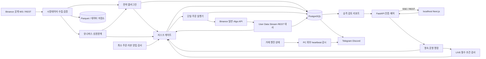

# 코인 무기한 선물 퀀트 자동매매 시스템 PRD v0.3

## 변경 이력

### v0.2 → v0.3

| 변경 항목 | v0.3 반영 내용 | 변경 이유 |
|---|---|---|
| 로컬 실거래 | 필수 조건 충족 시 개인 PC에서도 LIVE 허용. 사전 조건 체크리스트와 버튼·API 차단 규칙 추가 | 사용자 확정 사항 반영 |
| API 키 IP 제한 | IP 제한 경로를 기본으로 유지하되, 거래소가 허용하는 경우 대체 통제와 명시적 위험 수용을 거쳐 IP 미제한 경로 허용 | 로컬 유동 IP 환경에 대응 |
| 초기 자본 | 최초 실거래 자본 500 USDT 이하로 확정 | 사용자 자본 조건 반영 |
| 주문 가능성 | 상위 5개 종목별 최소 주문·위험 예산·증거금·동시 포지션 양립 검사 추가 | 소액 계좌에서 주문 불가·한도 초과 방지 |
| 승격 판단 | 기간·체결 수에 의한 강제 승격 기준 제거. 운영자가 승격 검토 리포트를 보고 결정 | 사용자 판단권 반영 |
| 안전 검증 | 장애 주입·킬스위치·보호 주문·대사 정합성은 승격의 필수 통과 조건으로 유지 | 관찰량과 실행 안전성을 구분 |
| 권장 관찰량 | 30일·50체결은 참고 권장치로 표시. 소액 실거래 14일도 참고 관찰 기간으로 변경 | 고정 기간이 승인이나 확대를 강제하지 않도록 정리 |
| 알림 | Telegram + Discord 웹훅으로 변경하고 이메일 제거. 채널 장애 전환과 외부 heartbeat 유지 | 사용자 지정 채널 반영 |
| 전략·포트폴리오 | v0.2 전략 파라미터·청산·유니버스·상관관계 기본값 유지, 대시보드 변경 지원 | 확정된 기본값 유지 |
| 피드백 항목 | 확정된 질문 제거, 남은 리스크 기본값 조정 여부만 유지 | 반복 확인 방지 |

### v0.1 → v0.2

| 변경 항목 | v0.2 반영 내용 | 변경 이유 |
|---|---|---|
| 거래소 | Binance USDⓈ-M 무기한 선물로 확정. 일반 주문·조건부 주문·User Data Stream·testnet 연동 명세 개정 | 사용자 확정 사항 반영 |
| 초기 전략 | 1시간봉 볼린저 밴드 돌파 + EMA 추세 필터 + 거래량 확인 전략으로 변경 | 사용자 전략 방향을 구현 가능한 규칙으로 구체화 |
| 전략 확장 | 공통 인터페이스를 사용하는 플러그인 구조 추가 | 추후 전략 추가 시 실행·리스크 코드를 재사용 |
| 리스크 설정 | 대시보드 설정값, 보수적 기본값, 시스템 하드 상한을 분리 | 운영 유연성과 실거래 안전성 확보 |
| 거래 종목 | 고정 2종목에서 거래대금 상위 5개 적격 USDT 무기한 종목으로 변경 | 사용자 지정 유니버스 반영 |
| 포트폴리오 통제 | 유니버스 선정·교체, 상관관계, 종목별·그룹별·총 익스포저 제한 추가 | 여러 종목의 동시 손실과 집중 위험 통제 |
| 운영 환경 | 개인 PC·localhost·Docker Compose를 1단계 기본값으로 변경 | 사용자의 초기 운영 환경 반영 |
| 인증·비밀관리 | 로컬 비밀번호·OS 키체인을 우선 적용하고 VPN·OIDC/MFA는 서버 이전 단계로 이동 | 로컬 운영에 맞게 구조 단순화 |
| 실거래·이전 | 로컬 실거래 기본 비활성화, 조건부 허용 절차와 클라우드 이전 절차 추가 | 절전·재부팅·유동 IP·통신 장애 대응 |
| 검증·데이터 | Binance M0 검증 목록, 과거 유니버스 재현, Algo 주문 연결 관계 추가 | 거래소 동작 오해와 백테스트 편향 방지 |

**이전 버전의 변경 이력은 당시 결정을 기록한다. 현재 요구사항은 v0.3 본문을 따른다.**

- **문서 상태:** 사용자 검토용 개정 초안
- **작성일:** 2026-10-11
- **범위:** 개인 자금으로 운영하는 코인 무기한 선물 자동매매 및 웹 대시보드
- **표기 원칙:** 사용자 확정 사항과 설계 가정을 구분한다. 직접 선택한 세부 규칙·수치·기술·운영 정책은 **A-xx**에 귀속한다.
- **추적 원칙:** 기존 가정·기능 ID를 유지하고 새 요구사항에는 ID를 추가한다.
- **검증 원칙:** 공식 API 명세와 실제 계정·환경의 동작을 구분한다. 불확실한 사항은 **M0에서 검증**하며, 필수 안전 동작이 확인되지 않으면 LIVE를 허용하지 않는다.

---

## 1. 개요 / 목표 / 비목표

### 1.1 개요

시장데이터 수집, 전략 검증, 페이퍼 트레이딩, 실거래 주문 실행, 리스크 통제, 운영 모니터링을 연결하는 자동매매 시스템이다.

운영자는 Next.js 대시보드에서 전략·유니버스·리스크 설정과 계좌 상태를 확인하고 거래 시작·중지·긴급 청산을 제어한다. 거래 엔진은 브라우저와 독립적으로 실행한다.

1단계는 개인 PC에서 운영한다. **로컬 LIVE 사전 조건을 충족하면 실거래를 허용**하며, 클라우드 서버 이전은 이후 안정적인 상시 운영을 위한 권장 단계다.

### 1.2 사용자 확정 사항

| 항목 | 확정 내용 |
|---|---|
| 제품 | 코인 무기한 선물 퀀트 자동매매 |
| 운영 UI | 웹 대시보드, Next.js |
| 거래소 | Binance USDⓈ-M 무기한 선물 |
| 초기 전략 | 볼린저 밴드 + EMA + 거래량 조합 |
| 기본 타임프레임 | 1시간봉 |
| 전략 확장 | 공통 인터페이스를 사용하는 플러그인 구조 |
| 리스크 | 대시보드 설정, 보수적 기본값·하드 상한, 보유 중 위험 증가 변경 금지 |
| 종목 | 거래량 기준 상위 5개 USDT 무기한 코인 |
| 백엔드 | Python + FastAPI |
| 초기 운영 | 개인 PC·localhost, 향후 클라우드 이전 가능 |
| 로컬 실거래 | 사전 조건 충족 시 허용 |
| 초기 실거래 자본 | 500 USDT 이하 |
| 승격 판단 | 사용자가 리포트를 검토해 결정. 기간·체결 수 강제 기준 없음 |
| 필수 안전 검증 | 장애 주입·킬스위치·보호 주문 등은 통과 필수 |
| 알림 | Telegram + Discord 웹훅, 외부 heartbeat 유지, 거래 명령 수신 금지 |
| 기존 설계 유지 | v0.2 전략 파라미터·청산 구성·유니버스 선정·상관관계 기본값 유지 |

종목 간 비교에는 코인 수량 대신 **USDT 거래대금**을 사용한다(A-34). 상위 5개는 거래 후보이며 동시에 5개 포지션을 보유한다는 의미가 아니다.

### 1.3 목표

1. 동일한 전략 코드와 설정으로 백테스트·페이퍼·실거래를 실행한다.
2. 모든 신규·증액 주문에 계좌 단위 리스크 검사를 적용한다.
3. 응답 유실·부분 체결·재시작 후 거래소 실제 상태를 복원한다.
4. 모든 보유 포지션의 거래소 측 보호 손절을 확인한다.
5. 손실 한도 도달 시 신규 거래를 차단하고 위험 축소를 시도한다.
6. 소액 계좌에서 주문할 수 없는 종목을 설명하고 안전하게 건너뛴다.
7. 운영자에게 승격 판단 자료와 필수 안전 검증 결과를 제공한다.
8. 로컬에서 시작해 설정·데이터·감사 이력을 보존하며 서버로 이전한다.

### 1.4 비목표

초기 범위에서 제외한다(A-03).

- 고객 자금 수탁, 다중 사용자 SaaS, 카피 트레이딩
- 초고빈도 매매, 거래소 간 차익거래
- COIN-M·USDC 결제 상품, 옵션, 현물 자동매매
- Hedge Mode, Portfolio Margin, Multi-Assets Mode
- 여러 전략의 동시 자금 배분과 상충 신호 조정
- AI의 실시간 전략 생성·자동 배포
- 자동 입출금, 모바일 네이티브 앱
- 세무 신고 자동화 및 법률 자문

---

## 2. 사용자 및 사용 시나리오

### 2.1 사용자

**개인 1인 트레이더가 본인 자금만 운영한다(A-01).**

운영자는 연구자·관리자 역할을 겸한다. 시스템은 연구 작업·대시보드·주문 실행기의 권한을 분리한다. 거래 전용 계좌를 사용하며 다른 봇·수동 매매를 혼용하지 않는다(A-03).

IP 미제한 거래 키를 사용할 때는 추가 통제로 **전용 서브계정**을 요구한다(A-41).

### 2.2 주요 시나리오

| 시나리오 | 흐름 | 완료 조건 |
|---|---|---|
| 로컬 시작 | Compose 실행 → 로그인 → 연결 검사 → 대사 | PAPER 또는 거래 중지 상태로 준비 |
| 전략 연구 | 파라미터 설정 → 과거 유니버스 백테스트 → 결과 저장 | 입력·코드·설정으로 재현 가능 |
| 페이퍼 운영 | 실시간 가상 주문 → 체결·위험·장애 관찰 | 승격 검토 자료 축적 |
| 승격 검토 | 리포트 확인 → 안전 검증 확인 → 사용자 결정 | 판단과 사용한 리포트 버전 저장 |
| 로컬 LIVE 시작 | 사전 조건 검사 → 미충족 항목 해소 → 재인증 | 모든 필수 조건 통과 후 활성화 |
| 소액 주문 | 종목별 최소 주문 계산 → 위험·증거금 검사 | 가능한 종목만 주문, 불가능한 종목은 사유 표시 |
| 리스크 변경 | 변경안 입력 → 영향 확인 → 재인증 → 적용 | 하드 상한·변경 조건 충족 |
| 유니버스 갱신 | 거래대금 집계 → 상위 5개 갱신 | 제외 종목도 보유 중이면 청산까지 관리 |
| 장애 복구 | PC·프로세스 복구 → 주문·포지션 대사 | 안전 조건 복구 후 수동 재개 |
| 서버 이전 | 거래 중지 → 데이터 이전 → 키 교체 → 검증 | 서버 단독 실행 확인 |

---

## 3. 핵심 가정 목록

사용자 확정 사항은 가정이 아니다. 아래에는 확정 사항을 구현하기 위한 세부 기본값을 기록한다.

| ID | 가정 및 기본값 |
|---|---|
| A-01 | 개인 1인 운영·본인 자금만 사용한다. 거주지·계정의 이용 자격은 실거래 전 확인한다. |
| A-02 | Binance 일반 선물 계정의 USDT 단일 자산 증거금 구성을 사용한다. 실제 지원 기능은 M0에서 검증한다. |
| A-03 | 단일 전용 계좌·단일 활성 전략으로 시작한다. 다른 봇·수동 매매·자동 입출금을 혼용하지 않는다. |
| A-04 | 초기 전략은 볼린저 밴드 돌파형이다. 구체적 규칙은 FR-02를 따른다. |
| A-05 | 완성된 1시간봉으로 신규 신호를 계산한다. 롱·숏을 허용하되 One-way Mode를 사용하고 피라미딩하지 않는다. |
| A-06 | 기본 격리마진·레버리지 2배다. 설정 범위와 하드 상한은 FR-08을 따른다. |
| A-07 | 주문별 계획 손실 기본 0.25%, 전체 계획 손실 기본 0.5%다. 최초 손절을 보유 중 넓히지 않는다. |
| A-08 | 일일 손실 기본 2%, 누적 낙폭 기본 5%, 가용 증거금 비율 기본 최소 50%다. 손실 한도 도달 시 청산 절차와 잠금을 실행한다. |
| A-09 | 진입은 가격 한도를 둔 IOC 지정가, 전략·긴급 청산은 수량 지정 reduce-only 시장가를 사용한다. |
| A-10 | 거래소 측 보호 손절은 필수다. 기본은 `STOP_MARKET`, `workingType=MARK_PRICE`, close-all 방식이다. 익절도 거래소 측 조건부 주문으로 설정한다. |
| A-11 | 공개 WebSocket·User Data Stream을 우선 사용한다. REST 대사는 30초마다 수행하고 Mark Price·호가가 5초 이상 오래되면 신규 진입을 차단한다. |
| A-12 | 저장 시각은 UTC, 일일 손실 기준은 UTC 00:00, UI 기본 표시는 Asia/Seoul이다. 손익 기준 통화는 USDT다. |
| A-13 | 백테스트 기본 연구 목표는 24개월 이상, 시간순 60%/20%/20% 연구·검증·최종 평가 구간이다. 데이터 기간 자체를 LIVE 승격의 강제 조건으로 사용하지 않는다. |
| A-14 | 페이퍼는 운영 시장데이터와 가상 체결 모델을 사용한다. testnet은 API·상태 전이 검증에 사용한다. |
| A-15 | Python 거래 엔진을 FastAPI·Next.js와 별도 프로세스로 실행한다. Binance 전용 어댑터와 공통 전략 인터페이스를 사용한다. |
| A-16 | PostgreSQL에 운영 상태, Parquet에 연구 데이터를 저장한다. 로컬 저장소와 향후 S3 호환 저장소를 공통 인터페이스로 연결한다. |
| A-17 | 개인 PC에서 Docker Compose로 시작한다. 공개 포트는 localhost로 제한한다. |
| A-18 | 로컬 인증은 비밀번호, 비밀 저장은 OS 키체인을 사용한다. 중요 명령은 최근 5분 이내 재인증을 요구한다. 서버 단계에서 VPN·OIDC/MFA·TLS를 적용한다. |
| A-19 | IP 제한 키를 기본으로 사용한다. IP 미제한 키는 거래소가 허용하고 A-41 대체 통제·위험 수용을 충족한 경우에만 사용한다. |
| A-20 | 일반 알림은 Telegram 우선·Discord 보조, 중요 알림은 두 채널에 발송한다. LIVE에는 PC와 독립된 외부 heartbeat 감시가 필요하다. |
| A-21 | 대시보드는 SSE를 사용한다. 가격·손익은 초당 최대 1회, SSE 실패 시 5초 REST 폴백을 적용한다. |
| A-22 | 내부 신호→전송 p95 500ms, 감지 후 진입 차단 1초, 최초 체결 감지 후 보호 확인 3초, 중요 알림 첫 발송 시도 10초를 목표로 한다. |
| A-23 | 서버 단계 월 가용성 목표는 99.5%다. 로컬은 실제 가동·중단 시간을 보고한다. 환경 복구 후 조회·대사 완료 목표는 15분이며 거래는 수동 재개한다. |
| A-24 | 주문·체결·감사는 2년, 운영 로그는 90일 보관한다. 일일 암호화 백업·월 1회 복구 검증을 수행한다. |
| A-25 | 장애 시 신규 진입을 중지하고 기존 거래소 보호 주문을 유지한다. countdown cancel-all은 기본 비활성화한다. |
| A-26 | 30일·50체결은 페이퍼 참고 권장치, 14일은 소액 실거래 참고 관찰 기간이다. 어느 수치도 승인·차단·자본 확대를 자동 결정하지 않는다. |
| A-27 | 숙련 개발자 1명 기준 초기 개발은 10~14주로 추정한다. M0 결과에 따라 재산정한다. |
| A-28 | 거래 설정은 버전·재인증·감사 기록을 갖는다. 포지션·미체결·미확정 주문이 있으면 위험 증가 변경을 금지한다. |
| A-29 | 외부 API의 정확히 한 번 실행을 가정하지 않는다. 단일 실행자·영속 주문 의도·식별자·대사로 중복을 방지한다. |
| A-30 | 기준 부하는 활성 5종목과 청산 관리 종목 최대 5개, 수신 이벤트 합계 초당 100건이다. 로컬 기준 환경은 4코어·RAM 8GB 이상이며 M0에서 측정한다. |
| A-31 | 전략 기본값은 BB 20/2.0, EMA 50/200, 거래량 평균 20봉·확인 배수 1.5, ATR 14·손절 2ATR·익절 3ATR, 최대 보유 48봉·재진입 대기 2봉이다. |
| A-32 | 리스크 하드 정책은 FR-08을 따른다. 대시보드·일반 환경변수로 완화할 수 없다. |
| A-33 | 진입 슬리피지 한도 10bp, 최대 스프레드 10bp, 신호 유효시간 60초, 신호 종가 대비 최대 이격 0.5ATR를 기본값으로 사용한다. |
| A-34 | 완료된 최근 7일 USDT 거래대금 상위 5개를 매일 UTC 00:05에 선정한다. 상장 90일 미만·스테이블·레버리지 토큰 등을 제외한다. |
| A-35 | 최근 30일 1시간 수익률의 절대 상관계수 0.8 이상으로 연결되는 종목을 같은 그룹으로 통제한다. 계산 실패 시 관련 종목을 같은 그룹으로 취급한다. |
| A-36 | 조건 충족 시 로컬 LIVE를 허용하되 초기·재시작 상태는 거래 중지다. FR-17의 필수 조건을 UI와 서버에서 모두 검사한다. |
| A-37 | 서버 이전은 포지션·주문이 없는 상태에서 수행한다. 데이터는 이전하고 거래 키는 서버용으로 교체한다. |
| A-38 | 세부 입력 범위·계산 방식·운영 기본값은 해당 FR에 함께 귀속하며 구현·설정 버전으로 기록한다. |
| A-39 | 500 USDT 이하의 초기 자본을 5등분하지 않는다. 5개 후보의 개별 주문 가능성과 실제 동시 보유 제약을 각각 검사하고 불가능한 종목은 건너뛴다. |
| A-40 | 로컬 LIVE 점검은 자동 검사와 사용자 확인을 구분한다. 외부 heartbeat는 15초마다 전달하고 60초 미수신 시 장애로 판단한다. 전원 대비는 PC 배터리 또는 최소 10분 UPS를 기본 필수 조건으로 둔다. |
| A-41 | IP 미제한 경로는 전용 서브계정, 출금·자금 이동 권한 없음, 초기 자본 500 USDT 이하, 최대 30일 키 교체 주기, 명시적 위험 수용을 요구한다. 실제 이용 가능 여부는 M0에서 확인한다. |
| A-42 | 승격 리포트의 성과·관찰량은 판단 자료다. 필수 안전 검사 실패·미실행·증거 만료 및 미해결 중요 대사 오류는 LIVE 차단 조건이다. |
| A-43 | 알림은 사건 ID로 중복을 관리하고 전송 실패·결과 미확정 시 다른 채널을 사용한다. 두 채널 모두 사용 불가하면 신규 진입을 차단한다. |

---

## 4. 시스템 아키텍처 개요

### 4.1 컴포넌트

| 컴포넌트 | 책임 |
|---|---|
| Next.js 대시보드 | 상태 조회, 설정, 운영 명령, 승격 검토 |
| FastAPI 제어 API | 인증, 입력 검증, 명령 영속화, SSE |
| 시장데이터 수집기 | 봉·호가·Mark Price·펀딩·종목 필터 수집 |
| 유니버스 관리자 | 거래대금 순위, 편입·제외, 상관관계 |
| 전략 플러그인 러너 | 공통 인터페이스로 신호·청산 의도 생성 |
| 포트폴리오 리스크 게이트 | 손실·증거금·익스포저·동시 포지션·상관 위험 검사 |
| 주문 가능성 계산기 | 최소 주문과 소액 계좌의 위험·증거금 양립 검사 |
| 단일 주문 실행기 | 일반·Algo 주문 전송, 취소, 미확정 상태 처리 |
| 계좌 대사기 | User Data Stream·REST로 실제 계좌 상태 복원 |
| 안전 조건 검사기 | LIVE 사전 조건·검증 증거·실시간 차단 조건 관리 |
| 백테스트·페이퍼 러너 | 공통 전략과 환경별 체결 모델 실행 |
| 승격 리포트 생성기 | 관찰·성과·안전·대사·주문 가능성 종합 |
| PostgreSQL·파일 저장소 | 상태·감사·검증·연구 데이터 |
| 알림·외부 감시 | Telegram·Discord, PC 외부 heartbeat 감시 |

### 4.2 데이터 흐름



### 4.3 실행 원칙

- 대시보드·전략 플러그인은 거래 키를 보유하거나 직접 주문하지 않는다.
- 주문 의도·리스크 판정을 저장한 후 거래소에 전송한다.
- 전략 주문과 운영 명령은 같은 리스크 상태를 공유한다.
- 실행 모드 `PAPER / TESTNET / LIVE`와 운영 상태 `RECONCILING / PAUSED / RUNNING / RISK_LOCKED / EXITING / ERROR`를 분리한다.
- 재시작은 `RECONCILING`에서 시작하고 LIVE 신규 진입은 자동 재개하지 않는다.
- DB 연결·실행자 소유권 상실 시 신규 주문 전송을 중단한다.
- LIVE 조건이 충족되지 않아도 조회·대사·보호 관리·위험 축소 기능은 유지한다.
- **PC가 꺼지면 계좌 단위 손실 감시도 중단된다. 거래소 측 개별 보호 주문은 남지만, 일일 손실·누적 낙폭 한도 준수를 대신 보장하지 않는다.**

### 4.4 Binance 연동 기준

일반 주문은 `newClientOrderId`, 조건부 주문은 `clientAlgoId`로 추적한다. One-way 주문에는 `positionSide=BOTH`를 명시한다. 보호 주문은 Algo API와 `triggerPrice`를 사용한다. `closePosition=true`에는 `quantity`·`reduceOnly`를 함께 보내지 않으며, 수량 지정 즉시 청산은 별도 reduce-only 시장가 경로로 처리한다. [Binance 거래 API](https://developers.binance.com/en/docs/catalog/core-trading-derivatives-trading-usd-s-m-futures/api/rest-api/trade)

User Data Stream은 `listenKey` 생성·갱신·만료·재연결을 관리한다. 문서상 유효시간 60분보다 짧은 **30분 갱신 주기**를 사용한다(A-11). 재연결 후 REST 대사를 수행한다. [User Data Stream API](https://developers.binance.com/en/docs/catalog/core-trading-derivatives-trading-usd-s-m-futures/api/rest-api/user-data-streams)

testnet은 운영과 URL·키·실행 데이터를 분리한다. 공식 문서의 REST 기준은 `https://demo-fapi.binance.com`, 스트림 기준은 `wss://demo-fstream.binance.com`이며 M0에서 재확인한다. [Binance 일반 정보·testnet](https://developers.binance.com/en/docs/products/derivatives-trading-usds-futures/general-info)

`countdownCancelAll`은 미체결 주문 취소 기능이며 포지션 청산 수단으로 취급하지 않는다. 보호 Algo 주문에 미치는 영향 확인 전 사용하지 않는다(A-25). [Binance 자동 주문 취소 API](https://developers.binance.com/en/docs/catalog/core-trading-derivatives-trading-usd-s-m-futures/api/rest-api/trade)

### 4.5 M0에서 검증할 항목

| ID | 검증 항목 | 통과 조건 |
|---|---|---|
| M0-01 | 계정·상품 이용 자격 | 해당 계정의 USDⓈ-M 이용·API 권한 확인 |
| M0-02 | 계정·포지션 모드 | One-way·Single-Asset·마진 모드 조회·변경 제한 확인 |
| M0-03 | 일반·Algo API | 생성·조회·취소·식별자·실제 주문 연결 확인 |
| M0-04 | 보호 손절·익절 | 롱·숏, 부분 체결, 수동 축소, 0포지션 동작 확인 |
| M0-05 | 청산 경합 | 손절·익절·수동 청산 경합에서 반전 방지 확인 |
| M0-06 | 조건부 이벤트 복구 | Algo·실제 주문·체결 연결과 REST 복구 확인 |
| M0-07 | User Data Stream | 갱신 실패·만료·연결 교체·누락 대사 확인 |
| M0-08 | countdown 취소 | 일반·Algo·보호 주문별 취소 범위 확인 |
| M0-09 | 소액 주문 제약 | 최소 수량·명목금액·부분 체결 잔량·축소 주문 예외 확인 |
| M0-10 | 청산·증거금 계산 | 레버리지 구간·유지증거금·격리/교차 영향 확인 |
| M0-11 | testnet 차이 | 운영과의 차이, 운영에서만 확인 가능한 항목 기록 |
| M0-12 | 로컬 실행 | 키체인·컨테이너 비밀 주입, 절전·복귀·IP 변경 확인 |
| M0-13 | IP 미제한 경로 | 계정의 실제 허용 여부, 서브계정 이용 가능성, 키 권한 확인 |
| M0-14 | 알림·외부 감시 | Telegram·Discord 장애 전환, PC 중단 시 외부 알림 확인 |

관련 기능의 필수 안전 검증이 미완료면 해당 기능의 LIVE를 차단한다. 운영에서만 확인 가능한 동작은 통제된 최초 소액 주문에서 재확인하며, 실패하면 신규 진입을 잠그고 체결분 축소를 시도한다.

---

## 5. 기능 요구사항

### FR-01. 시장데이터 수집·품질 관리

**요구사항:** 전략·유니버스·리스크·주문 가능성 계산에 필요한 데이터를 수집한다(A-11~13, A-34).

**수용 기준**

- 거래소 시각·수신 시각·봉 완료 여부를 저장한다.
- 미완성 봉은 신규 진입 신호에 사용하지 않는다.
- 누락·중복·역순 데이터를 감지하고 복구 전 해당 종목의 신규 진입을 차단한다.
- Mark Price·호가가 5초 이상 오래되면 해당 종목을 거래 불가로 표시한다.
- 유니버스 후보의 거래대금 수집과 실시간 전략 구독을 분리해 API 예산을 관리한다.
- 종목별 거래 상태·가격 단위·수량 단위·최소 주문 필터를 저장하고 실제 주문 전에 검증한다.
- 표시용 소수점 정밀도를 `tickSize`·`stepSize` 대신 사용하지 않는다.

종목 상태·상장일·자산 구분·거래대금 필드는 Binance 시장데이터 API를 기준으로 매핑한다. [Binance 시장데이터 API](https://developers.binance.com/en/docs/catalog/core-trading-derivatives-trading-usd-s-m-futures/api/rest-api/market-data)

### FR-02. 초기 전략: 볼린저 밴드 + EMA + 거래량

**요구사항:** v0.2의 돌파 전략과 기본값을 유지한다(A-04, A-05, A-31).

#### 설정 파라미터

모든 전략 파라미터는 대시보드에서 조회·편집하고 버전에 저장한다.

| 설정값 | 기본값 | 초기 허용 범위·의미 |
|---|---:|---|
| `timeframe` | `1h` | v0.3 지원값은 1h |
| `bb_period` | 20 | 10~100봉 |
| `bb_stddev` | 2.0 | 1.0~4.0 |
| `ema_fast_period` | 50 | 10~200봉 |
| `ema_slow_period` | 200 | 50~500봉, fast보다 커야 함 |
| `volume_period` | 20 | 5~100봉 |
| `volume_multiplier` | 1.5 | 1.0~5.0 |
| `atr_period` | 14 | 5~100봉 |
| `stop_atr_multiple` | 2.0 | 1.0~5.0 |
| `take_profit_atr_multiple` | 3.0 | 1.0~10.0 |
| `exit_on_bb_middle` | true | 중심선 반대편 종가에서 청산 |
| `exit_on_ema_reversal` | true | EMA 추세 반전 시 청산 |
| `max_holding_bars` | 48 | 1~240봉 |
| `cooldown_bars` | 2 | 청산 후 0~24개 완성 봉 대기 |
| `trade_direction` | both | long / short / both |
| `warmup_multiplier` | 5 | 가장 긴 지표 기간의 3~10배 준비 봉 |

지표 계산은 종가 기준 SMA·모집단 표준편차의 볼린저 밴드, EMA, Wilder 방식 ATR로 정의한다. 계산 방식은 플러그인 버전으로 고정한다.

#### 진입 규칙

완성 봉 `t`에서 다음 조건을 모두 만족해야 한다.

**롱**

1. `EMA_fast(t) > EMA_slow(t)`이고 `Close(t) > EMA_fast(t)`.
2. `Close(t) > BB_upper(t)`이며 직전 봉은 `Close(t-1) ≤ BB_upper(t-1)`.
3. 현재 봉 USDT 거래대금이 **현재 봉을 제외한 직전 `volume_period`봉 평균 × `volume_multiplier`** 이상.
4. 해당 종목에 포지션·미확정 진입 주문이 없고 재진입 대기 기간이 끝남.
5. 유니버스·데이터·리스크·최소 주문·실행 조건 통과.

**숏**

- EMA·가격·밴드 부등호를 반대로 적용하며 거래량 조건은 동일하다.

신호는 봉 마감 이후 처리하고 종가에 소급 체결하지 않는다. 동시 신호는 유니버스 거래대금 순위, 종목 코드 순으로 처리한다.

#### 손절·익절·청산 규칙

- 최초 체결 가격 `P0`와 신호 봉 ATR로 보호 가격을 고정한다.
- 롱 손절: `P0 − stop_atr_multiple × ATR`.
- 롱 익절: `P0 + take_profit_atr_multiple × ATR`.
- 숏은 반대 방향으로 계산한다.
- 후속 부분 체결로 평균 진입가가 바뀌어도 손절을 불리하게 이동하지 않는다.
- 실제 위험이 승인 예산을 넘으면 초과 수량 축소를 시도한다.
- 거래소 측 손절·익절 외에 중심선 이탈, EMA 추세 반전, 최대 보유시간 도달 시 청산 의도를 생성한다.
- 중심선 청산은 롱 `Close < BB_middle`, 숏 `Close > BB_middle`이다.
- 기존 포지션 청산·보호 주문 정리·대기 기간 완료 전 반전 진입하지 않는다.
- 피라미딩·물타기·손절 확대는 허용하지 않는다.

**수용 기준**

- 같은 데이터·설정·버전에서 같은 신호와 청산 의도를 생성한다.
- 준비 봉 부족·지표 NaN·거래량 평균 0이면 진입하지 않는다.
- 조건 경계·이전 봉 참조·현재 봉 제외 거래량 평균을 검증한다.
- 같은 봉 재처리로 추가 진입 의도가 생성되지 않는다.
- 파라미터 변경은 새 버전을 생성한다.
- 활성 버전 교체는 계좌가 비어 있을 때 수행한다.

### FR-03. 백테스트

**요구사항:** 당시 정보만으로 전략·유니버스·비용을 재현한다(A-13).

**수용 기준**

- 기본 연구 기간은 24개월 이상이며 부족한 데이터 기간과 이유를 표시한다.
- 시간순 연구·검증·최종 평가 구간을 분리한다.
- 현재 상위 5개를 과거 전체에 적용하지 않고 당시 거래대금·상장 상태·분류를 사용한다.
- 상장폐지 종목 등 자료를 확보하지 못하면 생존편향 가능성을 표시한다.
- 신호 이후 체결, IOC 미체결·부분 체결, 가격·수량 단위, 수수료·펀딩·슬리피지를 반영한다.
- 보호 트리거의 Mark Price와 실제 체결 가격을 구분한다.
- 봉 내부 순서를 알 수 없는 손절·익절 동시 도달은 손절 우선의 보수적 가정을 적용한다.
- 기본 비용과 수수료·슬리피지 2배 스트레스 결과를 함께 출력한다.
- 데이터·코드·유니버스·파라미터·체결 모델·비용 버전을 저장한다.
- 청산 모델 미검증·데이터 부족 등 결과의 한계를 승격 리포트에 전달한다.

백테스트 기간 부족이나 성과 부진 자체는 자동 승격 차단 조건이 아니다. 실제 주문·증거금·보호 동작을 검증하지 못한 문제는 별도의 안전 조건으로 처리한다.

### FR-04. 페이퍼 트레이딩·testnet

**요구사항:** 페이퍼와 거래소 API 검증 환경을 분리한다(A-14).

**수용 기준**

- 페이퍼는 운영 시장데이터를 사용하되 실제 주문을 전송하지 않는다.
- 공통 전략·유니버스·리스크 코드를 사용하고 체결 어댑터만 교체한다.
- 호가·지연·부분 체결·수수료·펀딩을 모델링한다.
- 가격 접촉만으로 지정가 전량 체결을 가정하지 않는다.
- testnet 키·URL·실행 데이터를 운영과 분리한다.
- testnet 체결 품질을 운영 시장 수익성의 근거로 사용하지 않는다.
- 페이퍼 기간·체결 수를 축적하되 특정 수치 도달 전 LIVE를 기계적으로 금지하지 않는다.

### FR-05. LIVE 활성화·운영 제어

**요구사항:** 사용자 판단과 시스템 안전 조건을 모두 반영한다(A-18, A-36, A-42).

**수용 기준**

- 초기 모드는 PAPER이며 LIVE는 명시적으로 시작한다.
- 재시작 후 LIVE 신규 진입은 자동 재개하지 않는다.
- 승격 리포트 검토·사용자 결정 기록과 현재 안전 조건을 각각 확인한다.
- 기간·체결 수·수익률만으로 LIVE 버튼을 차단하거나 자동 활성화하지 않는다.
- FR-17의 필수 조건 실패·미확인·유효성 만료 시 LIVE 버튼을 비활성화하고 사유를 표시한다.
- 서버는 버튼 상태와 무관하게 동일 조건을 재검사해 우회 요청을 거부한다.
- 사용자 재인증 후 계좌·자본·전략·리스크 버전·IP 보안 경로를 확인하고 시작한다.
- `PAUSED`에서도 조회·대사·보호·위험 축소를 계속한다.
- 운영 명령은 멱등 키를 사용하며 접수·진행·완료·실패를 구분한다.

### FR-06. Binance 주문 실행·중복 방지

**요구사항:** 일반·Algo 주문과 미확정 상태를 관리한다(A-09, A-29, A-33).

**수용 기준**

- 주문 의도를 먼저 저장하고 외부 식별자를 내부 이력 전체에서 재사용하지 않는다.
- 의도·Algo 주문·조건 발동 후 실제 주문·체결을 연결한다.
- 응답 유실·실행 결과 불명확 시 `UNKNOWN`으로 두고 조회·이벤트·대사 전 새 주문으로 재전송하지 않는다.
- 체결은 계좌·종목·거래소 체결 ID로 중복 제거한다.
- 기본 IOC 가격 한도는 최신 반대 호가에서 10bp 이내다.
- 스프레드 10bp 초과, 신호 60초 초과, 신호 종가 대비 0.5ATR 초과 이격이면 진입하지 않는다.
- IOC 잔량을 자동 추격하지 않는다.
- 실제 전송 직전 최소 주문·리스크 예약·LIVE 조건을 재검사한다.
- 부분 체결·잔량·취소 상태를 대사하며 미확정 잠재 체결분도 위험 예산에서 차감한다.
- API 제한을 준수하면서 취소·위험 축소를 우선 처리한다.
- 접수·조건 발동·체결 완료를 구분한다.

일부 Binance HTTP 503 응답은 실행 결과 미확정을 뜻하므로 즉시 실패로 간주해 재주문하지 않는다. [Binance 오류 처리 문서](https://developers.binance.com/en/docs/products/derivatives-trading-usds-futures/general-info)

### FR-07. 포지션·잔고·손익 대사

**요구사항:** 거래소의 실제 계좌 상태를 기준으로 복원한다(A-11, A-12, A-29).

**수용 기준**

- 시작·재연결·listenKey 재생성 후 전체 대사를 수행한다.
- 정상 운영 중 30초마다 일반·Algo 주문, 포지션, 잔고를 대사한다.
- 포지션 수량·진입가·Mark Price·손익·증거금·마진 모드·레버리지·보호 상태를 저장한다.
- 수수료·펀딩·입출금·실현 손익을 구분하고 중복 반영하지 않는다.
- 수동 주문·예상하지 못한 자금 이동·계정 설정 변경을 감지하면 신규 진입을 잠근다.
- 유니버스 제외 종목·미확정 주문을 대사에서 누락하지 않는다.
- 이력 조회 가능 기간을 넘는 공백은 정상으로 처리하지 않는다.
- 미해결 중요 불일치는 승격 리포트와 LIVE 차단 사유에 반영한다.

### FR-08. 설정 가능한 리스크와 하드 상한

**요구사항:** v0.2 기본값을 유지하며 하드 정책 안에서 설정한다(A-06~08, A-32, A-35).

#### 설정표

비율의 기준은 최신 계좌 평가자산 `E`다. 하드 상한은 본 릴리스의 최대 허용 설정값이며 안전한 투자 수준을 의미하지 않는다.

| 항목 | 기본값 | 대시보드 허용 범위·하드 정책 |
|---|---:|---|
| 거래소 설정 레버리지 | 2배 | 1~5배, 최대 5배 |
| 마진 모드 | 격리 | 격리 / 교차. 교차는 M0 검증 후 허용 |
| 주문별 계획 손실 | 0.25% | 0.01~0.50% |
| 전체 계획 손실 합계 | 0.50% | 0.01~1.00% |
| 일일 손실 한도 | 2% | 0.1~3% |
| 누적 낙폭 한도 | 5% | 0.5~10% |
| 최대 동시 포지션 | 2개 | 1~5개 |
| 총 명목 익스포저/E | 2.0배 | 0.1~3.0배 |
| 단일 종목 익스포저/E | 0.75배 | 0.05~1.0배 |
| 절대 순 익스포저/E | 1.0배 | 0.1~2.0배 |
| 상관 그룹 총 익스포저/E | 1.0배 | 0.1~1.5배 |
| 상관 그룹 계획 손실 | 0.35% | 0.01~0.50% |
| 가용 증거금/E 최소값 | 50% | 30~100%、하드 하한 30% |

거래소 제약이 더 엄격하면 거래소 제약을 따른다. 모든 조건을 동시에 적용하므로 실제 주문 가능 규모는 개별 상한보다 작을 수 있다.

#### 계산 원칙

- 총 익스포저는 포지션 명목가치 절댓값의 합이다.
- 순 익스포저는 롱 명목가치에서 숏 명목가치를 뺀 값이다.
- 미체결·미확정 진입 주문은 최악의 추가 체결량을 예약한다.
- 계획 손실은 진입·손절 간 가격 차이, 수량, 수수료·청산 슬리피지 완충분을 포함한다.
- 주문별·전체·그룹 위험, 종목·총 노출, 증거금 중 가장 엄격한 조건으로 수량을 정한다.
- 수량은 아래로 반올림한다. 최소 주문을 맞추려고 위험 예산을 초과해 올림하지 않는다.
- 손절과 예상 청산 가격 사이의 기본 최소 여유는 1ATR이며 계산 불가 시 신규 진입을 거부한다.
- 교차마진에서도 동일한 계좌 위험 제한을 적용한다.

**수용 기준**

- API 직접 호출로 하드 상한을 우회할 수 없다.
- 하드 정책 완화는 별도 정책·소프트웨어 버전과 안전 검증이 필요하다.
- 손실 한도 비활성화에 해당하는 설정을 거부한다.
- 일일 손실 한도는 누적 낙폭 한도 이하, 주문별 위험은 전체·그룹 한도 이하로 검증한다.
- 동시 신호의 위험 예산·포지션 슬롯을 원자적으로 예약한다.
- 위험 축소 주문은 신규 진입 한도에 막히지 않으며 포지션을 반전시킬 수 없다.
- 운영 한도 초과 시 신규 진입을 중지하고, 하드 노출·증거금 정책 위반 시 위험 축소를 시도한다.

### FR-09. 손실 한도·리스크 잠금

**요구사항:** 실현·미실현 손익과 비용을 포함한 계좌 손실을 감시한다(A-08, A-12).

**측정 정의**

- `E(t)`: USDT 평가자산. 미실현 손익과 반영된 비용을 포함한다.
- 일일 손실: UTC 일 시작 평가자산 대비 외부 자금 흐름을 보정한 평가자산 감소율.
- 누적 낙폭: 실거래 시작 후 자금 흐름을 보정한 평가자산 고점 대비 감소율.
- 이미 반영된 수수료·펀딩은 다시 차감하지 않는다.
- 예상하지 못한 입출금은 보정 기준 확인 전 거래를 잠근다.

**수용 기준**

- 일일 손실 또는 누적 낙폭 도달 시 `RISK_LOCKED`와 청산 절차를 실행한다.
- 감지 후 1초 이내 신규 진입을 차단한다.
- 재시작·날짜 변경·한도 상향으로 잠금이 자동 해제되지 않는다.
- 일일 잠금 해제는 다음 UTC 일, 원인 검토, 재인증을 모두 요구한다.
- 누적 고점·실거래 기준 변경은 근거와 감사 기록을 남긴다.
- 통신 불능·가격 급변으로 실제 손실이 설정값을 초과한 사건을 기록한다.

### FR-10. 킬스위치·긴급 청산

| 명령 | 동작 |
|---|---|
| 신규 거래 중지 | 신규 진입 차단 → 진입 주문 취소 → 기존 포지션·보호 관리 유지 |
| 긴급 전량 청산 | 계좌 잠금 → 진입 주문 취소 시도 → 실제 포지션 조회 → reduce-only 청산 → 잔여 상태 대사 |

**수용 기준**

- 로그인한 운영자의 중지 명령은 추가 재인증 없이 즉시 접수한다.
- 수동 전량 청산은 최근 재인증과 대상 계좌 확인을 요구한다.
- 자동 리스크 청산은 사용자 입력이나 알림 전송 성공을 기다리지 않는다.
- 취소 응답을 무기한 기다리느라 확인 가능한 포지션 축소를 지연하지 않는다.
- 취소·체결 경합으로 추가된 수량은 재대사 후 축소한다.
- 잔여 포지션이 있는 동안 보호 손절을 유지한다.
- 포지션 0과 일반·Algo 잔여 주문 정리 전 완료로 표시하지 않는다.
- 통신 불능이면 `청산 미확인`과 마지막 확인 시각·수량을 표시한다.
- 공식 앱·웹을 통한 수동 확인·청산 절차를 제공한다.

### FR-11. 보호 주문·장애 대응

**요구사항:** PC 장애 시에도 남는 거래소 측 보호 주문을 사용한다(A-10, A-25).

**수용 기준**

- 진입 전에 보호 주문 경로·설정·계정 지원 상태를 확인한다.
- 최초 체결 감지 후 3초 이내 보호 손절 활성 상태를 확인하지 못하면 신규 진입을 잠그고 체결분 축소를 시도한다.
- 요청 성공뿐 아니라 거래소 조회·이벤트로 보호 상태를 확인한다.
- 기본 `priceProtect=false`를 사용하며 가격 괴리와 발동 동작은 M0에서 검증한다.
- 손절·익절을 원자적 OCO로 가정하지 않는다.
- 하나가 체결되면 잔여 보호 주문을 정리하고 다음 진입 전에 확인한다.
- 부분 체결·수동 축소·청산 경합에서도 보호 누락과 반전이 없는지 검증한다.
- 비공개 스트림 단절·listenKey 갱신 실패 시 신규 진입을 차단하고 REST 대사를 수행한다.
- 공개 데이터 단절 시 오래된 가격으로 진입하거나 손절을 불리하게 수정하지 않는다.
- countdown cancel-all의 보호 주문 영향이 확인되지 않으면 사용하지 않는다.

### FR-12. Telegram·Discord 알림과 외부 heartbeat

**요구사항:** 지정된 두 채널로 장애를 통지하고 한 채널 실패 시 다른 채널을 사용한다(A-20, A-43).

#### 발송 정책

- 일반 알림: Telegram 우선, 실패·타임아웃 시 Discord 전송.
- 중요 알림: Telegram·Discord에 각각 발송하고 채널별 결과 기록.
- Discord를 사용 중인 상황에서 실패하면 Telegram의 복구 상태를 확인해 전송한다.
- 채널 우선순위는 설정 가능하지만 두 채널의 자격 증명과 장애 전환 검증을 유지한다.
- 출금·주문·거래 재개 명령을 알림 채널에서 수신하지 않는다.

**수용 기준**

- 손실 잠금, 보호 누락, 미확정 주문, 대사 불일치, 엔진 중단을 중요 알림으로 분류한다.
- 정상 통신 환경에서 감지 후 10초 이내 첫 발송을 시도한다.
- 한 채널 장애를 주입했을 때 다른 채널의 전송 확인을 기록한다.
- 전송 성공·실패·결과 미확정·운영자 확인을 구분한다.
- API 제한의 재시도 시간을 준수하며 재시도 대기 때문에 다른 채널 발송을 지연하지 않는다.
- 결과 미확정 시 중복 알림 가능성을 허용하되 동일 사건 ID를 표시한다.
- 두 채널 모두 사용 불가하면 신규 진입을 차단하고 보호·대사·자동 위험 축소는 유지한다.
- Bot token·Discord 웹훅 URL·listenKey·거래 키·서명을 로그에 남기지 않는다.
- Discord는 메시지 생성 확인을 받을 수 있도록 웹훅 호출에 `wait=true`를 사용한다. [Discord 웹훅 문서](https://docs.discord.com/developers/resources/webhook)
- Telegram 전송 결과와 API 제한 응답을 처리한다. [Telegram Bot API](https://core.telegram.org/bots/api)

#### 외부 heartbeat

- 거래 엔진의 실제 제어 루프 상태를 15초마다 외부 감시 서비스에 전달한다.
- 외부 감시는 60초 미수신 시 장애로 판단하고 두 채널에 통지한다.
- 단순히 PC가 켜져 있다는 신호만으로 거래 엔진을 정상으로 판단하지 않는다.
- 외부 감시는 거래 키를 보유하지 않으며 거래 명령을 실행하지 않는다.
- PC 전원·네트워크를 끊는 검증에서 외부 알림이 도달해야 한다.
- 내부 중요 알림의 10초 목표는 사건 감지 이후 기준이며 heartbeat의 60초 감지 시간과 구분한다.

### FR-13. 대시보드·보고

**수용 기준**

- 모든 화면에 PAPER/TESTNET/LIVE, LOCAL/SERVER, 계좌, 상태, 갱신 시각을 표시한다.
- 오래된 데이터와 연결 단절을 정상 데이터와 구분한다.
- 유니버스 5개·청산 관리 종목·주문 불가 종목을 구분한다.
- 일반·Algo 주문과 접수·조건 대기·부분 체결·완료·취소·미확정 상태를 표시한다.
- 리스크 현재값·운영 한도·하드 상한을 함께 표시한다.
- 승격 검토 리포트와 LIVE 사전 조건을 별도 화면 요소로 제공한다.
- 거래·주문·감사·유니버스·검증·리포트를 내보낼 수 있다.

### FR-14. 설정 변경·버전·감사

**수용 기준**

- 전략·청산·유니버스·상관관계·리스크·실행 설정을 버전으로 저장한다.
- 변경 전후 값·위험 영향·적용 가능 여부를 표시하고 재인증을 요구한다.
- 포지션·미체결·미확정 주문이 있으면 한도 상향·증거금 최소값 하향 등 위험 증가 변경을 거부한다.
- 전략·마진 모드 등 위험 영향을 단순 비교할 수 없는 변경은 계좌가 비어 있을 때 적용한다.
- 정기 유니버스 리밸런싱은 승인된 정책에 따라 수행하고 별도 재인증을 반복 요구하지 않는다.
- 위험 축소 변경이 현재 노출보다 엄격하면 적용 상태와 필요한 축소 작업을 표시한다.
- 거래소 설정 변경은 조회로 확인한 후 적용 완료로 처리한다.
- 새 손실 한도가 현재 손실보다 낮으면 즉시 잠금을 실행한다.
- 주문·보호·리스크 동작에 영향을 주는 변경은 관련 안전 검증 증거를 무효화하고 재검증한다.
- 감사 기록에는 수행자·재인증·변경 전후·버전·결과를 남긴다.

### FR-15. 상위 5개 유니버스·상관관계

**요구사항:** v0.2 선정·청산 관리·상관관계 기본값을 유지한다(A-34, A-35).

#### 유니버스 선정

1. 거래 가능한 USDT 결제·USDT 증거금 무기한 코인 계약만 후보로 둔다.
2. 스테이블 기초자산·레버리지 토큰·비코인 상품·상장 90일 미만·거래 중단·상장폐지 예정 종목을 제외한다.
3. 메타데이터와 검토된 분류 목록을 사용하며 분류 불명 종목은 제외한다.
4. 최근 24시간 거래대금 1,000만 USDT 미만 종목을 제외한다.
5. 매일 UTC 00:05에 UTC 00:00까지 완료된 168개 1시간봉 거래대금으로 순위를 계산한다.
6. 상위 5개를 선정하고 동률이면 종목 코드 순으로 결정한다.
7. 적격 종목이 부족하면 더 적게 운영하며 조건을 자동 완화하지 않는다.

#### 제외 종목 처리

- 신규 진입·증액을 금지한다.
- 보유 포지션은 `DRAINING`으로 표시하고 기존 보호·청산·최대 보유시간을 유지한다.
- 순위 하락만으로 강제 청산하지 않는다.
- 상장폐지·거래 제한은 별도 위험 사건으로 처리한다.
- 제외 종목도 동시 포지션·위험·익스포저·상관 그룹 계산에 포함한다.

#### 상관관계

- 최근 30일의 1시간 로그수익률로 계산하고 매시간 갱신한다.
- 절대 상관계수 0.8 이상으로 연결된 종목을 같은 그룹으로 취급한다.
- 롱·숏 방향이 달라도 그룹의 총 위험·총 익스포저를 제한한다.
- 계산 실패·자료 부족 시 해당 종목을 보수적으로 같은 그룹에 넣는다.
- 그룹 재편으로 운영 한도를 넘으면 신규 진입을 차단한다. 추정 변화만으로 즉시 전량 청산하지 않는다.

**수용 기준**

- 집계 기간·리밸런싱 주기·최소 상장일·유동성 기준·제외 후 처리 정책·상관 기간·임계값을 대시보드 설정으로 노출한다.
- 상품 범위와 상위 5개 원칙은 사용자 확정 범위로 유지한다.
- 설정 변경에는 FR-14를 적용한다.
- 순위 계산에 기준 시각 이후 정보를 사용하지 않는다.
- 후보·순위·제외 이유·데이터 기준 시각을 버전에 저장한다.
- 주문 불가 종목은 후보 목록에 남겨 사유를 표시하며 자동으로 6위 종목으로 대체하지 않는다.

### FR-16. 전략 플러그인

공통 인터페이스 초안:

```text
metadata() -> 전략 ID, 버전, 설명
config_schema() -> 파라미터 형식·범위·기본값
required_history(config) -> 준비 데이터 요구량
initialize(config, state) -> 초기 상태
on_bar(context, closed_bar) -> 신호·청산 의도
on_execution(context, execution) -> 상태 갱신
snapshot_state() -> 직렬화 가능한 상태
restore_state(snapshot) -> 상태 복원
```

**수용 기준**

- 플러그인은 거래 키·거래소 직접 주문 권한을 갖지 않는다.
- 최종 주문 수량·허용 여부는 공통 리스크 엔진이 결정한다.
- 같은 플러그인을 백테스트·페이퍼·실거래에서 실행한다.
- 코드 해시·설정 스키마·상태 버전을 저장한다.
- 새 플러그인은 인터페이스·재현성·실패 처리 검증 후 등록한다.
- v0.3은 단일 활성 전략만 지원한다.

### FR-17. 로컬 LIVE 사전 조건·운영·서버 이전

**요구사항:** 조건 충족 시 로컬 LIVE를 허용하고 미충족 시 신규 활성화를 차단한다(A-17~19, A-36, A-40, A-41).

#### 로컬 기본 구성

- Docker Compose로 Next.js·FastAPI·거래 엔진·PostgreSQL을 실행한다.
- 공개 포트는 `127.0.0.1`에 바인딩하고 DB는 내부 네트워크에서만 접근한다.
- 로컬 비밀번호는 Argon2id 해시로 저장한다.
- 세션에 HttpOnly·SameSite 정책을 적용하고 상태 변경 요청에 Origin·Host·CSRF 검증을 적용한다.
- OS 키체인에서 필요한 프로세스에만 비밀을 주입한다.
- 이미지·Git·평문 `.env`·일반 DB에 거래 키와 알림 비밀을 저장하지 않는다.
- 키체인 잠금·비밀 주입 실패 시 LIVE를 시작하지 않는다.

#### 로컬 LIVE 활성화 사전 조건 체크리스트

각 항목은 `PASS / FAIL / UNKNOWN / EXPIRED / NOT_APPLICABLE`로 저장한다. 검증 방식은 **자동 검사**와 **사용자 확인**을 구분하며 사용자 확인을 자동 검증으로 표시하지 않는다.

| ID | 필수 조건 | 검사·증거 | 미충족 시 |
|---|---|---|---|
| L-01 | 필수 안전 검증 통과 | 현재 주문·보호·리스크 구현에 유효한 장애 주입·킬스위치·보호 시험 결과 | LIVE 비활성화 |
| L-02 | 승격 검토 완료 | 리포트 버전·검토 시각·운영자 결정·재인증 | LIVE 비활성화 |
| L-03 | 계좌·주문 대사 정상 | 최신 전체 대사, 중요 미해결 오류·미확정 주문 없음 | LIVE 비활성화 |
| L-04 | 기존 포지션 보호 확인 | 모든 보유 포지션의 거래소 측 손절 활성 확인 | LIVE 비활성화, 누락분 축소 시도 |
| L-05 | 데이터·계정 모드 정상 | 신선도, 시간 동기화, One-way·증거금 모드·레버리지 확인 | LIVE 비활성화 |
| L-06 | 자본·리스크 설정 유효 | 초기 자본 500 USDT 이하, 하드 상한 내 설정, 손실 잠금 없음 | LIVE 비활성화 |
| L-07 | 주문 가능 종목 존재 | FR-19 검사상 구조적으로 주문 가능한 후보가 최소 1개 | LIVE 신규 활성화 비활성화 |
| L-08 | 키 보안 경로 충족 | 아래 IP 제한 경로 또는 IP 미제한 대체 통제 경로 통과 | LIVE 비활성화 |
| L-09 | Telegram·Discord 구성·전환 검증 | 두 채널 설정 및 장애 전환 시험, 현재 최소 한 채널 사용 가능 | LIVE 비활성화 |
| L-10 | 외부 heartbeat 정상 | PC 밖 감시 서비스의 최근 수신 확인, PC 단절 알림 시험 통과 | LIVE 비활성화 |
| L-11 | 절전·재부팅 방지 | OS·Docker 절전 방지, 거래 중 자동 업데이트 재부팅 금지 확인 | LIVE 비활성화 |
| L-12 | 전원 대비 | 정상 배터리를 가진 PC 또는 예상 부하에서 최소 10분 UPS 확보 | LIVE 비활성화 |
| L-13 | 네트워크·수동 대응 | 주 인터넷 정상, 별도 통신망의 공식 앱·웹으로 계좌 확인·청산 가능 | LIVE 비활성화 |
| L-14 | 로컬 보안·비밀 접근 정상 | localhost 바인딩·인증·키체인·비밀 마스킹 확인 | LIVE 비활성화 |
| L-15 | 단일 실행자 확인 | 같은 계좌의 다른 봇·로컬·서버 실행자 없음 | LIVE 비활성화 |

세부 적용 원칙:

- 포지션이 없으면 L-04는 적용 대상 없음으로 처리하되, L-01의 보호 주문 검증은 반드시 통과해야 한다.
- 최초 진입 이후에는 FR-11의 보호 확인 기한을 적용한다. 포지션이 없었다는 이유로 보호 검증을 생략하지 않는다.
- 자동 계좌 검사는 활성화 시점에 다시 수행한다. 기존 대사 스냅샷은 30초 이내, 가격·호가는 5초 이내여야 한다(A-11, A-40).
- 하드웨어·OS 수동 확인은 LIVE 시작 시와 관련 환경 변경 후 갱신한다.
- 라우터 UPS와 자동 보조 회선 전환은 권장 사항이다. 미구성 상태와 잔여 위험을 기록하되 L-12·L-13의 대체 수단은 충족해야 한다.
- 미충족 조건은 항목별 이유·확인 시각·해결 방법을 표시한다.
- 관찰 기간·체결 수·수익률은 이 체크리스트의 차단 조건에 포함하지 않는다.

#### API 키 보안 경로 A: IP 제한

- 검증된 송신 IP 또는 고정 송신 게이트웨이를 허용 목록에 등록한다.
- 출금·불필요한 자금 이동 권한 없이 조회·선물 거래에 필요한 권한만 사용한다.
- 송신 IP 변경·키 권한 불일치 시 신규 진입을 중지하고 재검증한다.
- 시스템이 IP 제한을 자동 해제하거나 IP 미제한 경로로 자동 전환하지 않는다.

#### API 키 보안 경로 B: IP 미제한 대체 통제

다음 항목을 **모두** 충족해야 한다.

1. 해당 계정·키에서 Binance가 IP 미제한 선물 거래를 실제 허용함을 M0에서 확인한다.
2. 다른 자산·전략과 분리된 전용 서브계정을 사용한다.
3. 거래 키에 출금·자금 이동·서브계정 관리 권한을 부여하지 않는다.
4. 마스터 계정 API 키를 로컬 프로그램에 주입하지 않는다.
5. 초기 자본 500 USDT 이하를 적용하고 자동 충전·자동 자금 이동을 금지한다.
6. 키체인 저장·최소 프로세스 접근·키 마스킹을 적용한다.
7. 키를 최대 30일 주기로 교체하고 교체일·만료 예정일을 기록한다.
8. 외부 감시·이중 알림·수동 대응을 검증한다.
9. 운영자가 다음 잔여 위험을 재인증 후 명시적으로 수용한다.

**위험 수용 문구**

> IP 미제한 키가 유출되면 다른 위치에서 무단 거래가 실행될 수 있다. 출금 권한이 없어도 악의적인 매매로 서브계정 자금을 잃을 수 있으며, 프로그램 밖에서 사용된 키에는 이 시스템의 리스크 한도가 적용되지 않는다. 대체 통제는 IP 제한과 같은 보호를 보장하지 않는다.

위험 수용 기록에는 계좌 별칭, 키 지문, 보안 경로, 정책 버전, 수용 시각, 유효기간을 포함한다. 키·권한·정책 변경 시 다시 확인하며 유효기간은 최대 30일로 둔다(A-41).

키 교체 기한이 지나면 신규 진입을 차단한다. 기존 보호를 관리할 수 있도록 현재 키를 무조건 자동 폐기하지 않으며, 포지션·주문 정리 후 새 키 검증과 기존 키 폐기를 수행한다.

IP 미제한 거래나 서브계정을 사용할 수 없는 계정에서는 이 경로를 제공하지 않는다. IP 제한 경로를 사용해야 하며 거래소 제한을 우회하지 않는다. Binance는 거래 권한을 가진 키에 IP 제한을 설정할 것을 강하게 권고한다. [Binance API 키 안내](https://www.binance.com/en-IN/support/faq/detail/360002502072)

#### 운영 중 조건 상실

- 핵심 조건을 계속 감시하고 실패하면 신규 진입을 차단한다.
- 보호·대사·위험 축소 기능은 유지한다.
- 한 알림 채널만 실패하면 다른 채널로 운영하고 `DEGRADED`를 표시한다.
- 두 채널 모두 실패하거나 외부 heartbeat 연결을 확인할 수 없으면 신규 진입을 중지한다.
- 조건이 회복되어도 잠금 사유에 따른 재검증·수동 재개를 수행한다.
- PC 자체가 꺼진 경우 로컬 차단 코드는 실행되지 않으며 거래소 보호와 외부 감시에 의존한다.

#### 클라우드 이전

1. 신규 진입 중지 및 포지션·일반·Algo·미확정 주문 정리.
2. 로컬 실행기·자동 재시작 비활성화.
3. 설정·DB·Parquet·감사·검증 기록 백업과 체크섬 확인.
4. 같은 버전의 서버 구성으로 복원.
5. 서버용 키 발급·IP 제한 설정 및 로컬 키 폐기.
6. 비밀 공급자를 서버 비밀관리 서비스로 교체.
7. VPN·OIDC/MFA·TLS·외부 감시 적용.
8. 단일 실행자·대사·알림·복구 검증 후 수동 LIVE 시작.

서버 이전은 로컬 LIVE의 선행 조건이 아니다.

### FR-18. 승격 검토 리포트

**요구사항:** 사용자가 LIVE 승격 여부를 판단할 수 있는 자료를 제공한다(A-26, A-42).

#### 필수 리포트 항목

| 구분 | 제공 정보 |
|---|---|
| 관찰 범위 | 페이퍼 시작·종료 시각, 달력 기간, 실제 가동 시간, 데이터 중단 시간 |
| 거래 표본 | 신호 수, 주문 수, 체결 주문 수, 부분 체결 수, 완료 거래 수 |
| 성과 | 수수료·펀딩·슬리피지 차감 손익, 수익률, 최대 낙폭, 손익 분포 |
| 실행 품질 | 체결률, 거부·미체결 사유, 지연, 예측 슬리피지 |
| 슬리피지 오차 | 관측치가 있는 경우 예측 대비 오차·MAE·분위수·표본 수 |
| 위험 | 한도 접근·차단 횟수, 최대 익스포저, 그룹 집중, 증거금 최저치 |
| 안전 검증 | 장애 주입·킬스위치·보호 주문·중복 방지·복구 결과 |
| 정합성 | 미해결 대사 오류, 미확정 주문, 보호 누락 사건 |
| 소액 적합성 | 5개 종목별 최소 주문·위험·증거금 검사와 거래 가능 수 |
| 데이터 한계 | 기간 부족, 결측, 유니버스 편향, 모델·운영 차이 |
| 버전 | 전략·리스크·유니버스·실행·코드·데이터·검증 증거 버전 |
| 사용자 판단 | LIVE 승인·보류, 판단 사유, 검토자·시각·재인증 |

#### 슬리피지 해석

- 실제 체결 자료가 있으면 주문 전송 시점 기준 가격과 실제 체결 평균 가격의 방향 보정 차이를 bp로 계산한다.
- 예측 슬리피지와 관측 슬리피지의 차이를 오차로 보고한다.
- 페이퍼의 가상 체결만 있으면 실제 슬리피지 오차로 표시하지 않는다.
- 실제 관측이 없으면 `측정 불가`와 이유를 표시한다. 모델 간 비교는 별도 표기한다.
- 미측정값을 0으로 대체하거나 testnet 체결로 운영 오차를 입증하지 않는다.

**수용 기준**

- 30일·50체결을 `참고 권장치`로만 표시한다.
- 권장치 미달·표본 부족·성과 부진만으로 승인 기능을 차단하지 않는다.
- 필수 안전 검증의 실패·미실행·유효하지 않은 증거는 승인 후에도 LIVE를 차단한다.
- 미해결 중요 대사 오류·보호 누락·UNKNOWN 주문이 있으면 LIVE를 차단한다.
- 승격 결정에 사용한 리포트는 불변 스냅샷으로 보관한다.
- 사용자 승인 후에도 실제 LIVE 시작 시 최신 계좌·환경 조건을 재검사한다.
- 새 리포트 생성이나 권장치 도달로 자동 승격하지 않는다.

### FR-19. 500 USDT 이하 계좌의 주문 가능성 검사

**요구사항:** 5개 후보의 최소 주문 크기와 위험 예산·증거금·동시 포지션 제약이 양립하는지 검사한다(A-39).

#### 자본 기준

- 최초 실거래에 배정한 자본은 500 USDT 이하다.
- 초기 자본, 외부 입출금, 거래 손익을 분리한다.
- 수익으로 평가자산이 500 USDT를 넘는 것은 초기 자본 초과 입금과 구분한다.
- 예상하지 못한 추가 입금은 대사·검토 전 신규 진입을 잠근다.
- 초기 범위를 넘는 자본 확대는 별도 사용자 결정 사항이며 자동 수행하지 않는다.

#### 종목별 계산

각 종목·방향에 대해 다음을 계산한다.

1. 최신 가격·ATR·진입 가격 한도·손절 거리 확인.
2. 적용 가능한 거래소 필터를 모두 만족하는 최소 진입 수량 `q_min` 계산.
3. 해당 수량의 최소 명목금액, 예상 증거금·수수료, 손절 시 계획 손실 계산.
4. 주문별·전체·그룹 잔여 위험, 노출, 증거금, 슬롯으로 최대 허용 수량 `q_max` 계산.
5. 수량 단위 반올림 후 `q_min ≤ q_max`인지 검사.
6. 부분 체결 잔량을 보호·축소할 수 있는 경로가 검증됐는지 확인.
7. 통과할 때만 주문 가능으로 판정.

개념식:

```text
주문별 위험 예산 = 평가자산 E × 주문 위험 비율

단위 수량 계획 손실
  = 보수적 진입가와 손절가의 차이
    + 단위 수량당 예상 수수료·청산 슬리피지

위험 기준 최대 수량
  = 사용 가능한 위험 예산 / 단위 수량 계획 손실

최종 최대 수량
  = 위험·익스포저·증거금·거래소 제약 중 최솟값을
    거래소 수량 단위로 내림
```

거래소의 최소 명목금액 계산 기준과 축소 주문 예외는 어댑터에서 처리하고 M0에서 검증한다.

#### 5종목·동시 보유 검사

- 5개를 각각 단독 거래할 수 있는지 검사한다.
- 현재 포지션·미체결·미확정 주문을 반영한 추가 진입 가능성을 별도로 계산한다.
- 현재 최대 동시 포지션은 기본 2개다. 5종목 전체의 동시 주문은 기본 설정에서 허용하지 않는다.
- 최소 주문을 여러 종목에 배치했을 때 전체·상관 그룹 위험과 증거금이 동시에 충족되는지 평가한다.
- 계좌 자본을 무조건 5등분하지 않는다.
- 모든 종목이 각각 가능하더라도 모든 조합이 동시에 가능하다고 표시하지 않는다.

예를 들어 평가자산이 500 USDT라면 기본 주문 위험은 1.25 USDT, 전체 계획 손실 한도는 2.50 USDT, 같은 상관 그룹 한도는 1.75 USDT다. 따라서 두 주문이 각각 주문별 한도를 만족해도 그룹 한도 때문에 두 번째 주문을 줄이거나 건너뛸 수 있다.

**수용 기준**

- 초기 LIVE 검사, 유니버스·설정·자본 변경, 실제 주문 직전에 재계산한다.
- `최소 주문 위험 초과`, `증거금 부족`, `그룹 한도 부족`, `슬롯 부족`, `필터 미확인` 등 구체적 사유를 표시한다.
- 불가능한 종목은 `SKIP` 처리하고 레버리지·위험 예산을 자동 상향하지 않는다.
- 5개 중 일부가 불가능해도 나머지 적격 종목은 운영할 수 있다.
- 구조적으로 가능한 후보가 0개이면 신규 LIVE 활성화를 차단하고 조회·보호·청산 기능은 유지한다.
- 현재 슬롯이 찬 상태와 종목 자체의 최소 주문 불가능 상태를 구분한다.
- 가격 변화·동시 주문 때문에 사전 계산이 바뀌면 전송 직전 다시 거부할 수 있다.
- 거래소가 최소 주문 관련 오류를 반환하면 필터를 갱신하고 무한 재시도하지 않는다.

---

## 6. 대시보드 화면 명세

### 6.1 공통 구성

- 상단: 실행 모드, LOCAL/SERVER, 계좌, 엔진 상태, 갱신 시각
- 상시 접근: 신규 거래 중지, 긴급 전량 청산
- 경고: 손실 잠금, 보호 누락, 미확정 주문, 대사 오류, 알림·heartbeat 장애
- 위험 표시: 현재값 / 운영 한도 / 하드 상한
- LIVE 버튼: 활성화 가능 여부와 미충족 사전 조건 수
- IP 보안 경로: `IP 제한` 또는 `IP 미제한·위험 수용`, 키 교체 예정일

### 6.2 페이지 구성

| 페이지 | 주요 구성요소 | 주요 동작 |
|---|---|---|
| 운영 개요 | 평가자산, 손익, 낙폭, 노출, 증거금, 보호·알림 상태 | 시작·중지·청산 |
| LIVE 사전 점검 | L-01~L-15, 검사 방식·시각·증거·실패 원인 | 재검사·확인·재인증 |
| 승격 검토 | 관찰량·성과·안전 검증·대사·한계·권장치 | 리포트 저장·승인·보류 |
| 유니버스·주문 가능성 | 순위, 거래대금, 최소 수량·명목금액·위험, SKIP 사유 | 선정·자본 적합성 확인 |
| 포지션·주문 | 일반·Algo·보호 주문, 잔여 수량, DRAINING | 종목별 축소·청산 |
| 전략 | 플러그인·버전·파라미터·조건별 신호 | 버전 생성·검증·활성화 |
| 백테스트 | 데이터·비용·유니버스·성과·한계 | 실행·비교·내보내기 |
| 페이퍼·testnet | 가상 실행·체결·API 검증 | 실행·중지·검증 |
| 리스크 | 설정, 상관행렬·그룹, 한도 사용량 | 변경 검토·적용 |
| 알림·외부 감시 | Telegram·Discord 결과, 전환 시험, heartbeat | 연결 검사·테스트 |
| 시스템·감사 | 데이터 age, listenKey, API 제한, 명령·사건 | 추적·검색 |
| 로컬·키·이전 | 전원·절전·네트워크 확인, 키 교체, 백업 | 환경 검증·서버 이전 준비 |

### 6.3 실시간 갱신

- 가격·손익은 초당 최대 1회 SSE 전송한다.
- 주문·체결·잠금·보호 누락·명령 결과는 즉시 전달한다.
- 이벤트 순번·생성 시각을 포함한다.
- 재연결·누락 시 전체 스냅샷을 다시 조회한다.
- SSE 실패 시 5초 REST 폴백을 사용한다.
- 브라우저·엔진·거래소·외부 감시 연결 상태를 구분한다.

---

## 7. 비기능 요구사항

| ID | 영역 | 요구사항·검증 기준 |
|---|---|---|
| NFR-01 | 성능 | 기준 부하에서 내부 신호→전송 p95 ≤ 500ms. 거래소 지연 분리 |
| NFR-02 | 위험 반응 | 감지 후 1초 이내 신규 진입 차단. 데이터 단절 감지 임계값은 별도 |
| NFR-03 | 로컬 가용성 | 실제 가동·절전·통신 중단 시간을 전체 달력 시간 기준으로 보고 |
| NFR-04 | 서버 가용성 | 이전 후 내부 서비스 월 99.5% 목표 |
| NFR-05 | 복구 | 환경 복구 후 15분 내 대사 목표, LIVE 자동 재개 금지 |
| NFR-06 | 보안 | localhost·인증·CSRF·최소 키 권한·키체인·보안 경로 검증 |
| NFR-07 | 무결성 | 실행 전 영속화, 중복·역순 이벤트의 상태·손익 중복 반영 방지 |
| NFR-08 | 시간·정밀도 | UTC·시간 편차 감시·Decimal, 서명 시간 검증 실패 시 차단 |
| NFR-09 | 감사 | 주문·설정·승격·위험 수용·검증 증거 연결, 비밀 제거 |
| NFR-10 | 관측성 | 데이터 age, 연결, API 오류, 보호 누락, 대사, 알림, 키 교체 기한 측정 |
| NFR-11 | 배포 | 계좌가 비어 있을 때 엔진 변경, 배포 후 대사·검증 |
| NFR-12 | 백업 | 일일 암호화 백업, 다른 저장 위치 사본, RPO 24시간 |
| NFR-13 | 자원 격리 | 연구 작업이 실시간 엔진 자원을 고갈시키지 않도록 제한 |
| NFR-14 | 과부하 | 데이터 노후화·처리 지연 시 신규 진입 차단 및 원인 기록 |
| NFR-15 | 검증 증거 | 안전 결과에 코드·설정·환경·실행 시각·성공 기준을 연결 |
| NFR-16 | 알림 신뢰성 | 채널별 실패·미확정·전환·중복 가능성을 기록하고 두 채널 장애 대응 검증 |

필수 장애 주입에는 응답 유실, 부분 체결, 취소·체결 경합, 보호 주문 거부, Algo 이벤트 누락, listenKey 만료, DB 중단, 프로세스 종료, PC 절전·재부팅, IP 변경, 알림 채널별 장애, 외부 heartbeat 단절을 포함한다.

백업 복원 후 거래소로 재구성할 수 없는 기록 공백은 정상으로 간주하지 않는다.

---

## 8. 데이터 모델 초안

| 엔티티/테이블 | 주요 필드 | 제약·용도 |
|---|---|---|
| `exchange_accounts` | 환경, 계좌 별칭, 비밀 참조, 계정 모드 | 키 원문 저장 금지 |
| `api_key_metadata` | 키 지문, 권한 확인, IP 경로, 생성·교체 기한 | 비밀과 메타데이터 분리 |
| `risk_acceptances` | 계좌, 키 지문, 정책, 수용 문구 버전, 시각·만료 | IP 미제한 위험 수용 |
| `instruments` | 계약·자산·거래 상태·상장일·주문 필터 | 메타데이터 이력 |
| `instrument_classifications` | 분류, 근거, 유효기간 | 제외 근거 |
| `market_dataset_versions` | 기간, 데이터 종류, 경로, 해시, 품질 | 연구 입력 고정 |
| `universe_versions` | 기준 시각, 규칙, 선정 결과 | 과거 재현 |
| `universe_members` | 순위, 거래대금, 제외 이유, ACTIVE/DRAINING | 종목 상태 |
| `correlation_snapshots` | 기간, 행렬, 그룹, 품질 | 당시 판정 재현 |
| `strategy_plugins` | 전략 ID, 인터페이스, 설정 스키마 | 플러그인 등록 |
| `strategy_versions` | 코드 해시, 파라미터, 상태 스키마 | 활성 버전 불변 |
| `strategy_states` | 종목, 지표·마지막 봉·cooldown | 재시작 복원 |
| `risk_policy_versions` | 운영 한도, 하드 정책 해시 | 리스크 변경 추적 |
| `execution_config_versions` | IOC·스프레드·이격·유효시간 | 실행 재현 |
| `runs` | 모드, 실행자, 버전, 상태 | 환경 분리 |
| `signals` | 종목, 봉, 방향, 조건값 | 중복 신호 방지 |
| `order_feasibility_snapshots` | 종목·방향, 최소·최대 수량, 위험·증거금, 판정 | 소액 적합성·SKIP 근거 |
| `order_intents` | 신호/명령, 수량, 예약 예산, 판정 | 전송 전 저장 |
| `orders` | 일반/Algo, 클라이언트·외부 ID, 상태, 체결량 | 외부 주문 추적 |
| `order_links` | 의도·Algo·실제 주문 연결 | 조건 발동 추적 |
| `order_events` | 외부 상태, 발생·수신 시각 | 중복·역순 처리 |
| `executions` | 계좌·종목·체결 ID, 가격, 수량, 비용 | 복합 유일성 |
| `protective_orders` | 포지션, 손절/익절, 트리거, 확인 상태 | 보호 커버리지 |
| `position_snapshots` | 수량, 가격, 손익, 모드·레버리지 | 대사 결과 |
| `account_snapshots` | 평가자산·증거금·손익·조회 시각 | 위험 입력 |
| `cashflows` | 입출금·수수료·펀딩·외부 ID | 손익 보정 |
| `capital_allocations` | 초기 배정액, 확인된 자금 이동, 적용 범위 | 500 USDT 초기 자본 검증 |
| `risk_states` | 일 시작 기준, 누적 고점, 잠금 원인 | 잠금 유지 |
| `control_commands` | 수행자, 명령, 멱등 키, 상태 | 운영 명령 |
| `safety_test_runs` | 시나리오, 환경·버전, 결과, 증거, 유효성 | 필수 안전 검증 |
| `live_preflight_checks` | 항목, 자동/수동, 상태, 시각, 증거 | LIVE 사전 조건 |
| `promotion_reports` | 관찰·성과·안전·대사·한계, 버전·해시 | 불변 검토 자료 |
| `promotion_decisions` | 리포트, 승인/보류, 사유, 재인증 | 사용자 판단 |
| `audit_events` | 동작, 변경 전후, 버전, 결과 | 수정·삭제 제한 |
| `incidents` / `notifications` | 사건, 채널별 결과, 확인·복구 | 알림 전환·추적 |
| `heartbeat_events` | 엔진 상태, 외부 수신·미수신 | 외부 감시 증거 |
| `backup_manifests` | 파일·스키마 버전, 체크섬, 복구 결과 | 이전·복원 |

공통 원칙:

- 금액·수량은 고정 정밀도, 시각은 UTC를 사용한다.
- 거래소 원본과 내부 정규화 상태를 구분한다.
- 원본 보관에서도 거래 키·서명·listenKey·알림 비밀을 제거한다.
- 주문마다 당시 전략·리스크·유니버스·실행 설정을 추적한다.
- 리포트의 미측정값은 `NULL`과 사유로 보관하며 0으로 대체하지 않는다.

---

## 9. 기술 스택 제안

| 영역 | 선택 | 근거 |
|---|---|---|
| 프론트엔드 | Next.js + TypeScript | 확정 조건, 운영·설정·리포트 통합 |
| API | Python + FastAPI | 확정 조건, 연구·실행 모델 공유 |
| 거래 엔진 | 별도 Python 프로세스 | 웹·연구 작업과 실행 루프 분리 |
| 전략 | 버전형 Python 플러그인 | 공통 인터페이스·재현성 |
| 거래소 | Binance 전용 어댑터 | 일반·Algo·모드·스트림 차이 처리 |
| 운영 DB | PostgreSQL | 트랜잭션·제약·감사·영속 명령 |
| 연구 저장 | Parquet + 저장소 어댑터 | 로컬 분석·객체 저장소 이전 |
| 분석 | pandas·NumPy | 지표·상관관계·백테스트 |
| 실시간 UI | SSE + REST | 상태 전달·재동기화 |
| 로컬 배포 | Docker Compose | 구성·DB 볼륨·프로세스 관리 |
| 로컬 인증·비밀 | 비밀번호 + OS 키체인 | 외부 인증 인프라 없이 시작 |
| 서버 인증·비밀 | VPN + OIDC/MFA + 비밀관리 | 원격 운영·권한 분리 |
| 알림 | Telegram Bot API + Discord 웹훅 | 지정된 이중 통지 경로 |
| 외부 감시 | PC와 다른 장애 영역의 heartbeat 서비스 | PC 전원·통신 중단 감지 |
| 관측성 | 구조화 로그·Prometheus·Grafana | 지연·오류·위험 상태 |
| 검증 | pytest·응답 시뮬레이터·testnet | 실패·경합·호환성 검증 |

라이브러리 버전은 M0 호환성 확인 후 고정한다. SDK가 필요한 기능을 지원하지 않으면 전용 어댑터 안에서 공식 REST API를 구현한다(A-15).

초기에는 Redis·Kafka·Kubernetes를 도입하지 않고 PostgreSQL과 단일 실행자로 시작한다.

---

## 10. 마일스톤 / 단계별 로드맵

개발 일정은 A-27의 추정이다. **관찰 기간과 체결 수는 단계 통과를 강제하지 않는다.**

| 단계 | 예상 개발 기간 | 산출물 | 단계 판단 |
|---|---|---|---|
| M0. 거래소·로컬 검증 | 1~2주 | 계정·API·보호·IP 경로·소액 필터·알림 검증 | 필수 기능 검증 및 미지원 경로 차단 |
| M1. MVP | 3~4주 | 데이터·유니버스·전략·백테스트·기본 UI | 재현성·데이터 품질·계산 검증 |
| M2. 페이퍼·안전 검증 | 3~4주 | 가상 실행·리스크·킬스위치·장애 주입·승격 리포트 | 안전 조건 통과 후 사용자가 승격 판단 |
| M3. 소액 LIVE | 3~4주 운영 기능 완성·준비 | 로컬 사전 조건, 500 USDT 이하 실행, 실제 보호·대사 확인 | 사용자 활성화, 첫 주문부터 안전 상태 검증 |
| M4. 서버 이전·확장 | 별도 산정 | 고정 IP·상시 가동, 이전·추가 전략·운영 고도화 | 운영 결과·위험 검토 후 사용자 결정 |

### 참고 권장치

- 페이퍼: **30일·50체결**
- 소액 실거래 관찰: **14일**
- 백테스트 연구 데이터: **24개월 이상**

이 수치에 못 미쳐도 필수 안전 조건을 충족하면 사용자가 LIVE를 선택할 수 있다. 수치에 도달해도 시스템이 자동 승격·증액하지 않는다.

### 필수 통과 조건

- 현재 구현에 대한 장애 주입·킬스위치·보호 주문 검증
- 주문 중복·응답 유실·부분 체결·재시작 복구 검증
- 미해결 중요 대사 오류·미확정 주문·보호 누락 없음
- LIVE 사전 체크리스트 통과
- 초기 자본·최소 주문·위험 예산 양립 확인
- 사용자 리포트 검토·재인증·명시적 활성화

---

## 11. 리스크 및 대응

| 리스크 | 영향 | 대응 |
|---|---|---|
| 돌파 전략의 거짓 신호 | 횡보장 연속 손실 | EMA·거래량 필터, 손절, 비용 포함 평가 |
| 과최적화·미래 참조 | 실거래 성과 저하 | 시간순 평가, 최종 구간 분리, 버전 고정 |
| 과거 유니버스 누락 | 생존편향 | 당시 순위·상장·분류 재현, 한계 표시 |
| 적은 관찰량으로 LIVE 선택 | 성과 불확실성 | 표본·누락·한계 공개, 사용자 판단 기록 |
| 상관관계 급변 | 동시 손실 | 그룹·총 위험·노출 제한 |
| 소액·최소 주문 충돌 | 위험 초과 또는 주문 거부 | 종목별 계산·SKIP·한도 자동 상향 금지 |
| 급변·갭·유동성 부족 | 손절·손실 한도 초과 | 낮은 예산, 보호 주문, 슬리피지 기록 |
| Mark Price·체결가 차이 | 예상 손절과 실제 손익 차이 | 트리거·체결 구분, 스트레스 평가 |
| 응답 유실·취소 경합 | 중복 주문·반전 | UNKNOWN 대사·단일 실행자·reduce-only |
| 잔여 보호 주문 | 다음 포지션에 영향 | 종료 후 정리, 재진입 전 확인 |
| countdown 범위 오해 | 보호 제거 | 기본 비활성화·M0 검증 |
| PC 절전·재부팅·정전 | 자동매매·손실 감시 중단 | 사전 조건, 배터리/UPS, 보호·외부 감시 |
| 네트워크·유동 IP | API 접근 상실 | IP 경로 검증, 별도 통신 수단, 신규 진입 차단 |
| IP 미제한 키 유출 | 외부 무단 거래 | 전용 서브계정·권한 제한·소액·교체·위험 수용 |
| 로컬 악성코드 | 키·세션 악용 | OS 보안·키체인·최소 접근·디스크 암호화 |
| 두 알림 채널 장애 | 운영자 인지 지연 | 신규 진입 중지, 외부 감시, 복구 후 재개 |
| 슬리피지 자료 부재 | 실행 비용 오판 | 미측정 표시, 모형과 실제 오차 구분 |
| DB·디스크 손상 | 상태·감사 유실 | 별도 위치 백업, 복구·대사 |
| 로컬·서버 중복 실행 | 중복 매매 | 이전 시 로컬 중지·키 교체·단일 실행 |
| USDT·거래소 신용 위험 | 자산·출금 위험 | 필요 자본만 배정, 별도 위험 검토 |
| 1인 운영 공백 | 대응 지연 | 자동 보호·이중 통지·공식 앱 대응 |

### 규제·법적 고지

- 거래소 선택은 이용자의 거주지·계정에서 해당 상품 이용이 허용된다는 의미가 아니다.
- 실거래 전 계약 법인·고객 분류·파생상품 제한·API 약관·세무·신고 의무를 확인한다.
- IP 미제한 예외는 제품의 보안 경로이며 거래소 제한이나 지역 규제를 우회하는 기능이 아니다.
- 본인 자금 외 제3자 자금 운용으로 범위를 넓히면 별도 검토가 필요하다.
- 본 문서는 제품 설계이며 투자·법률·세무 자문이 아니다. 자동매매·보호·킬스위치는 수익이나 최대 손실 한도 준수를 보장하지 않는다.

---

## 12. 성공 지표(KPI)

| 구분 | KPI | 목표·해석 |
|---|---|---|
| 안전 | 의도하지 않은 중복 신규 주문 | 0건 |
| 안전 | 청산으로 발생한 반대 포지션 | 0건 |
| 안전 | 보호 미확인 사건 대응 | 모든 감지 사건에서 잠금·축소 절차 실행 |
| 안전 | 잠금·필수 조건 실패 후 신규 진입 승인 | 0건 |
| 설정 | 하드 상한 우회·금지된 변경 적용 | 0건 |
| 자본 | 최소 주문을 맞추기 위한 위험 자동 상향 | 0건 |
| 정합성 | 미해결 중요 대사 불일치 | LIVE 활성화 시 0건 |
| 복구 | 필수 장애 시나리오 | 현재 적용 버전에서 전부 통과 |
| 알림 | 단일 채널 장애 시 다른 채널 전송 | 시험 시나리오 전부 통과 |
| 외부 감시 | PC 중단 감지 | 기본 60초 미수신 판정 후 알림 시도 |
| 성능 | 내부 신호→전송 p95 | 기준 부하에서 500ms 이하 |
| 알림 지연 | 중요 사건 첫 발송 시도 | 정상 통신에서 감지 후 10초 이내 |
| 서버 가용성 | 내부 서비스 | 월 99.5% 목표 |
| 로컬 관측 | 가동·절전·통신 중단 시간 | 누락 없이 보고 |
| 재현성 | 동일 입력 백테스트 | 신호·주문·손익 동일 |
| 승격 자료 | 필수 리포트 항목 | 값 또는 미측정 이유 100% 제공 |
| 페이퍼 관찰량 | 기간·체결 수 | 측정값과 30일·50체결 참고치 병기, 통과 기준 아님 |
| 실행 품질 | 실제 슬리피지·예측 오차 | 관측 가능한 표본에서 측정 |
| 전략 | 비용 차감 손익·낙폭·거래 분포 | 백테스트·페이퍼·실거래를 분리 보고 |

수익률 목표는 확정하지 않는다. 시스템 안전성, 전략 성과, 사용자의 승격 판단을 별도로 기록한다.

---

## 13. 사용자 피드백이 필요한 결정사항

로컬 LIVE 허용, 초기 자본, 승격 판단 방식, 알림 채널, 전략·청산·유니버스·상관관계 기본값은 확정되어 질문에서 제외했다.

### 초기 리스크 기본값의 추가 조정 여부 — A-06~08, A-32

**질문:** 최초 실거래에는 현재 리스크 기본값을 적용할 것인가, 더 보수적으로 낮출 것인가?

| 선택지 | 장단점 |
|---|---|
| v0.2 기본값 유지 | 기존 설계와 일치하지만 실제 손실·최소 주문 양립 여부를 관찰해야 함 |
| 기본값보다 축소 | 주문별 손실 노출은 줄지만 소액 계좌에서 주문 불가 종목이 늘 수 있음 |

**현재 반영값:** 레버리지 2배, 주문 위험 0.25%, 전체 위험 0.5%, 일일 손실 2%, 누적 낙폭 5%, 동시 2포지션.

**추천 이유:** 이 값을 초기 설정으로 유지하고 FR-19의 주문 가능성 결과와 승격 리포트를 보고 필요할 때 낮춘다. 최소 주문을 맞추기 위해 자동으로 위험을 높이지 않는다.

그 밖의 추가 결정은 **M0 검증 결과 후 재검토**한다.